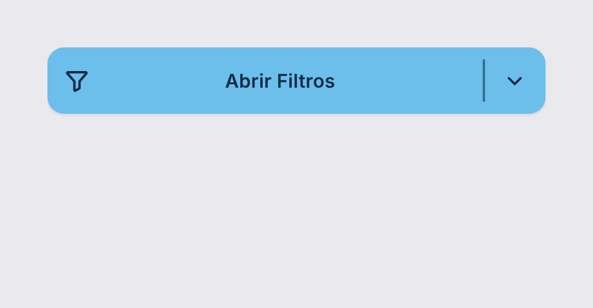
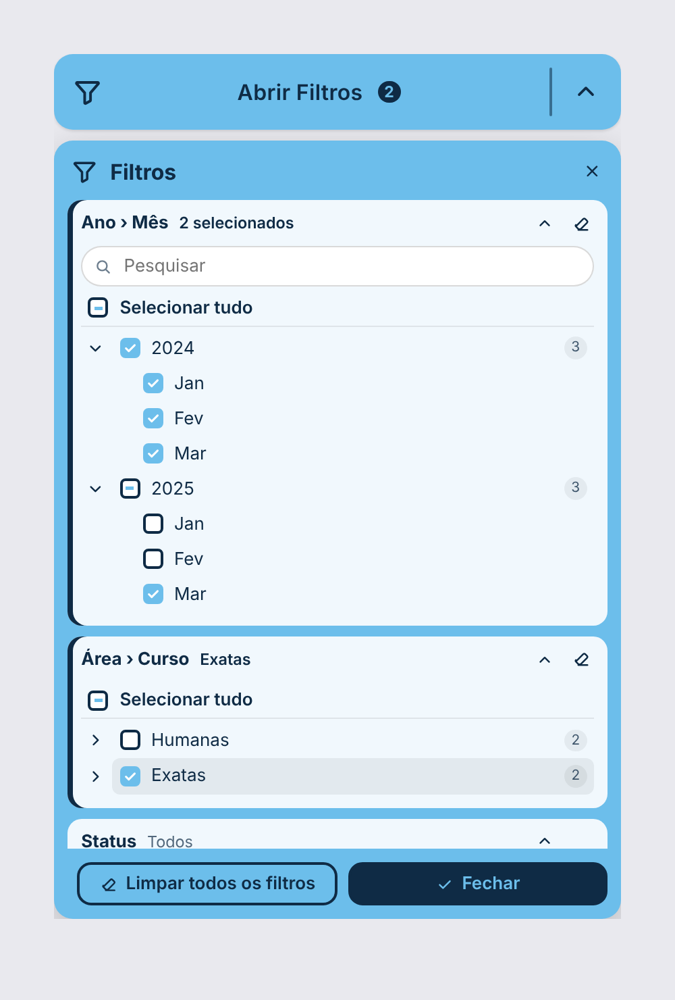

# Power BI Custom Visuals

Coleção de **visuais personalizados para Power BI**, feitos em TypeScript + HTML/CSS com o SDK oficial (`powerbi-visuals-tools`). Cada visual tem sua pasta em [`visuals/`](visuals/) com código, documentação e o arquivo **`.pbiviz` pronto para importar**.

## Visuais

| Visual | O que faz | Download |
|---|---|---|
| [**Filtro em Pop-up**](visuals/filtro-popup/) | Botão "Abrir Filtros" que abre um pop-up com slicers: filtros simples, filtros aninhados em árvore (ex.: Ano › Mês), colunas de várias tabelas, pesquisa, limpar todos, copiar/colar, sincronização entre páginas e formatação completa. | [`.pbiviz`](visuals/filtro-popup/dist/) |
| [**Segmentação Estilizada**](visuals/segmentacao/) | Substituto da segmentação nativa com três estilos: blocos (botões), lista vertical ou suspenso. Mesmo padrão visual e de formatação do Filtro em Pop-up. | [`.pbiviz`](visuals/segmentacao/dist/) |

<p align="center">
  
  
</p>

## Como importar um visual no Power BI

1. Baixe o arquivo `.pbiviz` na pasta `dist/` do visual.
2. No Power BI Desktop: painel **Visualizações → `…` → Importar um visual de um arquivo**.
3. Selecione o `.pbiviz`. O visual aparece no painel de visualizações do relatório.

## Estrutura do repositório

```
powerbi-custom-visual/
├── visuals/
│   ├── filtro-popup/        # um visual por pasta
│   └── segmentacao/
│       ├── src/             # código TypeScript
│       ├── style/           # estilos (LESS)
│       ├── assets/          # ícone
│       ├── docs/            # imagens do README
│       ├── dist/            # .pbiviz pronto para importar
│       ├── capabilities.json
│       ├── pbiviz.json
│       └── README.md
└── .github/workflows/       # build automático de todos os visuais
```

## Desenvolvimento

Requisitos: Node.js 18 ou superior.

```bash
cd visuals/<nome-do-visual>
npm install
npm run lint        # ESLint
npm run package     # gera dist/*.pbiviz
npm start           # servidor de desenvolvimento (Developer Visual no Power BI Service)
```

A cada push, o GitHub Actions instala, valida e empacota todos os visuais; o `.pbiviz` gerado fica disponível nos artefatos da execução.

### Adicionando um novo visual

1. `npx powerbi-visuals-tools new <nome>` dentro de `visuals/`.
2. Preencha `pbiviz.json` (nome, descrição, autor) e escreva um `README.md` para ele.
3. Rode `npm run package` e faça commit do `dist/*.pbiviz`.
4. Adicione uma linha na tabela de visuais acima.

## Licença

[MIT](LICENSE)
