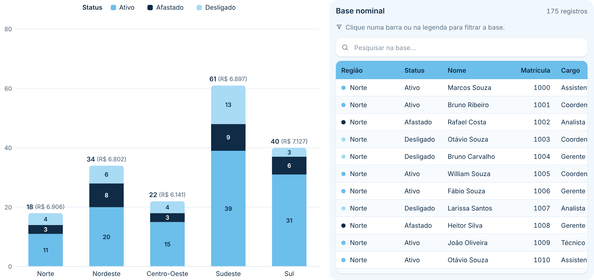
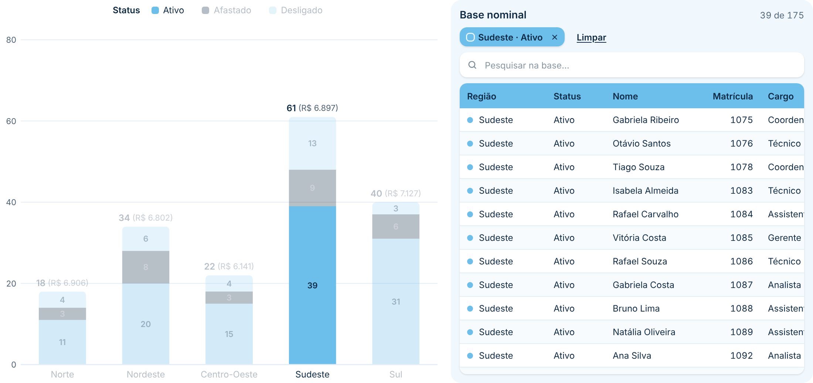
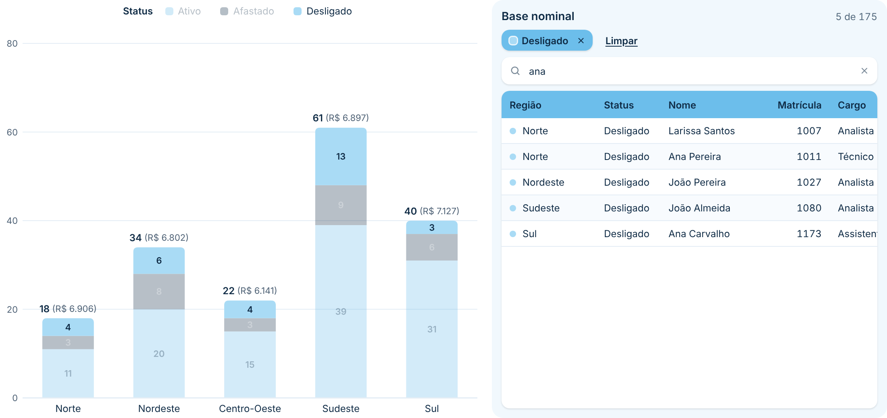
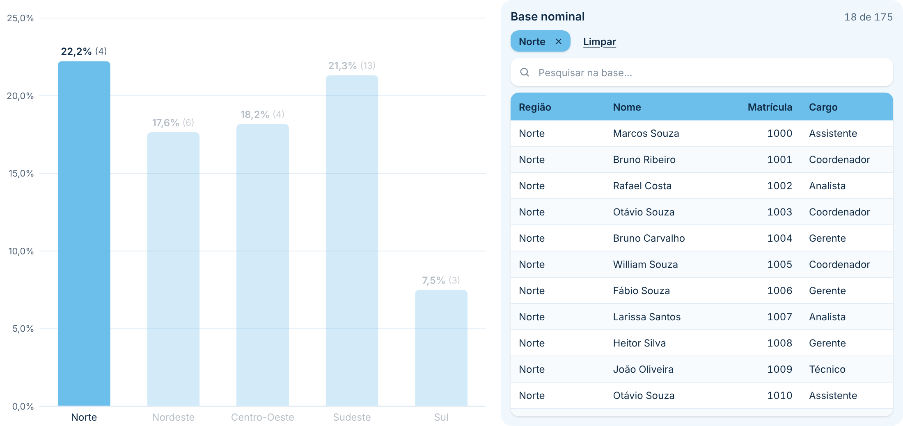
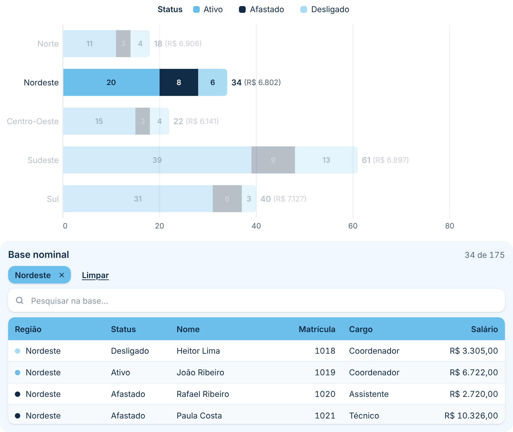

# Barras com Base Nominal

Gráfico de **barras empilhadas** (colunas ou barras horizontais) com legenda e, ao lado, uma **base nominal**: a tabela com os registros (pessoas, clientes, contratos…) que formam as barras. **Clique numa barra, num segmento ou num item da legenda** e a base mostra só os registros daquela parte. Segue o padrão visual do repositório ([DESIGN.md](../../DESIGN.md)).

| Padrão | Clique num segmento | Clique na legenda + pesquisa |
|---|---|---|
|  |  |  |

| Percentual com o número absoluto ao lado | Barras horizontais, base embaixo |
|---|---|
|  |  |

## Como usar

1. Baixe [`dist/barrasBase8FC090A640FA4FB18B23DCC0577A38CF.1.2.0.0.pbiviz`](dist/) e importe no Power BI (**Visualizações → `…` → Importar um visual de um arquivo**).
2. Arraste os campos:
   - **Eixo**: cada valor vira uma barra (ex.: Região, Cargo).
   - **Legenda** (opcional): divide as barras em segmentos coloridos (ex.: Status).
   - **Valores**: a medida que define o tamanho das barras: contagem, soma, percentual, média… O Power BI calcula a medida para cada barra e cada segmento, como num gráfico nativo. Para contar pessoas, arraste a matrícula (ou o ID) e escolha **Contagem**.
   - **Detalhe** (opcional): outra medida mostrada ao lado do valor, também calculada pelo Power BI para cada barra e segmento. Ex.: Valores = *% de desligamento*, Detalhe = *Nº de desligados* → `22,2% (4)`.
   - **Colunas da base**: as colunas da tabela, na ordem em que forem adicionadas (ex.: Nome, Matrícula, Cargo, Admissão). Inclua uma coluna que identifique o registro (matrícula, CPF, ID), senão registros iguais viram uma linha só.
   - **Medidas da base** (opcional): medidas mostradas como colunas, calculadas para cada registro (ex.: Salário).

### Exemplo 1 (percentual com o número absoluto)

| Espaço | Campos |
|---|---|
| Eixo | Região |
| Valores | % Desligamento |
| Detalhe | Nº de desligados |
| Colunas da base | Nome, Matrícula, Cargo |

Cada barra mostra `22,2% (4)`; clicando nela, a base lista as pessoas da região.

### Exemplo 2 (quadro de pessoas por status)

| Espaço | Campos |
|---|---|
| Eixo | Região |
| Legenda | Status |
| Valores | Contagem de Matrícula |
| Detalhe | Salário médio |
| Colunas da base | Nome, Matrícula, Cargo, Admissão |
| Medidas da base | Salário |

## Recursos

- **Filtrar a base clicando no gráfico:**
  - clique num **segmento** → registros daquela barra **e** daquele item da legenda (ex.: Sudeste · Ativo);
  - clique no **rótulo da categoria** → a barra inteira;
  - clique num **item da legenda** → aquele item em todas as barras;
  - **Ctrl + clique** soma vários do mesmo tipo; clicar de novo no mesmo item ou no vazio do gráfico limpa.
  - O filtro ativo aparece em **chips** em cima da base, com **×** para tirar um item e **Limpar** para tirar tudo. O que não está selecionado fica esmaecido no gráfico.
- **Filtrar os outros visuais da página** (ligado por padrão, **Formatar → Geral**): o mesmo clique filtra o restante do relatório, com filtros JSON como a segmentação nativa (o estado volta com favoritos e troca de página).
- **Base nominal:** pesquisa (sem diferenciar acentos e maiúsculas), ordenação clicando no cabeçalho (crescente → decrescente → original), contagem `41 de 175`, marcador com a cor da legenda, rolagem leve mesmo com dezenas de milhares de registros (só as linhas visíveis são desenhadas) e menu do botão direito na linha (ex.: **Detalhamento**).
- **Detalhe ao lado do valor:** uma segunda medida entre parênteses `22,2% (4)`, após um ponto `22,2% · 4` ou sem separador, no total da barra, nos segmentos ou nos dois (no segmento, só aparece se couber). Fonte, tamanho, cor e negrito próprios; também aparece na dica de ferramenta.
- **Gráfico:** colunas verticais ou barras horizontais; ordem do Power BI, maior total, menor total ou A–Z; rótulos dentro dos segmentos (valor, % da barra ou ambos) com cor automática pelo contraste; total na ponta; dicas de ferramenta com % da barra, % do total e nº de registros.
- **Layout:** base à direita, à esquerda ou embaixo, com tamanho em %; em visuais estreitos a base passa sozinha para baixo.
- **Números e datas** no formato de cada campo e no idioma do relatório.

## Formatação

- **Geral:** fonte e filtrar os outros visuais.
- **Layout:** posição e tamanho da base, espaço entre gráfico e base, largura em que a base vai para baixo.
- **Barras:** orientação, ordem, espaço entre barras, espessura máxima, arredondamento, espessura e cor da borda, opacidade do que não está selecionado.
- **Cores da legenda:** uma cor por item (sem legenda: cor das barras).
- **Eixos:** rótulos das categorias (tamanho, cor, largura), eixo de valores (tamanho, cor) e linhas de grade (cor).
- **Rótulos de dados:** rótulo dos segmentos, tamanho, cor (ou automática) e total da barra (medida calculada para a barra ou soma dos segmentos).
- **Detalhe:** mostrar, onde mostrar, estilo, tamanho, cor e negrito.
- **Legenda:** mostrar, posição, título, tamanho e cor.
- **Base nominal:** título (em branco = sem título), tamanho e cor do título, contagem, pesquisa, colunas do Eixo / Legenda / Valores, marcador de cor, texto para vazio e máximo de registros lidos.
- **Painel da base:** cor de fundo, arredondamento, espessura e cor da borda, cores do filtro ativo.
- **Cabeçalho da tabela:** cor de fundo, cor do texto, tamanho e maiúsculas.
- **Linhas da tabela:** cor de fundo, cor do texto, tamanho, altura, linhas alternadas, linhas de grade e arredondamento.

## Observações

- Valores e Detalhe são calculados pelo Power BI em cada nível (segmento, barra inteira e cada registro da base), então percentuais, médias e contagens distintas saem certos. Com Legenda, o total da barra é a medida calculada para a barra inteira; com uma medida de %, ele pode ser diferente da soma dos segmentos (troque em **Formatar → Rótulos de dados → Valor do total**). Com uma medida de %, a dica de ferramenta não mostra "% da barra" nem "% do total geral".
- O Power BI envia a base em partes de 10 mil registros; o visual lê até **30 mil** por padrão (**Formatar → Base nominal → Máximo de registros lidos**). Passando disso, aparece um aviso embaixo da tabela.
- Até 30 itens na legenda.
- Valores negativos são tratados como zero no tamanho da barra.
