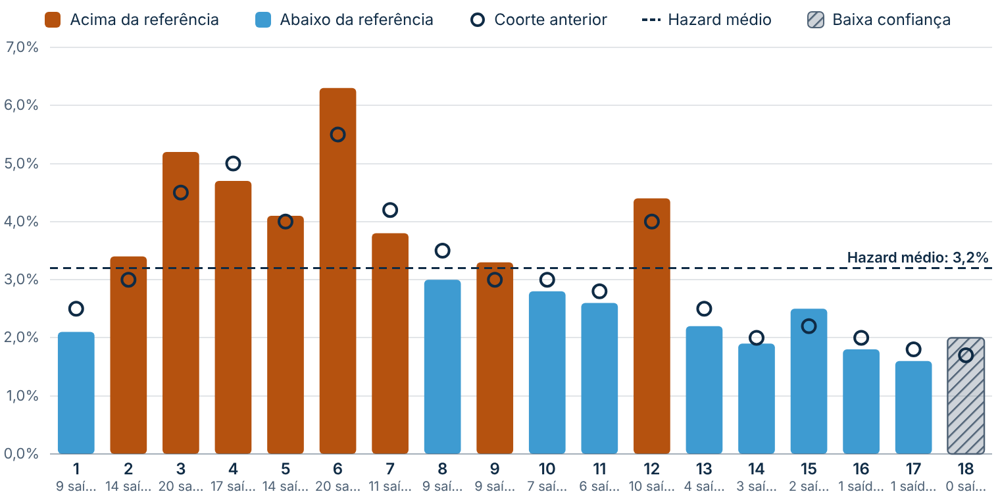
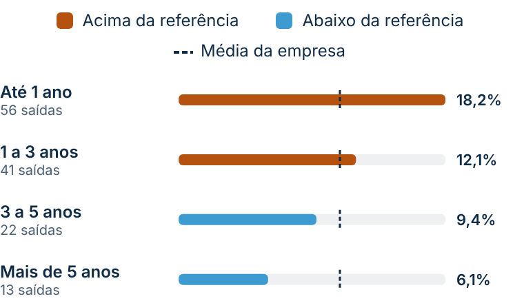
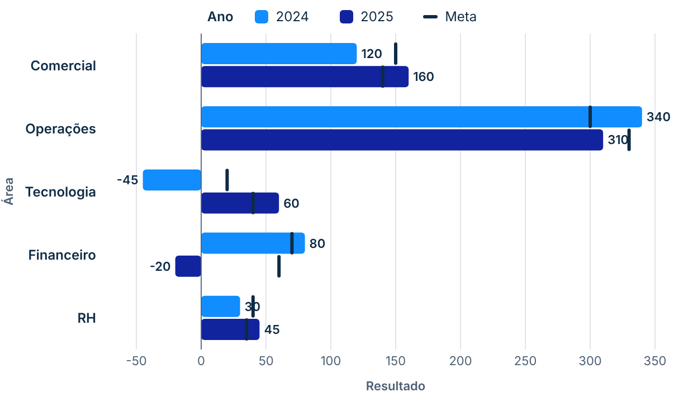
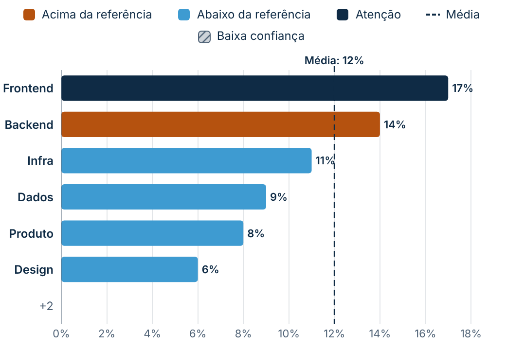

# Barras com Comparação

Uma barra por categoria e, ao lado dela, o que serve de régua: **marcadores de comparação** (ano anterior, meta), uma **linha de referência** (média) e uma **cor por regra** (acima/abaixo da referência, sinalizador ou gradiente). Barras de **baixa confiança** (poucas pessoas, n pequeno) ficam cinza e hachuradas. Funciona na vertical, na horizontal e em **modo cartão**. Segue o padrão visual do repositório ([DESIGN.md](../../DESIGN.md)).

O visual é genérico: nenhum nome de medida ou regra de negócio fica no código. Tudo entra por campo de dados ou pelo painel de formatação.

| Risco mensal (acima/abaixo da média) | Modo cartão |
|---|---|
|  |  |

| Horizontal com séries e negativos | Ordenado, Top N e sinalizador |
|---|---|
|  |  |

## Como usar

1. Baixe [`dist/barrasComparacao735BE4406C084C31BAEECD49B349D361.1.0.0.0.pbiviz`](dist/) e importe no Power BI (**Visualizações → `…` → Importar um visual de um arquivo**).
2. Arraste os campos. Só **Categoria** e **Valor** são obrigatórios; o resto aparece quando é preenchido.

| Campo | Tipo | Comportamento |
|---|---|---|
| **Categoria** | Agrupamento | Uma barra (ou grupo de barras) por valor. |
| **Série** | Agrupamento | Opcional. Barras agrupadas lado a lado dentro da categoria. |
| **Valor** | Medida | Comprimento da barra. Vazio não vira zero: a barra não é desenhada. |
| **Comparação 1 / 2** | Medida | Marcadores sobre a barra (ex.: ano anterior, meta). |
| **Referência** | Medida | Igual em todas as categorias → linha única; diferente → um traço por barra. |
| **Sinalizador** | Medida | Valor ≠ 0 pinta a barra com a cor de destaque (prioridade sobre as outras regras). |
| **Confiança / Limiar de confiança** | Medida | Barra de baixa confiança quando Confiança < Limiar. Sem o campo Limiar, usa a constante do painel (padrão 1). **Confiança vazia = barra normal.** |
| **Rótulo extra** | Medida (texto ou número) | Texto curto sob o rótulo da categoria (ex.: "56 saídas"). |
| **Dicas de ferramenta** | Medidas | Entram na dica de ferramenta. Também funciona com dica de ferramenta de página. |

Números saem no **formato da medida** e no idioma do relatório (o visual nunca assume que o valor é percentual).

### Exemplo: risco mensal de turnover

| Campo | Medida |
|---|---|
| Categoria | `'SV Meses de Casa'[Mes]` (filtro 1 a 18) |
| Valor | `SV Hazard` |
| Comparação 1 | `SV Hazard Comparacao` |
| Referência | `SV Hazard Medio Geral` |
| Confiança / Limiar | `SV Em Risco` / `SV N Minimo Value` |
| Dicas de ferramenta | `SV Em Risco`, `SV Saidas` |
| Painel | Regra de cor = acima/abaixo da referência; orientação vertical; marcador círculo vazado |

Para as quebras do topo (tempo de casa, senioridade, performance, especialidade), use uma instância por cartão com **Layout → Modo cartão** e referência = média da empresa.

## Regras de desenho

- A barra **sempre começa em zero**. Não há opção de mínimo maior que zero (barra cortada exagera diferenças).
- O eixo vai até o maior entre valor, comparações e referência: nenhum marcador fica fora da área.
- Valores negativos crescem para o outro lado do zero, com o zero marcado.
- Com **Série**, a regra acima/abaixo muda a **saturação** da cor de cada série (a legenda continua legível).
- Rótulos de categoria longos são truncados com reticências e aparecem inteiros na dica de ferramenta.
- Muitas categorias (ex.: 200): o eixo de categorias ganha **rolagem**, com o eixo de valores fixo.
- Até 1.000 categorias e 30 séries. Acima disso, um aviso discreto aparece no canto (o visual não corta em silêncio).
- Regra acima/abaixo **sem referência**: as barras usam a cor padrão e o painel mostra um aviso no card **Regra de cor**.

## Interação e acessibilidade

- Clique numa barra filtra os outros visuais; **Ctrl + clique** soma seleções; clique no fundo limpa.
- Clique num item de série na legenda seleciona a série inteira.
- Quando outro visual filtra este, a parte não destacada fica esmaecida (não some).
- Botão direito abre o menu de contexto do Power BI (**Analisar**, **Drill through**).
- **Teclado:** Tab entra no visual, setas percorrem as barras, Enter seleciona (Ctrl + Enter soma), Esc sai. Cada barra tem `aria-label` e o leitor de tela anuncia a barra em foco.
- **Alto contraste:** usa só as cores do sistema; acima da referência é preenchido, abaixo é vazado, baixa confiança é hachurada (nunca só por cor).

## Formatação

- **Layout:** orientação, modo cartão, espaço entre barras, arredondamento, largura dos rótulos, espessura da barra no cartão, opacidade do que não está selecionado, fonte.
- **Regra de cor:** nenhuma / acima-abaixo da referência / por sinalizador / gradiente pelo valor; cor de cada estado; séries com as cores do tema.
- **Cores das séries:** uma cor por série (quando há campo Série).
- **Marcadores:** para cada comparação, forma (círculo vazado, traço, losango), tamanho, cor e rótulo.
- **Referência:** mostrar, constante quando o campo está vazio, rótulo (com o valor formatado), cor, estilo e espessura.
- **Baixa confiança:** cinza hachurado ou esmaecido, limiar constante, cor e texto na legenda.
- **Ordenação:** ordem do modelo, valor decrescente/crescente, alfabética; baixa confiança sempre no fim.
- **Top N:** mostrar só as N primeiras após a ordenação, com "+N" no fim.
- **Rótulos de dados:** valor no fim ou dentro da barra, esconder quando não couber, tamanho, cor, negrito.
- **Eixos:** eixo de valores, títulos, grade, tamanhos e cores dos rótulos de categoria e do rótulo extra.
- **Legenda:** mostrar, em cima ou embaixo, título, tamanho e cor.

## Desenvolvimento

O código compartilhado (eixos, formatação, dica de ferramenta, seleção, estado vazio) fica em [`../common`](../common/). O `npm install` deste visual instala também as dependências do `common`.

```bash
npm install
npm test            # testes do modelo de dados (Jest)
npm run lint        # ESLint (este visual e o common)
npx tsc --noEmit -p .
npm run package     # gera dist/*.pbiviz
```
