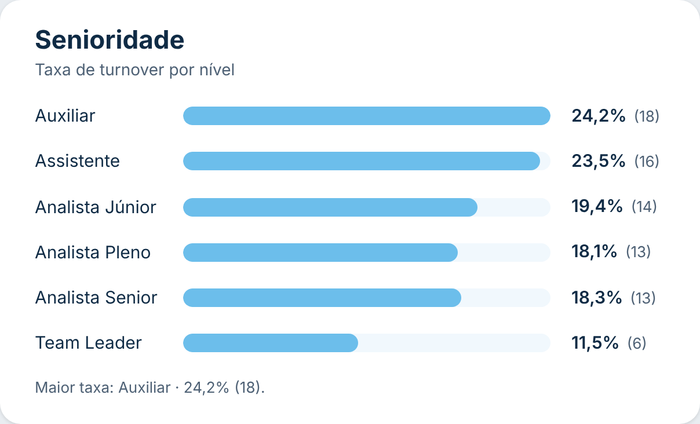
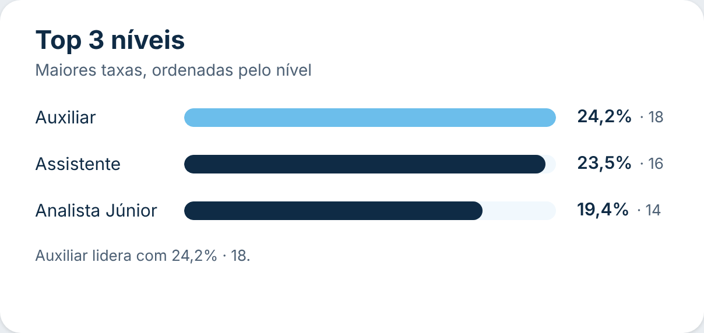
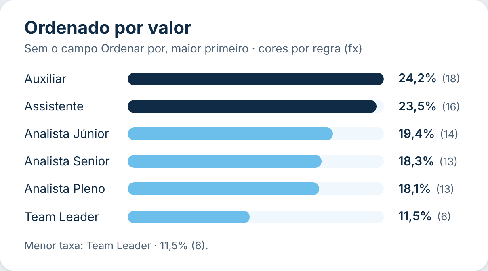

# Barras com Insight

Gráfico de barras horizontais no estilo de ranking: cada linha tem o **rótulo da categoria**, uma **barra com trilho** e o **valor com um detalhe ao lado** (ex.: `24,2% (18)`). Embaixo aparece uma **frase de insight** automática, como *"Maior taxa: Auxiliar · 24,2% (18)."*. Dá para mostrar só o **top N** e **ordenar por outro campo** (ex.: a ordem dos níveis). Segue o padrão visual do repositório ([DESIGN.md](../../DESIGN.md)).

| Padrão (ordenado pelo nível) | Top 3 com destaque | Cores por regra (fx) |
|---|---|---|
|  |  |  |

## Como usar

1. Baixe [`dist/barrasRankingA8588BCCC6D14E3E8FC340A9DF9CD332.1.0.0.0.pbiviz`](dist/) e importe no Power BI (**Visualizações → `…` → Importar um visual de um arquivo**).
2. Arraste os campos:
   - **Categoria**: cada valor vira uma barra (ex.: Nível, Cargo).
   - **Valor**: a medida que define o tamanho da barra (ex.: Taxa de turnover).
   - **Detalhe** (opcional, até 3): medidas mostradas ao lado do valor (ex.: nº de desligados → `(18)`). Com mais de uma, elas aparecem separadas por `·`.
   - **Ordenar por** (opcional): campo ou medida usado para ordenar as barras (ex.: *Ordem do nível* = 1, 2, 3…). Para uma coluna de texto, troque a agregação para **Primeiro**.
   - **Dicas de ferramenta** (opcional): medidas extras mostradas ao passar o mouse.

## Recursos

- **Ordenação** (**Formatar visual → Ordenação**):
  - **Automático**: pelo campo *Ordenar por*, se houver; senão, pelo valor;
  - **Valor**, **Campo Ordenar por**, **Categoria (A–Z)** ou **Ordem do Power BI** (respeita a classificação do campo e o menu *Classificar eixo*);
  - **Direção**: automática (valor: maior primeiro; demais: crescente), decrescente ou crescente.
- **Top N** (**Formatar visual → Top N**): mostra só N barras, escolhidas pelos **maiores valores**, **menores valores** ou **primeiros da ordenação**. As barras escolhidas continuam na ordem configurada (ex.: top 3 por taxa, exibidas na ordem do nível).
- **Detalhe ao lado do valor**: entre parênteses `(18)`, após um ponto `· 18` ou sem separador, com fonte, tamanho e cor próprios.
- **Insight** (**Formatar visual → Insight**):
  - liga e desliga a frase;
  - destaca o **maior** ou o **menor** valor;
  - com top N ligado, considera só as barras exibidas ou todas as categorias;
  - texto editável com os marcadores `{categoria}`, `{valor}` e `{detalhe}` (padrão: `Maior taxa: {categoria} · {valor} {detalhe}.`). Sem detalhe, os espaços e parênteses vazios somem sozinhos.
- **Barras:** cor com o botão **fx** (regras, escala ou valor de campo, por barra), destaque da maior barra com outra cor, trilho com cor própria, espessura, arredondamento, borda e máximo da escala (0 = maior valor; use 1 para escala de 0 a 100%).
- **Cabeçalho** opcional dentro do visual: título e subtítulo (em branco = escondido).
- **Filtro cruzado:** clique numa linha para filtrar os outros visuais (Ctrl + clique para vários); o que não está selecionado fica esmaecido. Menu do botão direito e Ctrl+C / Ctrl+V.
- **Números** no formato de cada medida e no idioma do relatório.

## Formatação

- **Geral:** fonte.
- **Cabeçalho:** título e subtítulo (texto, tamanho e cor).
- **Ordenação:** ordenar por e direção.
- **Top N:** mostrar apenas o top N, quantidade e critério.
- **Barras:** cor (fx), destaque da maior barra, trilho, espessura, arredondamento, espessura e cor da borda, máximo da escala, opacidade do que não está selecionado.
- **Linhas:** altura, ajustar à altura do visual (sem ajuste, aparece a rolagem) e espaço entre colunas.
- **Rótulos das categorias:** mostrar, tamanho, cor, negrito, largura (0 = automática) e alinhamento.
- **Rótulos de valor:** mostrar, tamanho, cor e negrito.
- **Detalhe:** mostrar, estilo, tamanho, cor e negrito.
- **Insight:** mostrar, maior ou menor, escopo, texto, tamanho, cor e negrito.

## Observações

- Até 1000 categorias.
- Valores negativos ficam com a barra vazia (o rótulo mostra o valor).
- Vazios no campo *Ordenar por* vão para o fim.
