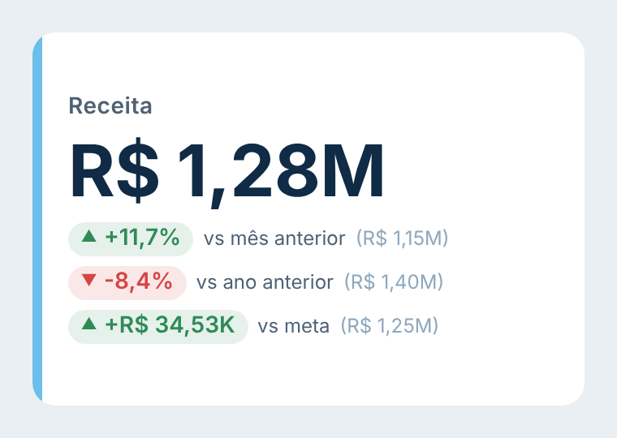
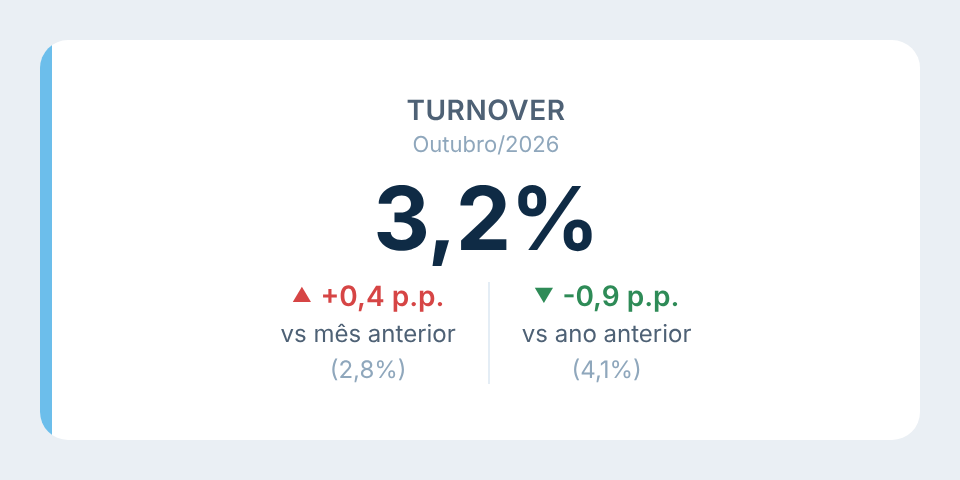
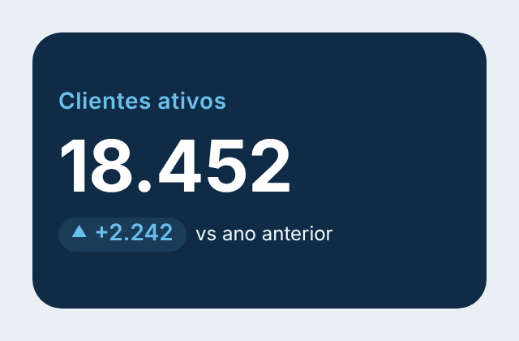

# Big Number

Card de **Big Number**: um título, o número em destaque e até **3 comparações** logo abaixo (mês anterior, ano anterior, meta…). Cada comparação tem o próprio título, a própria unidade de diferença (variação %, absoluta ou pontos percentuais) e o próprio sentido de "melhor" (para cima ou para baixo). Segue o padrão visual do repositório ([DESIGN.md](../../DESIGN.md)).

| Padrão | Pontos percentuais, lado a lado | Cores personalizadas |
|---|---|---|
|  |  |  |

## Como usar

1. Baixe [`dist/bigNumber84F7DBE5AD19445FA94E34EF0E0FCA42.1.0.0.0.pbiviz`](dist/) e importe no Power BI (**Visualizações → `…` → Importar um visual de um arquivo**).
2. Arraste as medidas:
   - **Big Number**: o número em destaque (ex.: Receita).
   - **Comparação 1**, **Comparação 2** e **Comparação 3**: as medidas comparadas com ele (ex.: Receita mês anterior, Receita ano anterior, Meta). Todas são opcionais.
3. Em **Formatar → Comparação 1 / 2 / 3**, dê um título para cada comparação (ex.: "vs mês anterior") e escolha a unidade da diferença e se maior ou menor é melhor.

## Como a diferença é calculada

Escolha em **Formatar → Comparação N → Unidade da diferença**:

| Opção | Conta | Exemplo |
|---|---|---|
| Variação % (padrão) | (atual ÷ anterior) − 1 | R$ 1,28 mi contra R$ 1,15 mi → **+11,7%** |
| Absoluta | atual − anterior, no formato da medida | 18.452 contra 16.210 → **+2.242** |
| Pontos percentuais (p.p.) | atual − anterior, em pontos | 3,2% contra 2,8% → **+0,4 p.p.** |

- **Pontos percentuais:** se a medida tem formato de porcentagem (0,032 = 3,2%), a diferença é multiplicada por 100. Se a medida já vem em pontos (3,2 = 3,2%), use um formato sem `%` e ela é usada como está.
- **Melhor para:** *cima* (subir é bom, verde), *baixo* (cair é bom, para turnover, custo, atraso) ou *neutro* (sem verde/vermelho).
- **Casas decimais da diferença:** automático (1 casa em % e p.p.; formato da medida na absoluta) ou 0 a 3.
- **Mostrar o valor anterior:** exibe o valor da comparação ao lado. O texto é configurável em **Comparações → Texto do valor anterior** (`{valor}` é trocado pelo número, ex.: `Anterior: {valor}`).
- Comparação vazia (ex.: meta não cadastrada) mostra um texto configurável ("Sem dado").
- Ao passar o mouse numa comparação aparecem os dois valores, a diferença, a variação % e os pontos percentuais.

## Formatação

- **Card:** fonte; alinhamento horizontal (esquerda, centro, direita) e vertical (centro, topo); cor de fundo; arredondamento; borda; espaço interno e entre as partes; faixa de destaque à esquerda (cor e largura).
- **Título:** mostrar ou não; texto (vazio = nome da medida); tamanho, cor, negrito, maiúsculas; subtítulo opcional (ex.: período) com tamanho e cor.
- **Big Number:** tamanho, cor, negrito, unidades de exibição (automático, nenhuma, mil, milhões, bilhões) e casas decimais.
- **Comparações (todas):**
  - quantidade de comparações (nenhuma, 1, 2 ou 3);
  - disposição: empilhadas ou lado a lado;
  - estilo da diferença: selo (fundo suave) ou só o texto colorido;
  - seta (▲ ▼) e sinal de + nos positivos;
  - cores de bom, ruim e neutro;
  - tamanho da diferença, tamanho e cor do nome, texto e cor do valor anterior;
  - texto quando vazia; linhas entre as comparações.
- **Comparação 1, 2 e 3 (cada uma):** título, melhor para cima/baixo/neutro, unidade da diferença, casas decimais e mostrar o valor anterior.

Quando o conteúdo não cabe no tamanho do visual, todas as fontes diminuem juntas para caber.
