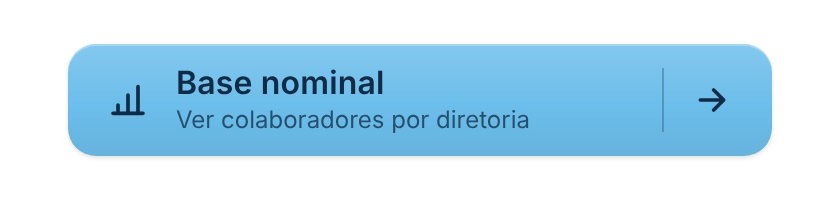
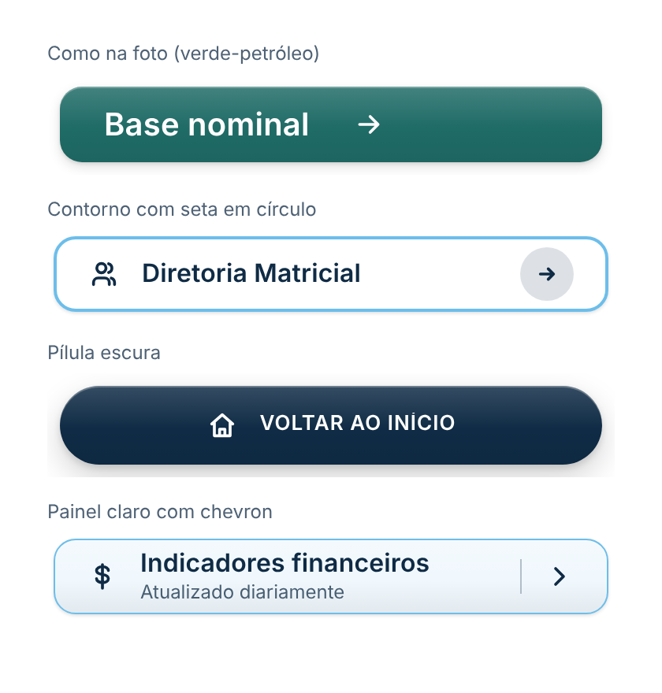
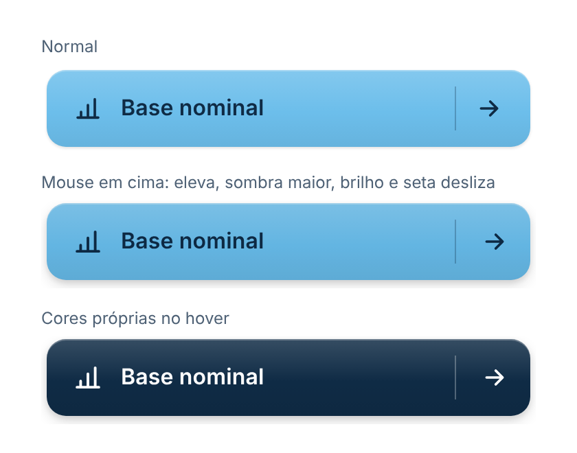

# Botão de Navegação

Botão para levar o usuário a outra página do relatório (ou a qualquer link), com acabamento caprichado: **ícone**, **texto e subtítulo**, **divisória** e **seta animada**, **degradê sutil**, **sombra em camadas** e efeitos de **hover** (eleva, brilho que passa, seta desliza) e de **clique** (afunda e solta uma onda). Segue o padrão visual do repositório ([DESIGN.md](../../DESIGN.md)).

| Padrão | Estilos | Hover |
|---|---|---|
|  |  |  |

## Como usar

1. Baixe [`dist/botaoNavegacaoF7704C68E0A445E7BC3C609A8EFD1E3C.1.0.1.0.pbiviz`](dist/) e importe no Power BI (**Visualizações → `…` → Importar um visual de um arquivo**).
2. Coloque o visual na página e escreva o texto em **Formatar visual → Texto**.
3. Escolha como o clique vai navegar (abaixo).

Campos opcionais (todos medidas):

- **Texto** e **Subtítulo**: substituem os textos do painel, para rótulos dinâmicos (ex.: `"Base nominal (" & [Qtd colaboradores] & ")"`).
- **Link**: medida que devolve o endereço a abrir. Tem prioridade sobre o link do painel.

## Navegar para outra página

Visuais personalizados não podem trocar a página do relatório por conta própria: a API do Power BI só deixa abrir links. Por isso há dois jeitos:

### 1. Mesma aba: botão nativo transparente por cima (recomendado)

1. **Inserir → Botões → Em branco** e coloque o botão nativo exatamente em cima do Botão de Navegação (mesmo tamanho e posição).
2. No botão nativo: **Ação → Tipo: Navegação de página** e escolha a página de destino.
3. Deixe o botão nativo invisível: **Estilo → Preenchimento** com transparência 100%, sem borda, sem texto e sem ícone.
4. Para manter um retorno visual, no estado **Ao passar o mouse** use preenchimento branco com transparência ~85% e no estado **Pressionado** preto com ~85%. Use o mesmo **arredondamento** do Botão de Navegação.
5. Selecione os dois e **Agrupe** (Ctrl+G), para moverem juntos.

Assim a troca de página é instantânea, na mesma aba, e funciona no Desktop, no Service e no app. O lado ruim: o botão nativo fica com o mouse, então os efeitos de hover do Botão de Navegação não aparecem (só os que você configurar no nativo).

### 2. Link: o próprio visual abre o endereço

Em **Formatar visual → Ação → Link (URL)**, cole o endereço da página no Power BI Service (copie da barra do navegador com a página aberta, ex.: `https://app.powerbi.com/groups/…/reports/…/ReportSection…`). Funciona com qualquer link `https`, inclusive outro relatório ou um filtro na URL (`?filter=Tabela/Campo eq 'Valor'`).

- Abre em **nova aba** (é como o Power BI trata links de visuais) e todos os efeitos do botão aparecem.
- Basta um clique normal, também no Power BI Desktop.
- Só endereços `http://` e `https://` são abertos.

## Formatação

- **Botão:** fonte, cor de fundo, degradê sutil, disposição (texto à esquerda e seta na ponta, tudo à esquerda ou centralizado), arredondamento (valores altos = pílula), altura (0 = ocupa o visual), espaço interno, espaço entre ícone/texto/seta, sombra (sem, leve, média, forte), espessura e cor da borda.
- **Texto:** texto, tamanho, cor, negrito, maiúsculas; subtítulo com tamanho e cor.
- **Ícone à esquerda:** mostrar, ícone (gráfico, página, tabela, pessoas, início, filtro, calendário, dinheiro, meta, voltar), tamanho e cor.
- **Seta à direita:** tipo (seta, chevron, seta em círculo, abrir fora, nenhuma), tamanho, cor, deslizar ao passar o mouse, divisória e cor da divisória.
- **Efeitos:** cor ao passar o mouse (automática: escurece botões claros e clareia os escuros; cores próprias de fundo e texto; ou nenhuma), elevar, brilho, afundar ao clicar e onda ao clicar.
- **Ação:** link (URL) e dica ao passar o mouse.

### Como na foto (verde-petróleo)

Fundo `#1F6B66`, texto e seta brancos, tamanho 20, **Ícone** desligado, **Disposição** tudo à esquerda, divisória desligada, espaço entre itens 28 e sombra média.

## Acessibilidade

- Funciona pelo teclado: Tab até o botão e Enter ou Espaço.
- Anel de foco visível, nome acessível com o texto e o subtítulo.
- Respeita a opção do sistema de reduzir animações.
