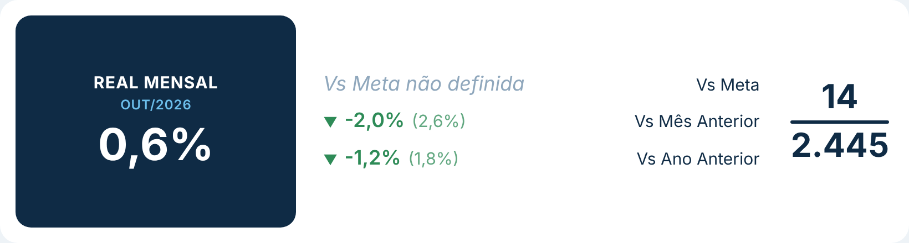
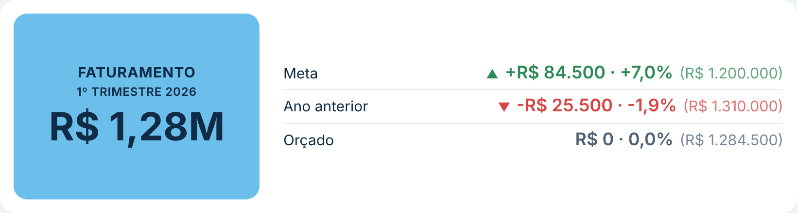
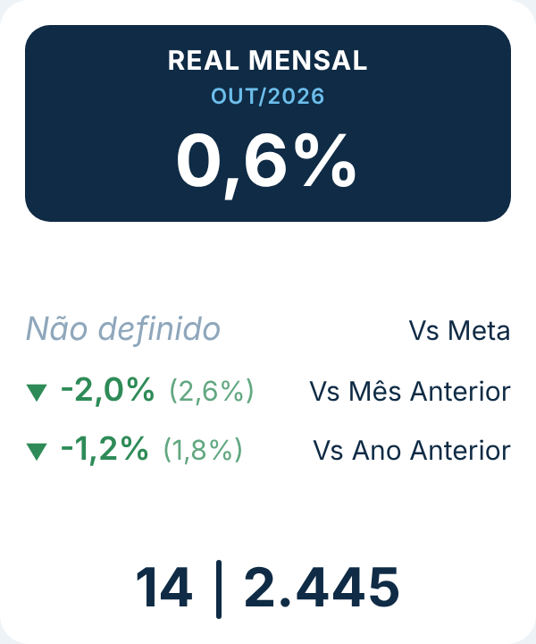

# Card Comparativo

Card de KPI com um **valor principal** em destaque, o **período selecionado** (vindo de uma medida do calendário) e até **5 comparações** com outras medidas, como meta, mês anterior ou ano anterior. À direita há um detalhe opcional em forma de fração (ex.: desligamentos / headcount). Segue o padrão visual do repositório ([DESIGN.md](../../DESIGN.md)).

| Padrão | Variação % e linhas | Empilhado (visual estreito) |
|---|---|---|
|  |  |  |

## Como usar

1. Baixe [`dist/cardComparativoE2A02E02532C40878D8D23A57D73ED62.1.0.0.0.pbiviz`](dist/) e importe no Power BI (**Visualizações → `…` → Importar um visual de um arquivo**).
2. Arraste as medidas:
   - **Valor principal**: o número em destaque (ex.: Turnover %).
   - **Período (medida do calendário)**: uma medida que devolve o período em texto (veja abaixo).
   - **Comparações**: até 5 medidas (ex.: Meta, Turnover mês anterior, Turnover ano anterior).
   - **Detalhe de cima** e **Detalhe de baixo** (opcionais): os números da fração à direita.
3. O nome de cada comparação no card é o nome da medida. Para trocar, use **Renomear para este visual** no campo (ex.: "Vs Mês Anterior").
4. O título é o nome da medida principal, ou o texto em **Formatar → Valor principal → Título**.

### Medida de período

Qualquer medida que devolva texto ou data. Exemplos:

```DAX
Período = FORMAT ( MAX ( Calendario[Data] ), "MMM/YYYY" )
```

```DAX
Período =
VAR Ini = MIN ( Calendario[Data] )
VAR Fim = MAX ( Calendario[Data] )
RETURN
    IF (
        FORMAT ( Ini, "MM/YYYY" ) = FORMAT ( Fim, "MM/YYYY" ),
        FORMAT ( Fim, "MMM/YYYY" ),
        FORMAT ( Ini, "MMM/YY" ) & " a " & FORMAT ( Fim, "MMM/YY" )
    )
```

## Como a comparação é calculada

Escolha em **Formatar → Comparações → Mostrar**:

| Opção | Conta | Exemplo (0,6% contra 2,6%) |
|---|---|---|
| Diferença (padrão) | principal − comparação, no formato da medida principal | -2,0% |
| Variação % | (principal ÷ comparação) − 1 | -76,9% |
| Diferença e variação % | as duas | -2,0% · -76,9% |
| Só o valor da comparação | mostra a medida como está | 2,6% |

- O valor da comparação aparece entre parênteses. Dá para desligar.
- **Maior é melhor:** define se subir é bom (verde) ou ruim (vermelho). Para turnover, custo ou atraso, desligue.
- Comparação vazia (ex.: meta não cadastrada) mostra um texto configurável. Use `{nome}` para o nome da comparação, por exemplo `{nome} não definida`.
- Ao passar o mouse numa comparação aparecem o valor principal, o valor da comparação, a diferença, a variação % e o período.

## Formatação

- **Card:**
  - fonte e disposição: automática, lado a lado ou empilhada (a automática empilha quando o visual é estreito);
  - cor de fundo, arredondamento, borda;
  - espaço interno e espaço entre as partes.
- **Valor principal:**
  - título; tamanhos do título, do período e do valor; maiúsculas;
  - unidades de exibição (nenhuma, automática, mil, milhões, bilhões);
  - cores do bloco, do título, do período e do valor;
  - largura, arredondamento e alinhamento.
- **Comparações:**
  - o que mostrar, valor entre parênteses, sinal de +, seta;
  - maior é melhor e colorir pelo resultado;
  - cores de bom, ruim e igual;
  - tamanhos, posição e cor do nome;
  - texto e cor quando a comparação está vazia;
  - linhas entre as comparações.
- **Detalhes (à direita):** tamanho, cor, cor do traço, negrito.

Quando o conteúdo não cabe no tamanho do visual, todas as fontes diminuem juntas para caber.
