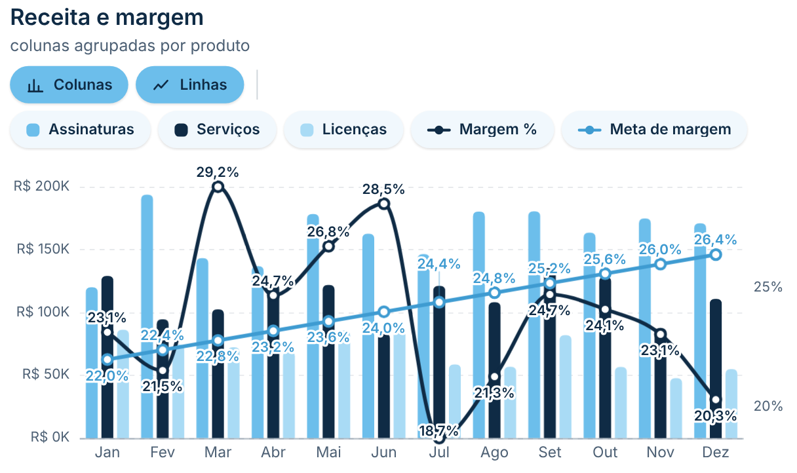
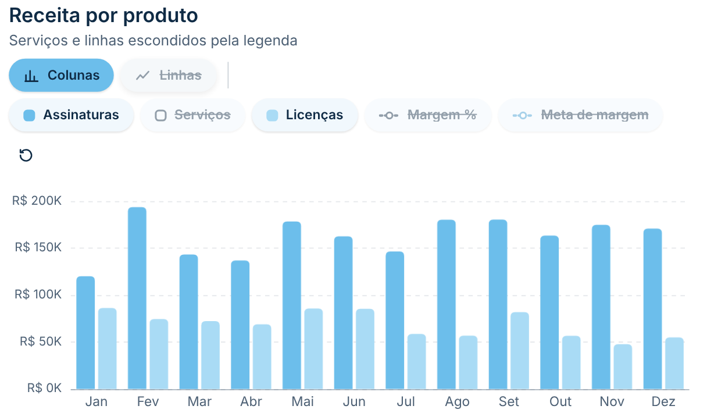
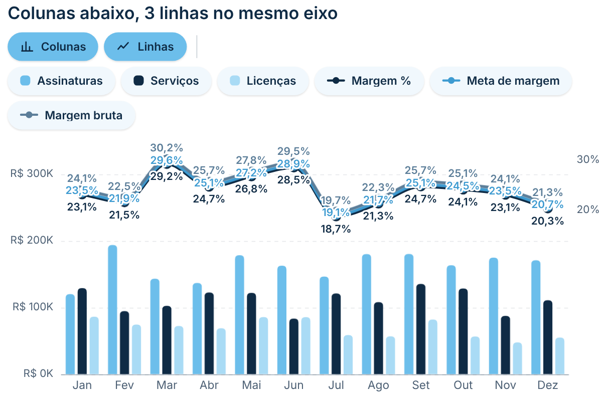
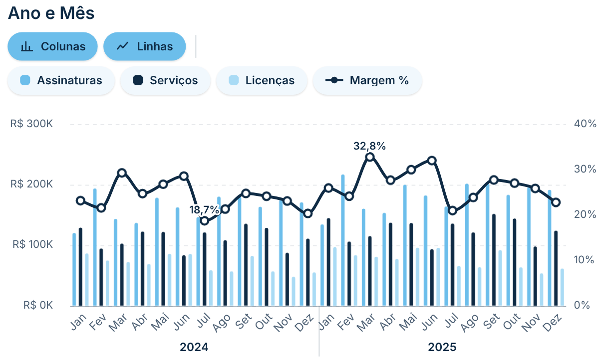
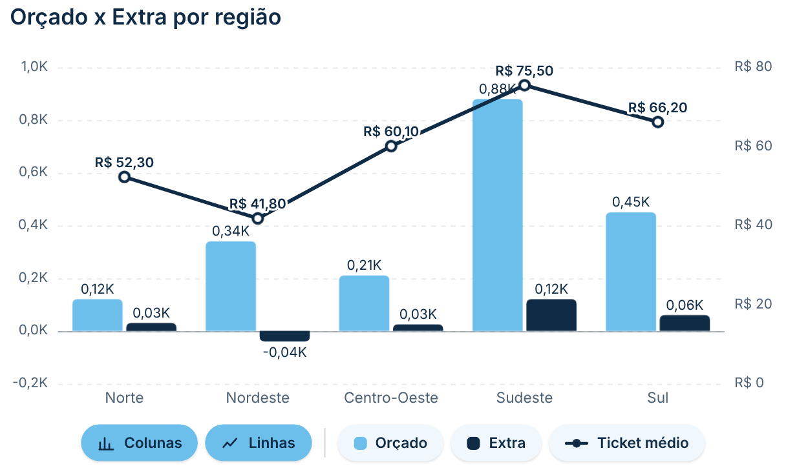
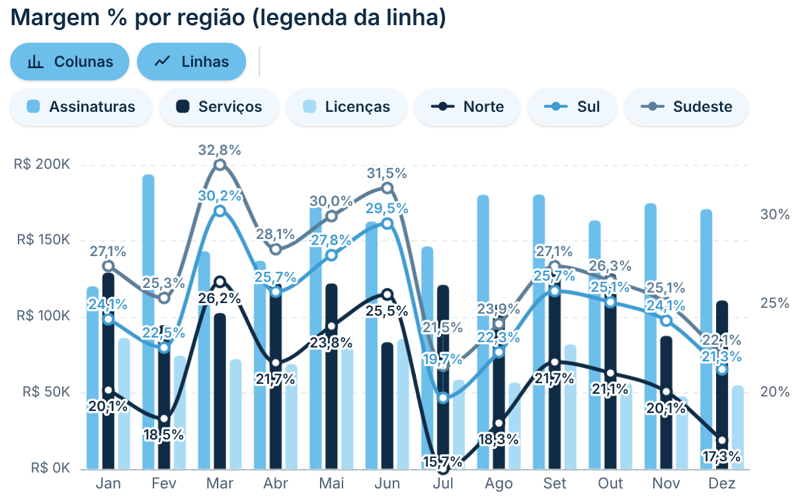

# Colunas Agrupadas e Linha

Réplica do gráfico nativo **"Gráfico de colunas clusterizado e de linhas"** do Power BI: as colunas de cada categoria ficam **lado a lado** (uma por item da legenda ou por medida). É a versão agrupada do [Colunas Empilhadas e Linha](../colunas-linha/), com os mesmos recursos, com uma **legenda interativa** em botões arredondados: clique para **mostrar ou esconder** cada série (um produto da legenda, uma medida de coluna ou uma linha) ou use os botões **Colunas** e **Linhas** para ligar e desligar todas de uma vez. A escala se reajusta ao que fica visível, com uma animação suave. Segue o padrão visual do repositório ([DESIGN.md](../../DESIGN.md)).

| Padrão | Legenda interativa (itens escondidos) |
|---|---|
|  |  |
| **Colunas abaixo, 3 linhas no mesmo eixo** | **Ano e Mês aninhados no Eixo X** |
|  |  |
| **Várias medidas, com negativos e rótulos** | **Legenda da linha (uma linha por região)** |
|  |  |

## Como usar

1. Baixe [`dist/colunasAgrupadasLinha0EA17ECAA7434FCDBD2D66C874C117EA.1.1.0.0.pbiviz`](dist/) e importe no Power BI (**Visualizações → `…` → Importar um visual de um arquivo**).
2. Arraste os campos (os mesmos nomes do visual nativo):
   - **Eixo X**: cada valor vira uma coluna (ex.: Mês, Região). Aceita **vários campos aninhados**, até 6 (ex.: *Ano* e *Mês* da tabela Calendário): cada mês aparece dentro do seu ano.
   - **Eixo Y da coluna**: uma ou várias medidas. Sem legenda, cada medida vira uma coluna do grupo.
   - **Legenda da coluna** (opcional): uma coluna por item (ex.: Produto), lado a lado. Com legenda, use uma medida só no Eixo Y da coluna, como no nativo.
   - **Eixo Y da linha**: uma ou mais medidas desenhadas como linhas (ex.: Margem %, Meta).
   - **Legenda da linha** (opcional): uma linha por item (ex.: uma linha de *Margem %* por *Região*). Cada item vira um botão na legenda interativa e tem cor, estilo e rótulos próprios em **Linhas — por série**. A linha de cada item é calculada só com o filtro dele (sem o filtro da legenda das colunas), e as colunas continuam com o valor do mês inteiro.
   - **Dicas de ferramenta** (opcional): medidas extras mostradas ao passar o mouse.
   - **Mínimo / Máximo do eixo Y (colunas)** e **Mínimo / Máximo do eixo Y secundário (linhas)** (opcionais): medidas que fixam o início e o fim de cada eixo. Use o menor (mínimo) ou o maior (máximo) valor da medida entre as categorias; uma medida constante (ex.: `Teto = 800000`) vira o valor exato. Têm prioridade sobre o valor digitado no painel.

## Legenda interativa

- **Um botão por série**: clique para esconder ou mostrar. A série escondida fica esmaecida, riscada e com a amostra de cor vazada.
- **Duplo clique** numa série mostra só ela (as do outro tipo continuam como estão).
- **Botões Colunas / Linhas**: escondem ou mostram todas as colunas ou todas as linhas de uma vez.
- **↺ Mostrar tudo** aparece quando há algo escondido.
- Escala, totais e dica de ferramenta consideram só o que está visível. Com tudo escondido, aparece um aviso.
- Dá para escolher o que começa visível ao abrir (ex.: só as colunas) em **Legenda interativa → Colunas/Linhas visíveis ao abrir**.

## Recursos

- **Linha calculada na categoria inteira**: a linha não é dividida pela legenda (como no nativo). Uma Margem % continua certa mesmo com Produto na legenda.
- **Vários campos no Eixo X** (ex.: Ano › Mês ou Ano › Trimestre › Mês), mostrados de três jeitos: **agrupado** (os meses e, embaixo, o ano de cada grupo, com divisórias, como no nativo), **concatenado** (`Jan 2024`, com ordem e separador configuráveis) ou **só o último nível**. A dica de ferramenta mostra o caminho completo (`2024 › Jan`) e o filtro cruzado filtra o mês daquele ano.
- **Eixo Y secundário** para as linhas, ou a mesma escala das colunas.
- **Colunas sempre abaixo das linhas** (**Colunas → Posição em relação às linhas**, o primeiro grupo do cartão): a coluna mais alta sobe até a altura escolhida e as linhas ficam **logo acima**, a um espaço em px que você define, numa área com altura também configurável (mais alta = mais variação visível). A escala das linhas vai do menor ao maior valor, sem arredondar, para a tendência aparecer. Funciona mesmo com "Usar a escala das colunas" ligado.
- **Várias linhas sem se embolar** (**Linhas → Várias linhas**): no padrão **mesmo eixo, rótulos afastados**, todas as linhas ficam no valor real, no mesmo eixo secundário; em cada ponto, o rótulo da linha de cima vai acima, o da linha de baixo vai abaixo e os do meio são empurrados para manter um espaço mínimo (automático ou em px), com um traço ligando o rótulo ao ponto quando ele fica longe; *em faixas* cada linha ganha uma faixa com escala própria (o eixo secundário some); em **Linhas — por série** dá para deslocar cada linha alguns pixels para cima ou para baixo. Nos rótulos, o modo **Sempre visível** afasta o rótulo até achar espaço em vez de escondê-lo.
- **Colunas agrupadas**: uma ao lado da outra em cada categoria, com espaço entre os grupos (%) e entre as colunas do grupo (px), largura máxima, arredondamento da ponta e da base, negativos para baixo, opacidade, borda e cor de cada série.
- **Linhas**: reta, suave ou em degraus; contínua, tracejada ou pontilhada; marcadores (círculo, quadrado ou losango, cheio ou vazado); área sombreada; vazios interrompem, ligam os pontos ou viram zero.
- **Rótulos**: valor de cada coluna (por padrão **acima da coluna**; também dentro, no topo, no centro ou na base, com contraste automático), **total do grupo** opcional acima do grupo e rótulos das linhas (todos os pontos, último, primeiro e último, ou maior e menor), com fundo atrás do texto. Rótulos que se sobrepõem são desviados ou escondidos.
- **Eixos**: mínimo e máximo, unidades de exibição (automático, mil, milhões, bilhões), casas decimais, títulos, grade (cor, opacidade, estilo) e rotação dos rótulos do eixo X (automática, horizontal, 45°, vertical).
- **Rolagem horizontal**: com uma largura mínima por categoria, o gráfico rola e os eixos ficam fixos.
- **Filtro cruzado**: clique numa coluna (categoria × legenda) ou na categoria para filtrar os outros visuais (Ctrl + clique para vários); o resto fica esmaecido. Menu do botão direito e Ctrl+C / Ctrl+V.
- **Dica de ferramenta** com todos os valores da categoria (e, se quiser, o total) ou só o item sob o mouse; destaque da categoria sob o mouse.
- **Números** no formato de cada medida e no idioma do relatório.

## Formatação

Praticamente tudo pode ser trocado no painel **Formatar visual**. Cada parte com texto tem o controle de fonte completo (**fonte, tamanho, negrito, itálico e sublinhado**); deixando a fonte padrão, ela segue a fonte de **Geral**. Opções que não fazem efeito (ex.: cor da borda com borda 0) somem do painel.

- **Geral:** fonte de todo o visual, animação (ligar e duração), margens laterais e de cima/baixo, fundo do visual (cor e arredondamento).
- **Cabeçalho:** título e subtítulo (texto, fonte e cor), alinhamento e espaço abaixo.
- **Legenda interativa**
  - *Posição e comportamento:* em cima ou embaixo, alinhamento, espaço entre os botões, distância até o gráfico, divisória entre os grupos (e a cor), o que começa visível, duplo clique para mostrar só a série e o texto do aviso quando tudo está escondido.
  - *Texto e forma dos botões:* fonte, altura, espaço interno lateral, arredondamento, espessura da borda, sombra, tamanho dos ícones e como mostrar o que está escondido (esmaecer, riscar ou os dois) com a opacidade.
  - *Botões Colunas / Linhas:* mostrar, textos, ícones e as cores de fundo, texto e borda **ligado** e **desligado**.
  - *Botões das séries:* mostrar, estilo quando visível (**fundo neutro**, **fundo na cor da série** ou **borda na cor da série**), cores de fundo, texto e borda **visível** e **escondida**, amostra de cor (mostrar, forma e tamanho) e largura máxima do texto.
  - *Botão "Mostrar tudo":* mostrar, texto (vazio = só o ícone), cor e fundo.
- **Colunas:** colunas sempre abaixo das linhas (altura da coluna mais alta, espaço até as linhas em px, altura da área das linhas), espaço entre os grupos, espaço entre as colunas do grupo, largura máxima, arredondamento da ponta e da base, opacidade, borda e quanto clarear ao passar o mouse.
- **Cores das colunas:** cor de cada série.
- **Linhas:** espessura, estilo, traçado, opacidade, valores vazios; marcadores (forma, tamanho, preenchimento, cor do centro, borda, aumento ao passar o mouse); área (mostrar e opacidade); várias linhas (mesmo eixo com rótulos afastados, ou em faixas, e o espaço entre os rótulos/faixas em px).
- **Linhas — por série:** para cada linha, cor, espessura, estilo, marcadores, área, rótulos (ou "igual às outras") e deslocamento vertical.
- **Eixo X:** mostrar; rótulos (fonte, cor, formato de data, rotação, largura máxima, distância do eixo, largura mínima da categoria para rolar); vários campos (como mostrar, ordem e separador do concatenado, fonte e cor dos grupos, espaço entre níveis, divisórias com cor, opacidade e opção de entrar no gráfico); linha do eixo (cor, espessura, opacidade); título (texto, fonte, cor).
- **Eixo Y (colunas)** e **Eixo Y secundário (linhas):** mostrar; escala (mínimo, máximo, quantidade de marcas e, no secundário, usar a escala das colunas); rótulos (fonte, cor, unidades, casas decimais); título (texto, fonte, cor); grade (cor, opacidade, espessura, estilo).
- **Rótulos das colunas:** mostrar, posição (acima da coluna, dentro no topo, centro ou base), fonte, cor fixa ou automática (com as cores clara e escura), esconder quando não cabe, unidades e casas decimais.
- **Rótulos do total do grupo:** mostrar (desligado por padrão), fonte, cor, distância da coluna, mostrar mesmo sem caber, contorno (cor e espessura), unidades e casas decimais.
- **Rótulos das linhas:** mostrar, quais pontos, posição, distância do ponto, evitar sobreposição (mudar de lado/esconder ou sempre visível), fonte, cor (da linha ou fixa), contorno (cor e espessura), unidades e casas decimais.
- **Interação:** conteúdo da dica de ferramenta, total na dica (e o nome dele), destaque da categoria sob o mouse (cor e opacidade) e opacidade do que não está selecionado.

## Observações

- Datas no Eixo X usam o formato da coluna no modelo (ex.: Data abreviada); sem formato, a data aparece sem a hora. Para outro formato só no visual, use **Eixo X → Formato de data** (data curta, dia e mês, mês e ano, mês por extenso, data e hora ou personalizado).

- Até 1000 categorias no eixo X e 60 itens na legenda.
- O que foi escondido na legenda vale enquanto o relatório está aberto. Para definir o estado inicial, use as opções "visíveis ao abrir".
- Os dados chegam no formato matriz (linhas = Eixo X e, embaixo, a Legenda da linha; colunas = Legenda da coluna; com subtotais), para que cada linha e cada coluna sejam calculadas só com os filtros delas.
- A cor e os ajustes de um item da Legenda da linha ficam guardados junto da primeira categoria em que ele aparece; se essa categoria sair do filtro, o item volta à cor automática.
