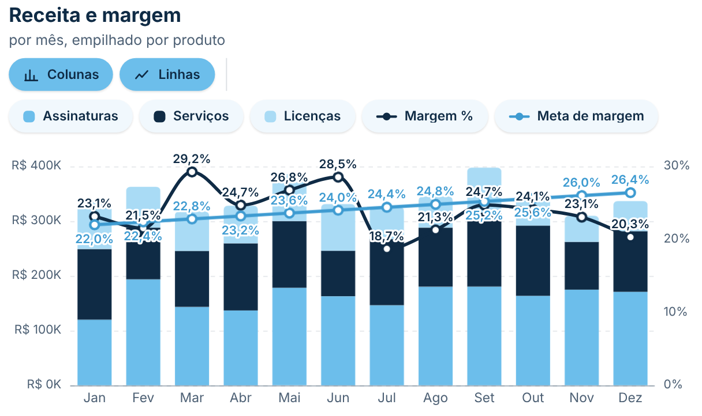
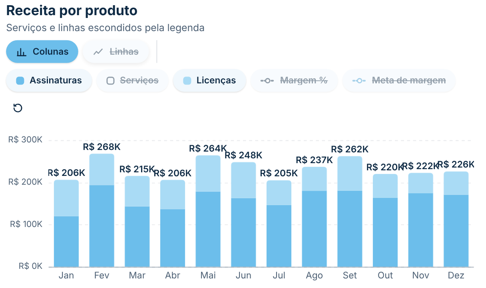
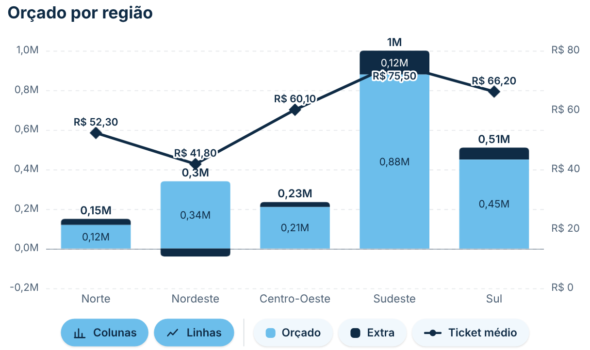
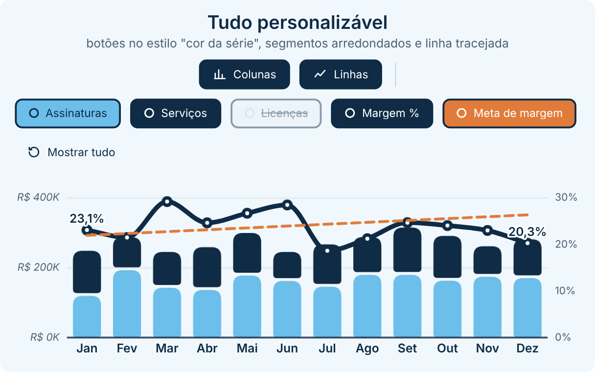
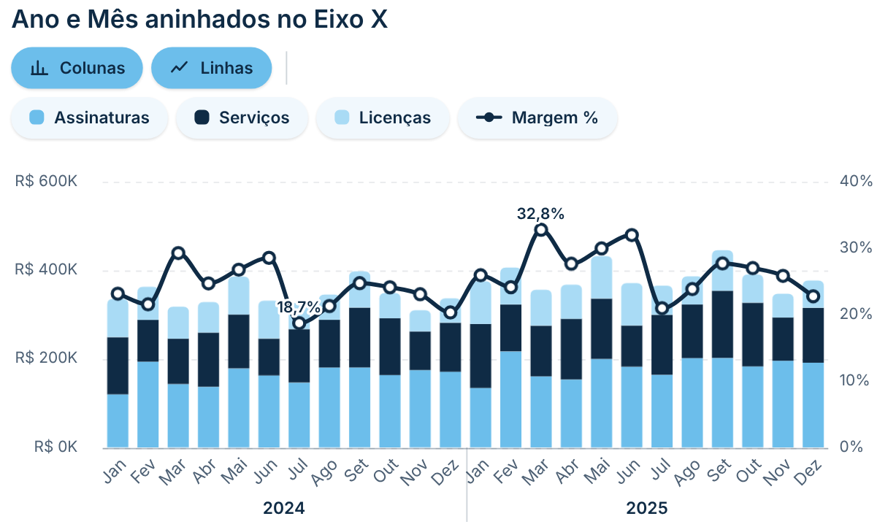

# Colunas Empilhadas e Linha

Réplica do gráfico nativo **"Gráfico de colunas empilhadas e de linhas"** do Power BI, com uma **legenda interativa** em botões arredondados: clique para **mostrar ou esconder** cada série (um produto da legenda, uma medida de coluna ou uma linha) ou use os botões **Colunas** e **Linhas** para ligar e desligar todas de uma vez. A escala se reajusta ao que fica visível, com uma animação suave. Segue o padrão visual do repositório ([DESIGN.md](../../DESIGN.md)).

| Padrão | Legenda interativa (itens escondidos) |
|---|---|
|  |  |
| **Várias medidas e rótulos** | **Personalizado** (botões na cor da série, segmentos arredondados, linha tracejada) |
|  |  |
| **Ano e Mês aninhados no Eixo X** | |
|  | |

## Como usar

1. Baixe [`dist/colunasLinha621BDED5AAC041AC84F6559C9571914C.1.2.0.0.pbiviz`](dist/) e importe no Power BI (**Visualizações → `…` → Importar um visual de um arquivo**).
2. Arraste os campos (os mesmos nomes do visual nativo):
   - **Eixo X**: cada valor vira uma coluna (ex.: Mês, Região). Aceita **vários campos aninhados**, até 6 (ex.: *Ano* e *Mês* da tabela Calendário): cada mês aparece dentro do seu ano.
   - **Eixo Y da coluna**: uma ou várias medidas empilhadas. Sem legenda, cada medida vira um segmento da pilha.
   - **Legenda da coluna** (opcional): divide a coluna em segmentos (ex.: Produto). Com legenda, use uma medida só no Eixo Y da coluna, como no nativo.
   - **Eixo Y da linha**: uma ou mais medidas desenhadas como linhas (ex.: Margem %, Meta).
   - **Dicas de ferramenta** (opcional): medidas extras mostradas ao passar o mouse.

## Legenda interativa

- **Um botão por série**: clique para esconder ou mostrar. A série escondida fica esmaecida, riscada e com a amostra de cor vazada.
- **Duplo clique** numa série mostra só ela (as do outro tipo continuam como estão).
- **Botões Colunas / Linhas**: escondem ou mostram todas as colunas ou todas as linhas de uma vez.
- **↺ Mostrar tudo** aparece quando há algo escondido.
- Escala, totais e dica de ferramenta consideram só o que está visível. Com tudo escondido, aparece um aviso.
- Dá para escolher o que começa visível ao abrir (ex.: só as colunas) em **Legenda interativa → Colunas/Linhas visíveis ao abrir**.

## Recursos

- **Linha calculada na categoria inteira**: a linha não é dividida pela legenda (como no nativo). Uma Margem % continua certa mesmo com Produto na legenda.
- **Vários campos no Eixo X** (ex.: Ano › Mês ou Ano › Trimestre › Mês), mostrados de três jeitos: **agrupado** (os meses e, embaixo, o ano de cada grupo, com divisórias, como no nativo), **concatenado** (`Jan 2024`, com ordem e separador configuráveis) ou **só o último nível**. A dica de ferramenta mostra o caminho completo (`2024 › Jan`) e o filtro cruzado filtra o mês daquele ano.
- **Eixo Y secundário** para as linhas, ou a mesma escala das colunas.
- **Colunas**: negativos empilham para baixo, arredondamento do topo, espaço entre colunas, opacidade, borda e cor de cada série.
- **Linhas**: reta, suave ou em degraus; contínua, tracejada ou pontilhada; marcadores (círculo, quadrado ou losango, cheio ou vazado); área sombreada; vazios interrompem, ligam os pontos ou viram zero.
- **Rótulos**: valor de cada segmento (com contraste automático), **total** acima de cada pilha e rótulos das linhas (todos os pontos, último, primeiro e último, ou maior e menor), com fundo atrás do texto. Rótulos que se sobrepõem são desviados ou escondidos.
- **Eixos**: mínimo e máximo, unidades de exibição (automático, mil, milhões, bilhões), casas decimais, títulos, grade (cor, opacidade, estilo) e rotação dos rótulos do eixo X (automática, horizontal, 45°, vertical).
- **Rolagem horizontal**: com uma largura mínima por categoria, o gráfico rola e os eixos ficam fixos.
- **Filtro cruzado**: clique num segmento (categoria × legenda) ou na categoria para filtrar os outros visuais (Ctrl + clique para vários); o resto fica esmaecido. Menu do botão direito e Ctrl+C / Ctrl+V.
- **Dica de ferramenta** com todos os valores da categoria (e o total) ou só o item sob o mouse; destaque da categoria sob o mouse.
- **Números** no formato de cada medida e no idioma do relatório.

## Formatação

Praticamente tudo pode ser trocado no painel **Formatar visual**. Cada parte com texto tem o controle de fonte completo (**fonte, tamanho, negrito, itálico e sublinhado**); deixando a fonte padrão, ela segue a fonte de **Geral**. Opções que não fazem efeito (ex.: cor da borda com borda 0) somem do painel.

- **Geral:** fonte de todo o visual, animação (ligar e duração), margens laterais e de cima/baixo, fundo do visual (cor e arredondamento).
- **Cabeçalho:** título e subtítulo (texto, fonte e cor), alinhamento e espaço abaixo.
- **Legenda interativa**
  - *Posição e comportamento:* em cima ou embaixo, alinhamento, espaço entre os botões, distância até o gráfico, divisória entre os grupos (e a cor), o que começa visível, duplo clique para mostrar só a série e o texto do aviso quando tudo está escondido.
  - *Texto e forma dos botões:* fonte, altura, espaço interno lateral, arredondamento, espessura da borda, sombra, tamanho dos ícones e como mostrar o que está escondido (esmaecer, riscar ou os dois) com a opacidade.
  - *Botões Colunas / Linhas:* mostrar, textos, ícones e as cores de fundo, texto e borda **ligado** e **desligado**.
  - *Botões das séries:* mostrar, estilo quando visível (**fundo neutro**, **fundo na cor da série** ou **borda na cor da série**), cores de fundo, texto e borda **visível** e **escondida**, amostra de cor (mostrar, forma e tamanho) e largura máxima do texto.
  - *Botão "Mostrar tudo":* mostrar, texto (vazio = só o ícone), cor e fundo.
- **Colunas:** espaço entre colunas, largura máxima, arredondamento do topo e da base, arredondar cada segmento, espaço entre segmentos, opacidade, borda e quanto clarear ao passar o mouse.
- **Cores das colunas:** cor de cada série.
- **Linhas:** espessura, estilo, traçado, opacidade, valores vazios; marcadores (forma, tamanho, preenchimento, cor do centro, borda, aumento ao passar o mouse); área (mostrar e opacidade).
- **Linhas — por série:** para cada linha, cor, espessura, estilo, marcadores, área e rótulos (ou "igual às outras").
- **Eixo X:** mostrar; rótulos (fonte, cor, rotação, largura máxima, distância do eixo, largura mínima da categoria para rolar); vários campos (como mostrar, ordem e separador do concatenado, fonte e cor dos grupos, espaço entre níveis, divisórias com cor, opacidade e opção de entrar no gráfico); linha do eixo (cor, espessura, opacidade); título (texto, fonte, cor).
- **Eixo Y (colunas)** e **Eixo Y secundário (linhas):** mostrar; escala (mínimo, máximo, quantidade de marcas e, no secundário, usar a escala das colunas); rótulos (fonte, cor, unidades, casas decimais); título (texto, fonte, cor); grade (cor, opacidade, espessura, estilo).
- **Rótulos das colunas:** mostrar, posição, fonte, cor fixa ou automática (com as cores clara e escura), esconder quando não cabe, unidades e casas decimais.
- **Rótulos do total:** mostrar, fonte, cor, distância da coluna, mostrar mesmo sem caber, contorno (cor e espessura), unidades e casas decimais.
- **Rótulos das linhas:** mostrar, quais pontos, posição, distância do ponto, evitar sobreposição, fonte, cor (da linha ou fixa), contorno (cor e espessura), unidades e casas decimais.
- **Interação:** conteúdo da dica de ferramenta, total na dica (e o nome dele), destaque da categoria sob o mouse (cor e opacidade) e opacidade do que não está selecionado.

## Observações

- Até 1000 categorias no eixo X e 60 itens na legenda.
- O que foi escondido na legenda vale enquanto o relatório está aberto. Para definir o estado inicial, use as opções "visíveis ao abrir".
- Os dados chegam no formato matriz (linhas = Eixo X, colunas = Legenda, com subtotal), para que a linha seja calculada sem o filtro da legenda.
