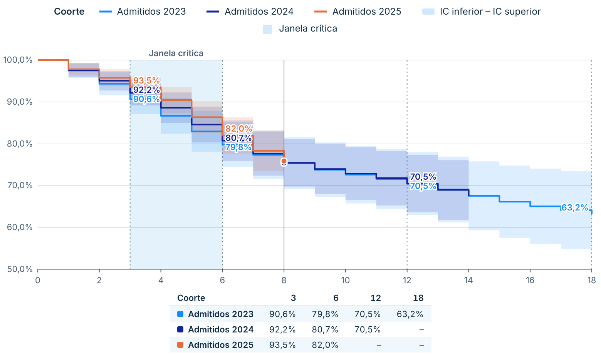
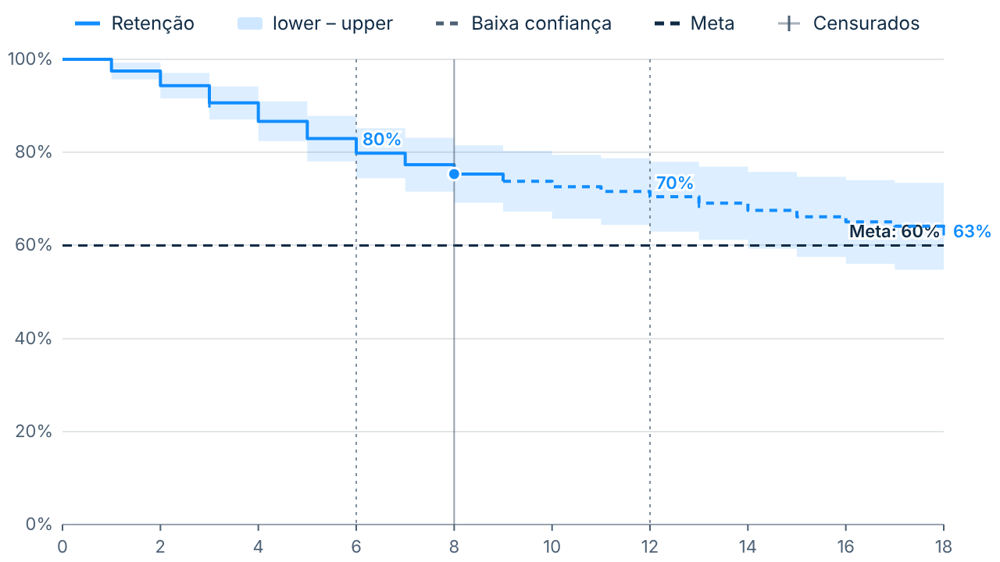
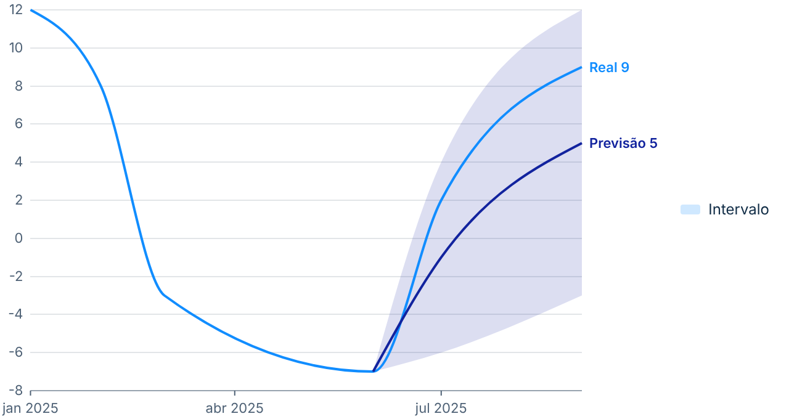
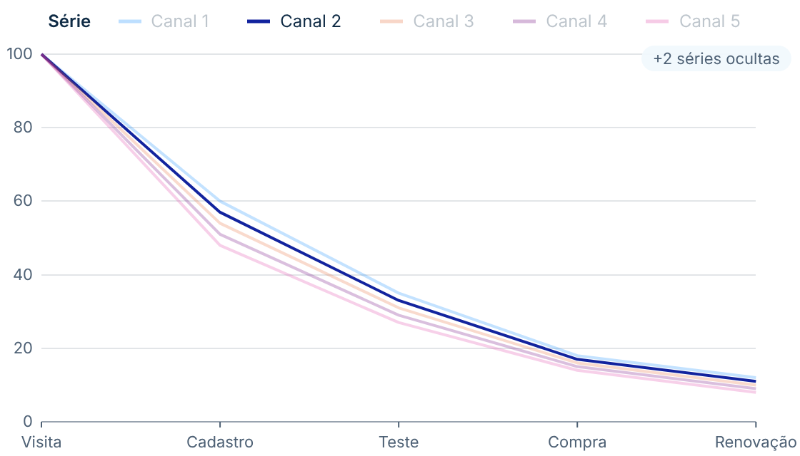

# Curvas com Incerteza

Desenha uma ou mais séries sobre um eixo ordenado e mostra **o quanto cada trecho é confiável**: faixa de intervalo (IC), trechos de **baixa confiança** tracejados, **janelas destacadas** no fundo, **marcos** com tabela e linha de **referência**. Feito para curvas de retenção por coorte (Kaplan-Meier), mas serve para funil acumulado, burn-up, série temporal com previsão e intervalo, curva de aprendizado. Segue o padrão visual do repositório ([DESIGN.md](../../DESIGN.md)).

O visual é genérico: nenhum nome de medida ou regra de negócio fica no código. Tudo entra por campo de dados ou pelo painel de formatação.

| Retenção por coorte, janela crítica e marcos | Baixa confiança tracejada e referência |
|---|---|
|  |  |

| Datas, previsão com intervalo e negativos | Série em destaque e séries ocultas |
|---|---|
|  |  |

## Como usar

1. Baixe [`dist/curvasIncerteza983C09C148CF4C8387AEC445521BF4F6.1.0.0.0.pbiviz`](dist/) e importe no Power BI (**Visualizações → `…` → Importar um visual de um arquivo**).
2. Arraste os campos. Só **Eixo X** e **Valor** são obrigatórios; o resto aparece quando é preenchido.

| Campo | Tipo | Comportamento |
|---|---|---|
| **Eixo X** | Agrupamento (número, data ou texto) | Número e data viram eixo contínuo, em ordem crescente; texto fica na ordem do modelo (respeita "Classificar por coluna"). |
| **Série** | Agrupamento | Opcional. Uma curva por valor; aceita parâmetro de campo. |
| **Valor** | Medida | Altura da curva. Vazio **interrompe** a linha (nunca vira zero): a curva de uma coorte recente termina onde os dados acabam. |
| **Limite inferior / superior** | Medida | Faixa sombreada atrás da linha, com a mesma interpolação. Só aparece com os dois limites; limite vazio interrompe a faixa. |
| **Confiança** | Medida | Ponto de baixa confiança quando Confiança < Limiar. **Confiança vazia = ponto normal.** |
| **Limiar de confiança** | Medida | Se vazio, usa a constante do painel (padrão 1). |
| **Destaque** | Medida | Pontos consecutivos com valor ≠ 0 viram uma janela sombreada no fundo (com várias séries, vale a união). |
| **Marcas** | Medida | Valor > 0 desenha um tique na curva (ex.: censuras). |
| **Referência** | Medida | Linha horizontal; alternativa à constante do painel. |
| **Dicas de ferramenta** | Medidas | Entram na dica de ferramenta. Também funciona com dica de ferramenta de página. |

Números saem no **formato da medida** e no idioma do relatório (o visual nunca assume que o valor é percentual).

### Exemplo: retenção por coorte

| Campo | Medida |
|---|---|
| Eixo X | `'SV Meses de Casa'[Mes]` (filtro 0 a 18) |
| Série | parâmetro de campo `SV Agrupamento` |
| Valor | `SV Retencao KM` |
| Limites | `SV Retencao IC Inf` / `SV Retencao IC Sup` |
| Confiança / Limiar | `SV Em Risco` / `SV N Minimo Value` |
| Destaque | `SV Janela Critica` |
| Marcas | `SV Censurados` (opcional) |
| Dicas de ferramenta | `SV Em Risco`, `SV Saidas` |
| Painel | Interpolação em degrau (automática no eixo inteiro); **Marcos** `3;6;12;18` com tabela; **Linhas → Máximo de séries** = 3 |

## Regras de desenho

- **Degrau após o ponto** é o padrão quando o eixo é numérico inteiro: o valor do mês *k* vale até o mês *k*+1 (correto para Kaplan-Meier). Em outros eixos, o padrão é a reta.
- Trechos de baixa confiança: o trecho entre os pontos *i* e *i*+1 herda o estado do ponto *i*+1, sem lacuna entre trechos. Estilo tracejado, esmaecido ou oculto.
- X repetido não é somado: fica o primeiro valor e aparece um aviso.
- Acima do máximo de séries visíveis, as excedentes ficam ocultas e aparece **"+N séries ocultas"** no canto.
- Até 1.000 pontos no eixo e 30 séries; acima disso, aviso discreto no canto.

## Interação e acessibilidade

- **Linha-guia** vertical segue o mouse e mostra todas as séries naquele X numa só dica de ferramenta (valor, intervalo, baixa confiança e as medidas extras).
- Clique perto de um ponto seleciona e filtra os outros visuais; **Ctrl + clique** soma; clique no vazio limpa.
- Clique num item da legenda seleciona a série inteira.
- Quando outro visual filtra este, as séries sem destaque ficam esmaecidas e os pontos destacados ganham marcador.
- Botão direito abre o menu de contexto do Power BI (**Analisar**, **Drill through**).
- **Teclado:** Tab entra no visual, setas percorrem os pontos, Enter seleciona (Ctrl + Enter soma), Esc sai. O leitor de tela anuncia o ponto em foco (ex.: "Mês 8, Admitidos 2025: 3,0%").
- **Alto contraste:** usa só as cores do sistema; cada série ganha um tracejado próprio e a baixa confiança continua tracejada (nunca só por cor).

## Formatação

- **Linhas:** interpolação (automática, degrau, reta, suave), espessura, cores do tema, série em destaque (as demais esmaecidas), máximo de séries visíveis (padrão 5), pontos, marcas, opacidade do que não está selecionado, fonte.
- **Cores e estilo das séries:** cor e estilo de linha (contínua, tracejada, pontilhada) por série.
- **Faixa:** mostrar, opacidade (padrão 15%), mesma cor da série ou cor própria.
- **Baixa confiança:** tracejado / esmaecido / oculto, limiar constante, texto na legenda.
- **Janelas destacadas:** campo Destaque ou intervalo fixo (início–fim), cor, opacidade, rótulo.
- **Marcos:** valores de X separados por `;` (ex.: `3;6;12;18`), linhas verticais, rótulo do valor no ponto, tabela de marcos abaixo do gráfico (linhas = séries, colunas = marcos).
- **Referência:** mostrar, constante quando o campo está vazio, rótulo (com o valor formatado), cor, estilo e espessura.
- **Eixo X / Eixo Y:** mostrar, título, começar em zero (Y), mínimo e máximo automáticos ou fixos, grade, tamanho e cor.
- **Rótulos:** valor no fim de cada curva; nome da série no fim (substitui a legenda quando há até 4 séries).
- **Legenda:** mostrar, em cima, embaixo ou à direita, título, tamanho e cor.

## Desenvolvimento

O código compartilhado (eixos, formatação, dica de ferramenta, seleção, estado vazio) fica em [`../common`](../common/). O `npm install` deste visual instala também as dependências do `common`.

```bash
npm install
npm test            # testes do modelo de dados (Jest)
npm run lint        # ESLint (este visual e o common)
npx tsc --noEmit -p .
npm run package     # gera dist/*.pbiviz
```
