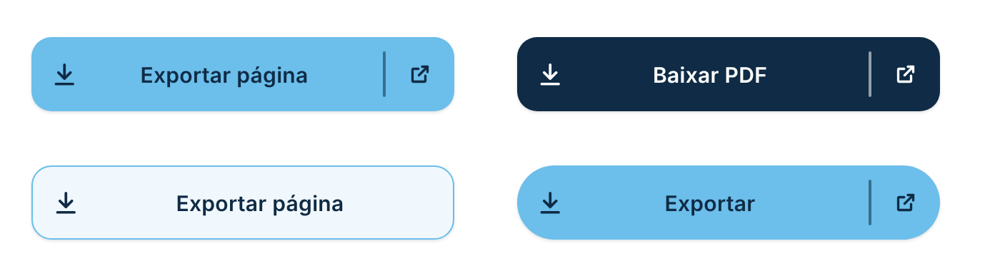
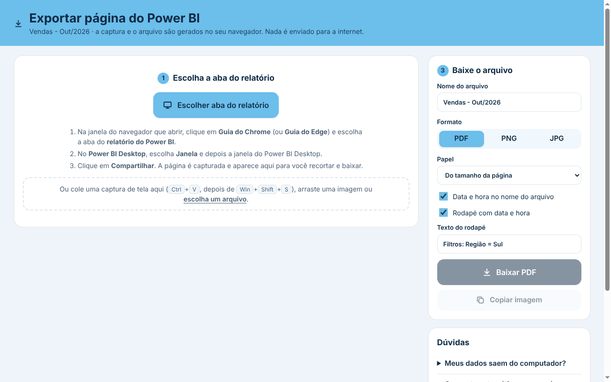
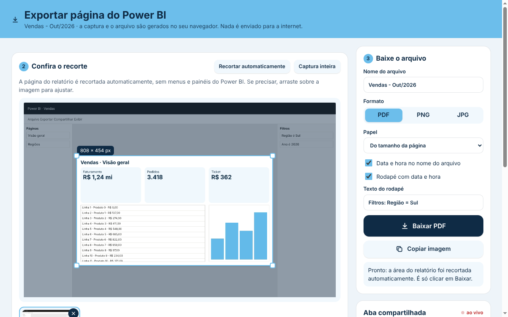
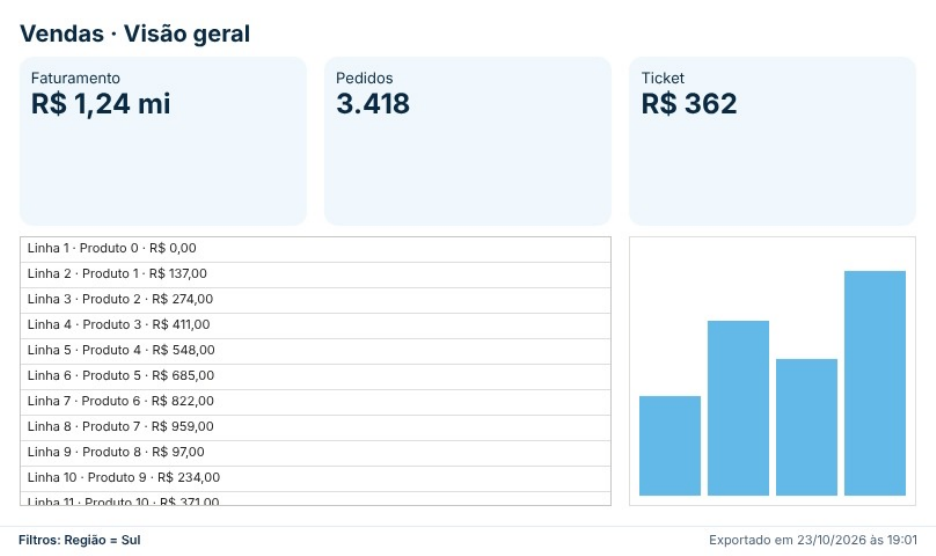

# Exportar Página

Botão que **exporta a página do relatório** para **PDF**, **PNG** ou **JPG**. Funciona com um visual não certificado e **sem nenhuma configuração do administrador** do Power BI. Também não precisa de Premium/Fabric. Segue o padrão visual do repositório ([DESIGN.md](../../DESIGN.md)).

| Botão no relatório | Página de exportação | Recorte da área do relatório | PDF gerado |
|---|---|---|---|
|  |  |  |  |

## Como funciona

1. O usuário clica em **Exportar página** no relatório.
2. Abre uma aba com a [página de exportação](https://zlanchus.github.io/powerbi-custom-visual/exportar/).
3. O usuário clica em **Escolher aba do relatório** e escolhe a aba do Power BI. No Power BI Desktop, escolhe a janela do Power BI Desktop.
4. A página é capturada e **recortada automaticamente**: fica só a página do relatório, sem a barra do Power BI, os painéis de páginas e de filtros e o fundo cinza.
5. **Baixar PDF** (o botão já vem selecionado: basta Enter), **PNG** ou **JPG**, ou **Copiar imagem** para colar no e-mail, no Teams ou no PowerPoint. Depois de baixar, o compartilhamento da aba para sozinho.

### Recorte automático

No Power BI (serviço e Desktop), a página do relatório é um retângulo de bordas retas cercado pelo fundo cinza da área de trabalho. A página de exportação procura o maior retângulo assim na captura, com preferência para os formatos de página 16:9 e 4:3, e acerta as bordas pixel a pixel. Funciona com os painéis abertos ou fechados, no modo **Tela inteira**, com fundo de página escuro e em qualquer resolução ou zoom de tela.

Se não achar a página (por exemplo, quando o fundo da página tem a mesma cor do fundo do Power BI), ela usa o último recorte feito à mão, ou a captura inteira. O usuário sempre pode arrastar para ajustar, ou clicar em **Recortar automaticamente** para voltar ao recorte automático.

Para exportar várias páginas do relatório num PDF só, troque de página na aba do Power BI e clique em **Capturar** de novo. Cada captura vira uma página do PDF. Com PNG/JPG, várias capturas saem num `.zip`.

### Segurança: o que fica salvo e o que sai do computador

- **A captura não sai do computador.** Ela é feita pelo próprio navegador (`getDisplayMedia`, a mesma API usada para compartilhar a tela numa reunião) e fica só na memória da aba. O recorte, o PDF, as imagens e o ZIP são montados em JavaScript na própria página. Ao fechar a aba, tudo some.
- **A página é proibida de usar a rede.** Ela tem uma política de segurança (`Content-Security-Policy` com `connect-src 'none'`) que faz o navegador bloquear qualquer envio e qualquer arquivo de fora. Não há scripts, fontes nem imagens externas.
- **O que fica salvo:**
  - o arquivo baixado, na pasta de downloads do usuário, como qualquer download;
  - no navegador, só a posição do recorte (4 números), sem nome nem dado do relatório.
- **O endereço:** as opções vão depois do `#`, parte que o navegador não envia ao servidor. Elas ficam, porém, no histórico do navegador, assim como qualquer endereço visitado. Se o texto do rodapé tiver informação sensível, prefira digitá-lo na página em vez de usar a medida.
- **O visual** não pede nenhum privilégio (`"privileges": []`): não acessa a rede, não baixa arquivos e não lê nada além das medidas de nome e rodapé.
- **Quem serve a página:** por padrão é o GitHub Pages deste repositório. O GitHub só vê que a página foi aberta (endereço sem o `#`, IP, navegador), nunca a captura. Para não depender de terceiros, hospede a sua cópia (veja abaixo).

### Por que desse jeito

| Caminho | Por que não serve |
|---|---|
| Download pelo visual (`downloadService.exportVisualsContent`) | Depende da opção **"Permitir downloads de visuais personalizados"** do portal de administração, que vem **desativada por padrão**. |
| Ler a página de dentro do visual | Cada visual roda num `iframe` isolado (sandbox) e não enxerga os outros visuais nem a página. |
| API REST "Export To File" | Exige capacidade Premium/Fabric, registro de aplicativo e token do Azure AD. |
| Capturar a tela de dentro do visual | O `iframe` do visual não tem permissão de captura de tela (`display-capture`). |
| **`host.launchUrl` + página de captura** ✅ | Abrir um link (http/https) é permitido para **qualquer** visual, sem privilégio, sem certificação e sem configuração do administrador. A página aberta é uma página comum do navegador, então pode usar a captura de tela e gerar o download. |

## Como usar

1. Baixe [`dist/exportarPagina40FB6B3372834974BEC785F386B84CA0.1.0.0.0.pbiviz`](dist/) e importe no Power BI (**Visualizações → `…` → Importar um visual de um arquivo**).
2. Coloque o visual na página e ajuste o tamanho (ele vira um botão).
3. Opcional: arraste medidas de texto para os campos:
   - **Nome do arquivo**: nome dinâmico do arquivo;
   - **Texto do rodapé**: texto no rodapé do PDF/imagem, por exemplo os filtros aplicados.

```DAX
Nome do arquivo = "Vendas - " & FORMAT ( MAX ( Calendario[Data] ), "MMM-YYYY" )
```

```DAX
Texto do rodapé =
"Região: " & IF ( ISFILTERED ( Regiao[Nome] ), CONCATENATEX ( VALUES ( Regiao[Nome] ), Regiao[Nome], ", " ), "Todas" )
    & " · Ano: " & IF ( ISFILTERED ( Calendario[Ano] ), CONCATENATEX ( VALUES ( Calendario[Ano] ), Calendario[Ano], ", " ), "Todos" )
```

Dica: no Power BI, deixe **Exibir → Ajustar à página** (o padrão) para a página inteira aparecer na tela e entrar na captura.

## Formatação

- **Botão:** texto, ícone, divisória e seta, fonte, tamanho da fonte, negrito, cor de fundo, cor do texto, altura (0 = altura toda do visual), arredondamento, espessura e cor da borda.
- **Exportação:**
  - formato padrão (PDF, PNG ou JPG);
  - papel do PDF (do tamanho da página, A4 ou Carta) e orientação (automática, paisagem ou retrato);
  - nome do arquivo e data e hora no nome;
  - rodapé com data e hora e texto do rodapé;
  - capturar assim que a aba for escolhida;
  - **endereço da página de exportação** (veja abaixo).

Tudo isso pode ser mudado pelo usuário na página de exportação antes de baixar.

## Hospedar a página na empresa

A página de exportação é um arquivo único e sem dependências: [`site/exportar/index.html`](../../site/exportar/index.html). Por padrão o botão abre a cópia pública em `https://zlanchus.github.io/powerbi-custom-visual/exportar/`. Para usar uma cópia interna (intranet, Azure Static Web Apps, IIS…), publique esse arquivo em qualquer endereço **https** e cole o endereço em **Formatar → Exportação → Endereço da página de exportação**.

## Plano B: sem visual personalizado

Se o administrador permitir **só visuais certificados**, nenhum visual personalizado é carregado, nem este. A página de exportação continua funcionando sozinha:

- use um **botão nativo** do Power BI com **Ação → URL da Web** apontando para a página de exportação. A URL pode ser uma medida (fx) com as mesmas opções do `#`:

```DAX
URL Exportar =
VAR Texto =
    SUBSTITUTE ( SUBSTITUTE ( SUBSTITUTE ( SUBSTITUTE (
        [Texto do rodapé], "%", "%25" ), "&", "%26" ), "#", "%23" ), "+", "%2B" )
RETURN
    "https://zlanchus.github.io/powerbi-custom-visual/exportar/#nome=Vendas "
        & FORMAT ( MAX ( Calendario[Data] ), "MMM-YYYY" )
        & "&formato=pdf&rodape=1&texto=" & Texto
```

- ou salve a página de exportação nos favoritos do navegador.

Opções aceitas no `#`: `nome`, `formato` (`pdf`, `png`, `jpg`), `papel` (`fit`, `a4`, `letter`), `orientacao` (`auto`, `landscape`, `portrait`), `datahora` (`1`/`0`), `rodape` (`1`/`0`), `texto` e `auto` (`1`/`0`).

## Limitações

- A captura de **aba** existe no Chrome e no Edge para computador. No Firefox e no Safari escolha a **janela** do navegador. Em celular e tablet não há captura de tela: dá para colar um print (`Ctrl+V`) ou escolher um arquivo de imagem.
- A captura pega o que está **visível** na tela. Páginas com rolagem precisam de **Ajustar à página** ou de várias capturas.
- O navegador sempre pede para o usuário escolher o que compartilhar. Isso é uma proteção do navegador e não dá para pular.
- Em relatórios incorporados ou publicados na Web, o Power BI pode bloquear a abertura de links. Nesse caso o botão fica sem efeito.
- O PDF contém imagens da página, sem texto selecionável.
