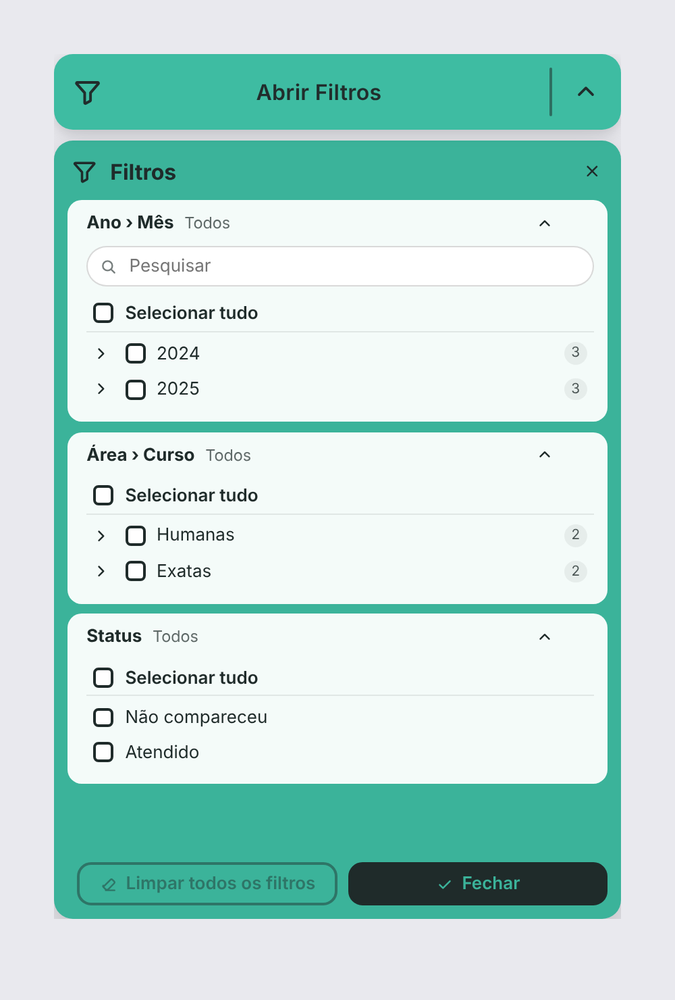

# Filtro em Pop-up — visual customizado do Power BI

Botão **"Abrir Filtros"** (azul-claro, ícone de funil, divisória e seta) que abre um **pop-up no mesmo estilo** com os filtros/slicers dos campos que você adicionar ao visual. Os filtros funcionam como o **segmentação de dados (slicer) nativo**: filtram os outros visuais da página, ficam salvos no relatório e respeitam indicadores (bookmarks).

| Fechado | Aberto |
|---|---|
|  |  |

## Como usar no Power BI

1. Baixe o arquivo pronto: [`dist/filtroPopup7AA90184E2E143838BC5449850609E02.1.7.0.0.pbiviz`](dist/).
2. No Power BI Desktop: painel **Visualizações → `...` → Importar um visual de um arquivo** e selecione o `.pbiviz`.
3. Insira o visual na página e arraste as colunas para os espaços de dados:
   - **Filtro aninhado 1, 2, 3 e 4** — todas as colunas colocadas no mesmo espaço viram **um único filtro em árvore**, na ordem em que foram adicionadas (a primeira é o nível de cima). Ex.: *Ano* e *Mês* no "Filtro aninhado 1" e *Área* e *Curso* no "Filtro aninhado 2". Sem limite de colunas por espaço.
   - **Filtros sem aninhamento** — cada coluna vira um filtro separado, sem limite de colunas.
   - **Ligação entre tabelas (opcional)** — necessária quando alguma coluna vem de uma **tabela sem relacionamento** com as outras. Veja "Colunas de tabelas diferentes" abaixo.
4. Clique no botão para abrir o pop-up.

### O que tem no pop-up

- Um bloco por campo, com **pesquisa**, **"Selecionar tudo"** e lista com caixas de seleção (ou botão de opção, se "Seleção única" estiver ligado).
- Resumo do que está selecionado no cabeçalho de cada bloco e botão de borracha para **limpar só aquele filtro**. Os blocos abrem **retraídos** ao abrir o pop-up; clique no título para expandir.
- **Filtros aninhados:** cada espaço "Filtro aninhado N" vira uma árvore, com setas para expandir/recolher, marcação parcial no nível de cima e contador de itens.
- Opcional: modo **intervalo (De/Até)** para campos numéricos e de data.
- **Limpar todos os filtros** e **Fechar** no rodapé; também fecha com `Esc`, no `X` ou clicando fora do pop-up.
- O botão mostra um contador com quantos campos estão filtrados.
- **Copiar e colar:** clique no visual e use `Ctrl+C` / `Ctrl+V`, ou o **menu do botão direito** do Power BI.
- **Sincronizar entre páginas:** o visual aparece no painel **Exibir → Sincronizar segmentações**, como a segmentação nativa. Ao colar em outra página, o Power BI pergunta se quer sincronizar.

### Formatação (painel "Formatar visual")

- **Botão:** texto, cor de fundo, cor do texto/ícones, fonte, tamanho da fonte do texto, arredondamento, altura, espessura e cor da borda, ícone e contador.
- **Pop-up:** título, tamanho da fonte do título, tamanho da fonte do título dos filtros, tamanho da fonte dos valores, cor de fundo, cor dos painéis, cor do texto, espessura e cor da borda, abrir abaixo do botão ou por cima dele.
- **Botões do pop-up** ("Limpar todos os filtros" e "Fechar"): posição (esquerda, centro ou direita), tamanho da fonte, fonte, largura (0 = automática), cor de fundo e cor do texto de cada um. Os dois botões têm sempre a mesma largura e altura.
- **Filtros:** abrir com os filtros retraídos (ligado por padrão), seleção única, caixa de pesquisa, intervalo para números e datas, espessura e cor da borda de cada bloco de filtro.
- **Caixa de seleção:** símbolo quando selecionado (visto ✓, xis ✕, bolinha ●, quadrado ■ ou nenhum), formato (quadrada arredondada, quadrada ou redonda), tamanho, espessura da borda, cor de fundo e da borda quando não selecionada, e cor de fundo, da borda e do símbolo quando selecionada.

## Como funciona o aninhamento


- A ordem das colunas dentro do espaço define os níveis: a primeira adicionada é o nível de cima. Para mudar, arraste para reordenar dentro do espaço.
- Marcar um item de cima marca tudo o que está abaixo dele; marcar só alguns filhos deixa o pai com marcação parcial.
- Funciona com qualquer combinação de colunas, inclusive quando o mesmo valor se repete em vários pais (ex.: *Mar* em 2024 e em 2025 são itens diferentes).
- O filtro enviado ao Power BI:
  - se só itens inteiros do primeiro nível estão marcados → filtro simples nessa coluna;
  - caso contrário → filtro de várias colunas (*tuple filter* da API de visuais), com o caminho completo de cada item marcado. Por isso ele é exato: marcar *2025 › Mar* filtra só março de 2025.
- As colunas de uma mesma árvore podem ser de tabelas diferentes, desde que estejam relacionadas no modelo (veja "Colunas de tabelas diferentes").
- A ordem dos itens segue a ordem do Power BI, incluindo "Classificar por coluna" (ex.: meses em ordem de calendário).

## Colunas de tabelas diferentes

O Power BI busca todas as colunas do visual numa **única consulta** (um visual personalizado não consegue consultar cada coluna separadamente, como a segmentação nativa faz). Por isso as tabelas usadas precisam estar ligadas de alguma forma — exatamente como numa tabela/matriz nativa com as mesmas colunas.

**Tabelas relacionadas** (ex.: tabela fato + Calendário): funciona direto. Opcionalmente, coloque em **Ligação entre tabelas** uma medida da tabela fato (ou qualquer coluna dela como *Contagem*) para mostrar só as combinações que existem.

**Tabela sem relacionamento** (ex.: tabela criada com *Inserir dados* ou *Nova tabela*): o Power BI recusa a consulta e o visual não aparece, mesmo com uma medida comum da tabela fato — essa medida não "enxerga" a tabela solta. A solução é uma medida que **use todas as tabelas envolvidas**. Crie-a e coloque em **Ligação entre tabelas**:

```DAX
Ligação Filtros =
IF ( NOT ISEMPTY ( 'Fato' ), 1 )
    * IF ( NOT ISEMPTY ( 'Tabela Local' ), 1 )
```

- Troque `'Fato'` pela sua tabela principal e `'Tabela Local'` pela tabela sem relacionamento.
- Se tiver mais de uma tabela solta, acrescente uma linha `* IF ( NOT ISEMPTY ( 'Outra Tabela' ), 1 )` para cada uma.
- Use **só essa medida** em "Ligação entre tabelas" (tire outras medidas/contagens de lá).

Com isso o Power BI consegue montar a consulta: cada valor da tabela solta aparece combinado com os valores das tabelas relacionadas que têm dados.

> Filtrar por uma tabela sem relacionamento não filtra os outros visuais por si só — isso também é verdade para a segmentação nativa. Ela só tem efeito em medidas que leiam o valor escolhido (ex.: `SELECTEDVALUE('Tabela Local'[Coluna])`).

## Importante: tamanho do visual

Visuais customizados rodam dentro de uma área isolada (iframe) e **não conseguem desenhar fora da própria caixa**. Por isso o pop-up abre **dentro da área do visual**:

- Redimensione o visual para o tamanho que o pop-up deve ter. O botão fica no topo (altura configurável) e o pop-up ocupa o espaço abaixo.
- Com o pop-up fechado essa área fica transparente, mas **continua sendo do visual** (cliques ali não chegam aos visuais que estiverem embaixo). Posicione-o sobre um espaço livre ou deixe-o por cima e aceite que o pop-up cubra os visuais ao abrir.
- Se preferir um botão pequeno, ligue **Pop-up → Abrir por cima do botão**: o pop-up ocupa a área inteira do visual.

Outras observações:

- Use a **coluna de data** diretamente (não a hierarquia automática Ano/Trimestre/Mês) para os filtros de data funcionarem melhor.
- Os valores listados vêm de até 30.000 combinações de todas as colunas do visual; com volumes maiores o visual busca o restante automaticamente. Muitas colunas com muitos valores aumentam o número de combinações.

## Desenvolvimento

Requisitos: Node.js 18+.

```bash
cd visuals/filtro-popup
npm install
npm run lint          # ESLint
npx tsc --noEmit -p . # checagem de tipos
npm run package       # gera dist/*.pbiviz
npm start             # servidor de desenvolvimento (visual "Developer Visual" no Power BI Service)
```

Estrutura:

- `capabilities.json` — espaços de dados ("Filtro aninhado 1–4", "Filtros sem aninhamento" e "Ligação entre tabelas"), suporte a sincronizar segmentações, propriedades do painel de formatação e a propriedade `general.filter` usada para aplicar os filtros.
- `src/visual.ts` — interface (botão, pop-up, listas) e integração com o host (`applyJsonFilter`).
- `src/hierarchy.ts` — monta a árvore dos espaços aninhados e o filtro de várias colunas (tuple) dela.
- `src/filters.ts` — monta os filtros JSON (`BasicFilter` "In" e `AdvancedFilter` de intervalo) e reconstrói o estado a partir dos filtros salvos.
- `src/settings.ts` — cartões do painel de formatação.
- `style/visual.less` — estilos.
