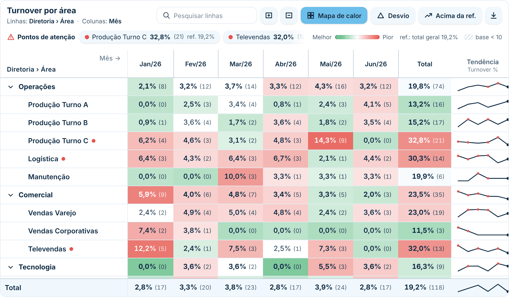
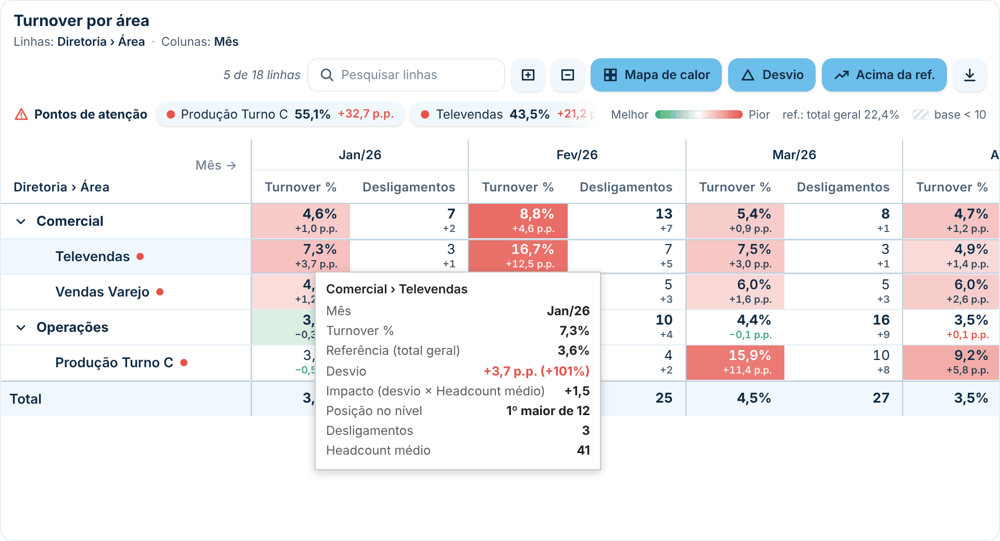
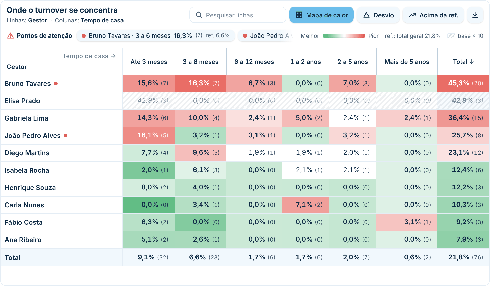
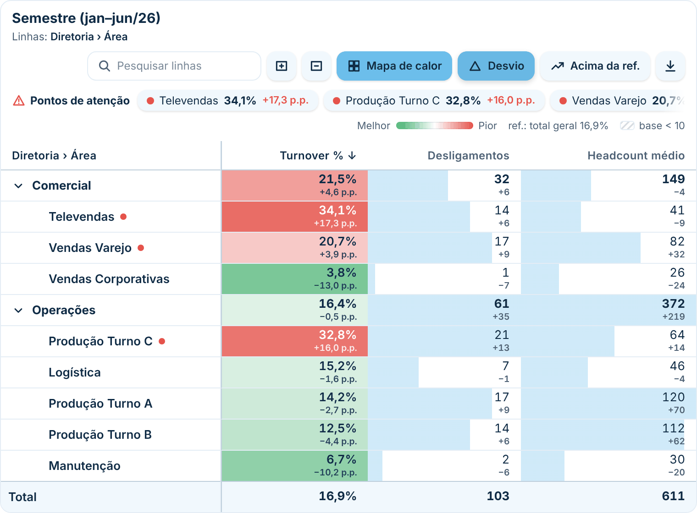
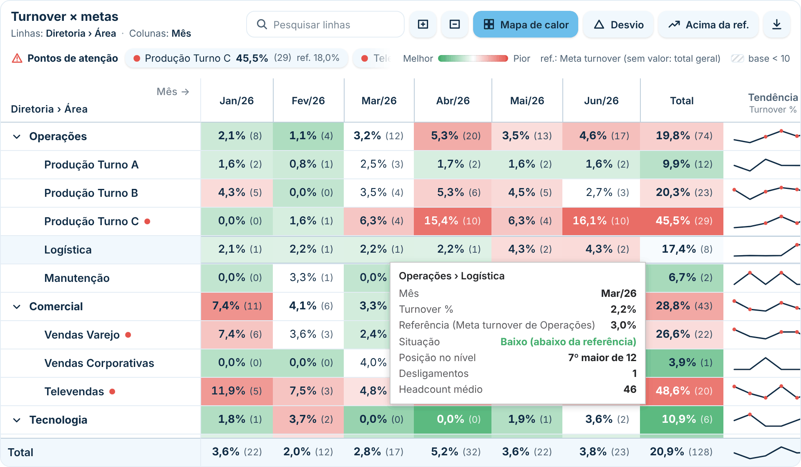

# Matriz Diagnóstica

Matriz para Power BI com o mesmo funcionamento da matriz nativa (linhas, colunas, valores, hierarquia, subtotais e filtro cruzado), pensada para **explorar e diagnosticar padrões**: por exemplo, um dashboard de turnover em que quem usa o relatório escolhe o que vai nas linhas e nas colunas com **parâmetros de campo** e procura onde o problema se concentra. Segue o padrão visual do repositório ([DESIGN.md](../../DESIGN.md)).

Na tabela, cada valor é comparado com uma **referência**, que serve de base para dizer se ele é **alto ou baixo**: o total geral, a mediana, a faixa típica, a média da própria linha ou uma medida sua com metas. O **mapa de calor** pinta o que está alto ou baixo, os **pontos de atenção** levam direto aos piores casos e a **base mínima** marca os grupos pequenos demais para tirar conclusão.

| Mapa de calor, tendência e pontos de atenção | Desvio, só acima da referência e dica de ferramenta |
|---|---|
|  |  |
| **Outra visão pelo parâmetro (Gestor × Tempo de casa)** | **Sem colunas: barras de dados e desvio** |
|  |  |
| **Referência por metas (só algumas diretorias têm meta)** | |
|  | |

> Quer só uma matriz mais bonita, com seções de colunas (ex.: Mensal × YTD)? Use a [Matriz Estilizada](../matriz/). A Matriz Diagnóstica é voltada para análise.

## Como usar

1. Baixe [`dist/matrizDiagnostica2E4F2050D5474936BAC0619F7AFC5427.1.2.0.0.pbiviz`](dist/) e importe no Power BI (**Visualizações → `…` → Importar um visual de um arquivo**).
2. Arraste os campos:
   - **Linhas**: campos ou um parâmetro de campo. Com mais de um campo, vira hierarquia (clique na linha para abrir e fechar).
   - **Colunas** (opcional): campos ou um parâmetro de campo (ex.: Mês, Tempo de casa).
   - **Valores**: as medidas (ex.: Turnover %).
   - **Detalhe (entre parênteses)** (opcional): uma medida mostrada ao lado do valor, na mesma célula. Com o nº de saídas aqui, a célula fica `24,2% (18)`. Com mais de uma medida, elas aparecem separadas por `·`.
   - **Referência (ex.: metas)** (opcional): uma medida com o valor de referência de cada célula, como a meta de turnover das diretorias. Pode ficar vazia onde não há meta (veja [Referência](#referência-o-que-é-alto-e-o-que-é-baixo)).
   - **Base (volume)** (opcional, recomendado): a medida que diz quantas pessoas há no grupo (ex.: Headcount médio). Serve para marcar amostras pequenas.
   - **Dicas de ferramenta** (opcional): medidas que aparecem só ao passar o mouse.
3. Em **Formatar visual → Análise**, escolha a **medida-chave** (padrão: a primeira de Valores). Ela é a base dos pontos de atenção, do botão *Acima da ref.*, da tendência e da ordenação inicial.

## Montando um dashboard de turnover com parâmetros de campo

1. **Modelagem → Novo parâmetro → Campos**. Crie um parâmetro *Ver linhas por* com os campos que fazem sentido abrir: Diretoria, Área, Gestor, Cargo, Turno, Faixa etária, Tempo de casa…
2. Crie outro, *Ver colunas por*: Mês, Trimestre, Tempo de casa, Tipo de desligamento (voluntário/involuntário)…
3. Coloque o primeiro parâmetro em **Linhas** e o segundo em **Colunas**. Na página, adicione uma segmentação para cada parâmetro (a [Segmentação Estilizada](../segmentacao/) funciona com parâmetros de campo). Ao trocar a escolha, a matriz troca os campos, reorganiza a hierarquia e recalcula referências e pontos de atenção.
4. Medidas sugeridas (adapte ao seu modelo):

   ```DAX
   Desligamentos = COUNTROWS ( Desligamentos )
   Turnover % = DIVIDE ( [Desligamentos], [Headcount médio] )
   ```

   `Headcount médio` é a sua medida de headcount médio do período. Ela vai em **Valores** (se quiser vê-la) e em **Base (volume)**. `Desligamentos` vai em **Detalhe**, para aparecer entre parênteses ao lado do turnover.

A coluna **Total** e o **total geral** são calculados pelo próprio Power BI, com a medida no contexto do total. Por isso o total de um semestre mostra o turnover do semestre, e não a soma dos meses.

## Referência: o que é alto e o que é baixo

A referência é a base de comparação de cada medida: acima dela o valor é **alto**, abaixo é **baixo**. O mapa de calor, os pontos de atenção, o botão *Acima da ref.*, os pontos da tendência e a linha *Situação* da dica de ferramenta seguem essa classificação. Escolha em **Formatar visual → Medidas → Referência (o que é alto ou baixo)**:

| Opção | Cada valor é comparado com | Quando usar |
|---|---|---|
| **Total geral** | o valor da empresa toda na mesma coluna (ex.: o turnover da empresa no mês) | "Esta área está acima da empresa?" Padrão para porcentagens. |
| **Mediana do nível** | o valor do meio entre as linhas do mesmo nível, na mesma coluna | Quando poucos casos extremos puxam o total ou a média para cima. |
| **Faixa típica do nível (1º a 3º quartil)** | a faixa onde estão os 50% do meio: acima do 3º quartil é **alto**, abaixo do 1º é **baixo** e entre os dois é **típico** (fica sem cor) | Separar o normal do fora da curva sem precisar de meta. Mostra só o que realmente se destaca. |
| **Média do nível** | a média simples das linhas do mesmo nível | Padrão para contagens (ex.: desligamentos, headcount). |
| **Média da própria linha** | a média da linha ao longo das colunas (ex.: os 6 meses daquela área) | Com meses nas colunas: "Este mês foi alto *para esta área*?" Na coluna de total, usa o total geral. |
| **Linha de cima** | o valor do nível anterior | Cada área contra a própria diretoria. |
| **Medida do campo Referência** | uma medida sua, calculada em cada célula (meta, ano anterior, benchmark…) | Metas, inclusive quando só algumas diretorias têm meta (abaixo). |
| **Valor fixo** | um número | Uma meta única para tudo. |

*Automática* usa a medida do campo **Referência** na medida-chave quando ele está preenchido; senão, total geral para porcentagens e média do nível para o resto. Células com base pequena não entram na mediana, nos quartis nem nas médias.

### Metas só para algumas diretorias

Coloque a medida de meta no campo **Referência**. Ela pode ficar vazia onde não há meta:

```DAX
Meta turnover = SELECTEDVALUE ( Metas[Meta turnover] )   -- vazio onde a diretoria não tem meta
```

Em cada célula, o visual procura a referência nesta ordem:

1. a meta da própria célula;
2. a meta das **linhas de cima** (ex.: as áreas de Operações usam a meta de Operações), até o total geral. Dá para desligar em *Sem valor, usar o da linha de cima*;
3. a **alternativa** escolhida em *Sem valor em nenhum nível, usar*: total geral (padrão), mediana do nível, média do nível, linha de cima ou nenhuma (a célula fica sem cor).

A dica de ferramenta diz de onde veio cada referência, por exemplo *Referência (Meta turnover de Operações)* ou *Referência (total geral, sem Meta turnover)*. A medida é calculada em cada célula como qualquer medida: se a meta é mensal e a coluna Total é o semestre, ela deve devolver a meta do semestre.

## Recursos para diagnóstico

- **Mapa de calor contra a [referência](#referência-o-que-é-alto-e-o-que-é-baixo):** com *maior é pior*, valores altos ficam em vermelho, baixos em verde e os que estão na referência (ou na faixa típica) sem cor. Quanto mais longe, mais forte a cor, sempre em relação ao mesmo nível: diretorias são comparadas entre si, áreas entre si, e a coluna de total tem a escala própria dela. Dá para colorir só o lado pior.
- **Sentido** de cada medida: *maior é pior* (turnover, absenteísmo), *maior é melhor* (retenção) ou *neutro* (escala simples, ex.: headcount). No *Automático*, porcentagens e a medida-chave ficam como "maior é pior" e as demais como neutras.
- **Desvio** (botão, desligado por padrão): mostra embaixo de cada valor o tamanho da diferença para a referência, em **pontos percentuais** para porcentagens (ex.: `+4,2 p.p.`) e no formato da medida para o resto. Com ele desligado, nenhum número de desvio aparece: a dica de ferramenta mostra a referência e a situação (alto, baixo ou na referência), e os pontos de atenção mostram o valor e a referência.
- **Base mínima (amostra pequena):** quando a medida de **Base** fica abaixo do mínimo (padrão 10), a célula fica hachurada e esmaecida e sai do mapa de calor, das médias e dos pontos de atenção. Um grupo de 3 pessoas com 1 saída dá 33% e assusta, mas não diz muito. Opcional: **ocultar** esses valores, para não expor grupos muito pequenos de pessoas.
- **Pontos de atenção:** os casos mais altos em relação à referência na medida-chave (1 a 5), com o valor e a referência ao lado (ex.: `32,8% (21) ref. 18,0%`). Clicar num deles abre a hierarquia até a linha, rola a tabela e pisca a célula. Compara o **total de cada linha** ou **cada célula** (linha × coluna), no nível mais detalhado, no primeiro nível ou em todos. Pode ordenar pela **distância acima da referência** ou pelo **impacto** (distância × base): uma área grande um pouco acima pode pesar mais que uma pequena muito acima.
- **Acima da ref.** (botão): mostra só as linhas piores que a referência na medida-chave, olhando a coluna de total. As linhas de cima continuam aparecendo quando algum filho passa no filtro.
- **Detalhe entre parênteses:** a medida do campo *Detalhe* (ex.: nº de saídas) aparece ao lado do valor, como `24,2% (18)`, nas células, nos totais e nos pontos de atenção. Assim uma taxa alta com poucas saídas fica visível na hora. Por padrão o detalhe acompanha só a medida-chave; em **Formatar visual → Medidas** dá para ligar em outras colunas. Estilo `(18)`, `· 18` ou `18`, com fonte e cor próprias.
- **Tendência:** uma coluna com um minigráfico da medida-chave em cada linha, com os pontos piores que a referência marcados. Ela só aparece quando as colunas são **datas ou períodos** (Mês, Ano, Trimestre, AnoMês, campos de data…). Com Tempo de casa, Senioridade ou outra categoria nas colunas, uma linha ligando as faixas não faz sentido, e a coluna some sozinha (inclusive ao trocar o parâmetro de campo). Se quiser, mude para **Sempre que houver colunas**. Pode ficar no fim ou logo depois dos nomes das linhas.
- **Dica de ferramenta completa:** caminho da linha, coluna, valor, referência (e de onde ela veio) ou faixa típica, **situação** (alto, baixo, na referência ou típico), posição no nível (ex.: *3º maior de 12*), as outras medidas da célula, a base e as medidas de *Dicas de ferramenta*. Com o botão Desvio ligado, também o desvio (p.p. e %) e o impacto. Avisa quando a amostra é pequena.
- **Pesquisa** de linhas (sem diferenciar acentos), com o trecho encontrado destacado. Os níveis de cima continuam aparecendo e abrem sozinhos.
- **Ordenação por clique no cabeçalho:** maior primeiro → menor primeiro → ordem original. No título das linhas, A–Z → Z–A → original. A ordenação vale dentro de cada nível da hierarquia.
- **Abrir nível / Fechar:** abre um nível da hierarquia por vez ou fecha tudo.
- **Barras de dados** por medida (ex.: Desligamentos, Headcount).
- **Campos escolhidos** à mostra embaixo do título (*Linhas: Diretoria › Área · Colunas: Mês*). Com parâmetros de campo, fica claro qual visão está na tela.

Os botões, a pesquisa e a ordenação são de quem está usando o relatório e voltam ao padrão ao reabrir. O estado inicial de cada botão é definido em **Formatar visual → Análise**.

## Funcionamento igual ao da matriz nativa

- **Hierarquia expansível**, subtotais nas linhas com filhos, **coluna de total** e **total geral** (em cima ou embaixo), todos calculados pelo Power BI.
- **Parâmetros de campo** em Linhas, Colunas ou Valores.
- **Filtro cruzado:** clicar numa célula filtra os outros visuais pela **linha × coluna**; clicar no nome da linha filtra só pela linha (Ctrl + clique para vários). O que não está selecionado fica esmaecido. Menu do botão direito e Ctrl+C / Ctrl+V.
- **Formatação condicional com fx:** em **Formatar visual → Medidas**, *Cor de fundo (fx)* e *Cor da fonte (fx)* aceitam regras, escala de cores ou valor de campo, avaliados por célula. Têm prioridade sobre o mapa de calor.
- **Números** no formato de cada medida e no idioma do relatório.
- Cabeçalho, coluna de linhas e total fixos ao rolar.
- **Exportar para Excel** (botão de download): gera um `.xlsx` com a matriz como está na tela (filtrada e ordenada), com números de verdade, o formato de cada medida, recuo da hierarquia, totais em negrito e as cores do mapa de calor. Valores ocultos por base pequena saem vazios.

> O download usa o serviço oficial de downloads de visuais personalizados. No Power BI Service, o administrador precisa deixar ligada a opção **"Permitir downloads de visuais personalizados"** (Portal de administração → Configurações do locatário). Se estiver desligada, o visual avisa.

## Formatação

- **Barra de ferramentas:** mostrar, título, campos escolhidos, quais botões aparecem, fonte, cores normal e ligado, altura, arredondamento, espessura e cor da borda.
- **Análise:** medida-chave, estado inicial dos botões (mapa de calor, desvio, acima da referência), ordenação inicial, cores pior / referência / melhor, colorir também o lado melhor, cor da escala das medidas neutras e intensidade máxima.
- **Base mínima:** valor mínimo, ocultar valores e hachura (aparece quando há medida em Base).
- **Pontos de atenção:** mostrar, título, quantidade, comparar (total da linha ou célula), linhas consideradas, ordenar por (desvio ou impacto), cores, fonte, arredondamento e borda.
- **Tendência:** mostrar, quando mostrar (só com datas/períodos ou sempre), título, posição, cor da linha, marcar pontos piores e largura.
- **Medidas** (um grupo por medida): mapa de calor, sentido, referência (com valor fixo, medida de referência, herdar da linha de cima e alternativa sem valor), mostrar detalhe ao lado, desvio, barras de dados, cor de fundo (fx) e cor da fonte (fx).
- **Tabela:** fonte, fundo, altura das linhas, linhas alternadas, cor ao passar o mouse, linhas de grade, arredondamento e borda.
- **Cabeçalho das colunas:** cores, tamanho, maiúsculas, quebra de texto e largura mínima.
- **Linhas:** título, cores, tamanho, largura, recuo por nível, negrito nos níveis com filhos e níveis abertos ao carregar.
- **Valores:** cor, tamanho, texto para vazio e cor das barras de dados.
- **Detalhe:** mostrar, estilo, tamanho, cor e negrito (aparece quando há medida em Detalhe).
- **Totais:** subtotais nas linhas, coluna de total, total geral, posição, rótulo e cores.
- **Exportar para Excel:** nome do arquivo e se exporta todos os níveis ou só os abertos.

## Observações

- O visual recebe até 30.000 linhas por vez e busca o restante automaticamente; mostra até 5.000 linhas abertas ao mesmo tempo e até 100 combinações nas colunas.
- Deixe ligados **Subtotais nas linhas** e **Coluna de total** em **Totais** (é o padrão). Sem o total geral, a referência *Total geral* passa a ser a média das linhas. Sem a coluna de total, os pontos de atenção comparam cada célula e o botão *Acima da ref.* mostra as linhas piores que a referência em pelo menos uma coluna.
- No valor fixo, porcentagens usam o valor decimal (8% = 0,08).
