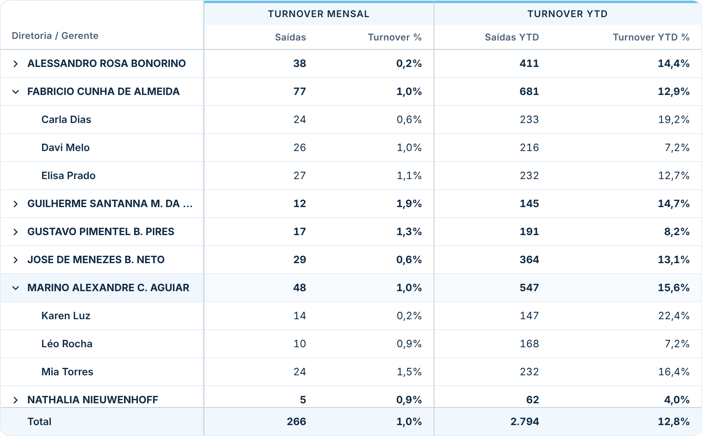
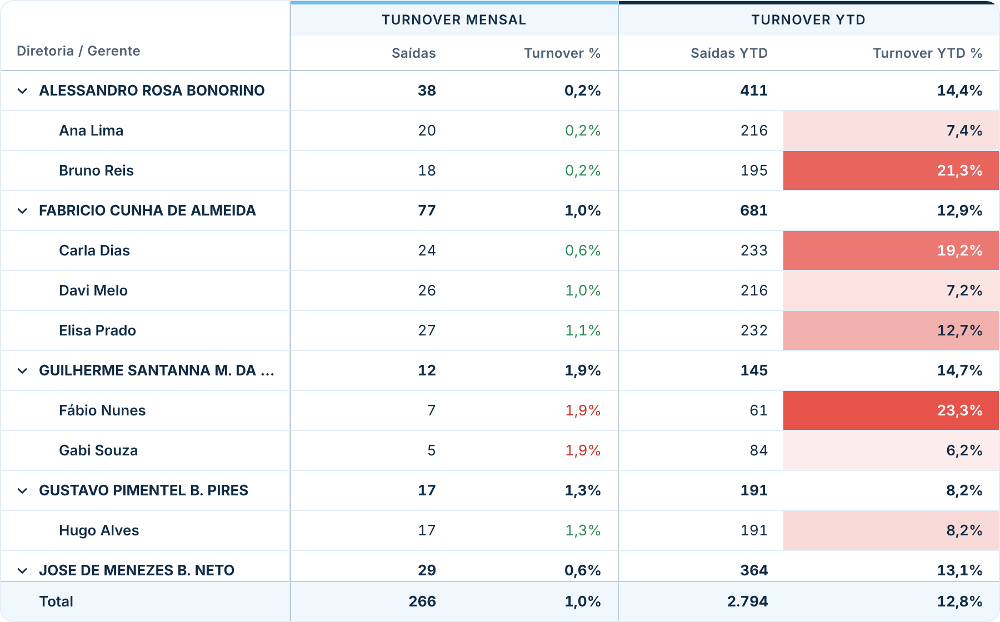
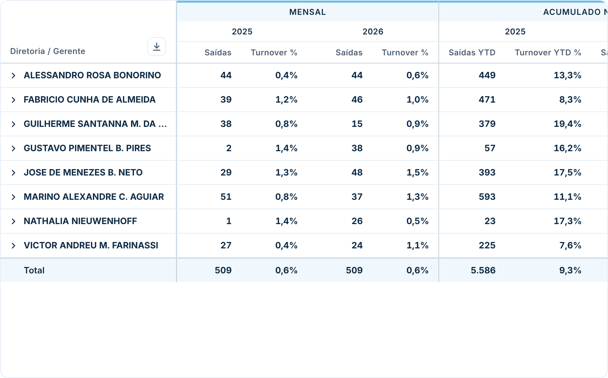

# Matriz Estilizada

Matriz para Power BI com o mesmo funcionamento da matriz nativa (linhas, colunas e valores), mas com visual mais limpo e **seções de colunas** configuráveis. Segue o padrão visual do repositório ([DESIGN.md](../../DESIGN.md)).

| Hierarquia expansível | Formatação condicional | Campos em colunas |
|---|---|---|
|  |  |  |

## Como usar

1. Baixe [`dist/matrizEstilizada14C18DB8D00543ABACD40F08AD778ABB.1.2.0.0.pbiviz`](dist/) e importe no Power BI (**Visualizações → `…` → Importar um visual de um arquivo**).
2. Arraste os campos:
   - **Linhas** — um ou mais campos. Com mais de um, vira hierarquia: clique na linha (ou na seta) para abrir e fechar.
   - **Colunas** (opcional) — como na matriz nativa (ex.: Ano).
   - **Seção 1 – valores**, **Seção 2 – valores**, … (até 8) — as medidas de cada seção ficam agrupadas sob um título comum.
   - **Medidas de apoio (ocultas)** (opcional) — medidas que não aparecem, mas podem ser a base da formatação condicional.
3. Em **Formatar visual → Seções**, dê um título e uma cor para cada seção.

### Exemplo (turnover)

| Espaço | Campos |
|---|---|
| Linhas | Diretoria, Gerente |
| Seção 1 – valores | Saídas, Turnover % |
| Seção 2 – valores | Saídas YTD, Turnover YTD % |
| Formatar → Seções | Seção 1 = "Turnover mensal", Seção 2 = "Turnover YTD" |

Para mudar o nome que aparece no cabeçalho de uma medida, use **Renomear para este visual** no campo, como em qualquer visual.

## Recursos

- **Hierarquia expansível:** clique na linha para abrir/fechar. Escolha quantos níveis já vêm abertos em **Linhas → Níveis abertos ao carregar**.
- **Seções de colunas:** título e cor da faixa de cada seção; divisória entre seções. Com campos em **Colunas**, a ordem do cabeçalho fica *seção › valor da coluna › medida*.
- **Subtotais e total geral** (calculados pelo próprio Power BI), com opção de desligar.
- **Parâmetros de campo:** funcionam normalmente em Linhas, Colunas ou nas seções — ao alternar o parâmetro, a matriz troca os campos/medidas.
- **Filtro cruzado:** clicar numa linha filtra os outros visuais (Ctrl + clique para várias), como na matriz nativa. Menu do botão direito e Ctrl+C / Ctrl+V.
- **Números** no formato de cada medida e no idioma do relatório.
- Cabeçalho e coluna de linhas fixos ao rolar.

## Exportar para Excel

O botão de download no canto superior esquerdo da tabela gera um arquivo **.xlsx** com a matriz como ela aparece:

- cabeçalhos das seções e das colunas (mesclados) e das medidas;
- hierarquia com recuo por nível, subtotais e total geral em negrito;
- **números de verdade** (não texto), com o formato de cada medida — dá para somar e filtrar no Excel;
- as cores da formatação condicional;
- cabeçalho e coluna de linhas congelados.

Em **Formatar visual → Exportar para Excel**: mostrar ou esconder o botão, nome do arquivo e se exporta **todos os níveis** ou só as linhas abertas na tela.

> O download usa o serviço oficial de downloads de visuais personalizados. No Power BI Service, o administrador precisa deixar ligada a opção **"Permitir downloads de visuais personalizados"** (Portal de administração → Configurações do locatário). Se estiver desligada, o visual avisa. O menu **… → Exportar dados** do próprio Power BI também continua disponível.

## Formatação condicional

Em **Formatar visual → Formatação condicional** há um grupo para cada medida exibida:

- **Cor de fundo (fx)** e **Cor da fonte (fx)** — o mesmo botão **fx** da matriz nativa: *Escala de cores*, *Regras* ou *Valor do campo*, **baseado em qualquer campo do modelo**, avaliado por célula (linha × coluna).
- **Formatação rápida** — alternativa embutida, sem abrir o fx:
  - **Escala de cores**: cor do menor e do maior valor;
  - **Regras**: até 3 condições (maior que, menor que, igual a…) com uma cor cada;
  - **Basear na medida**: a própria medida, outra medida da matriz ou uma *medida de apoio*;
  - **Aplicar em**: cor de fundo ou cor da fonte; opção de aplicar também a totais.
- Quando o fundo é colorido, o texto troca automaticamente para escuro ou branco, para continuar legível.

> Nas regras, porcentagens usam o valor decimal (15% = 0,15).

## Formatação geral

- **Tabela:** fonte, fundo, altura das linhas, linhas alternadas, cor ao passar o mouse, linhas de grade, arredondamento, borda.
- **Cabeçalho das seções:** mostrar, cores, tamanho, maiúsculas, espessura da faixa colorida.
- **Cabeçalho das colunas:** cores, tamanho, maiúsculas, largura mínima.
- **Linhas:** título, cores, tamanho, largura, recuo por nível, negrito nos níveis com filhos, níveis abertos ao carregar.
- **Valores:** cor, tamanho, texto para vazio.
- **Totais:** subtotais nas linhas e colunas, total geral, rótulo e cores.
- **Exportar para Excel:** botão, nome do arquivo, todos os níveis ou só os abertos.

## Observações

- O visual recebe até 30.000 linhas por vez e busca o restante automaticamente.
- Todos os níveis da hierarquia são carregados de uma vez; abrir e fechar linhas é instantâneo.
