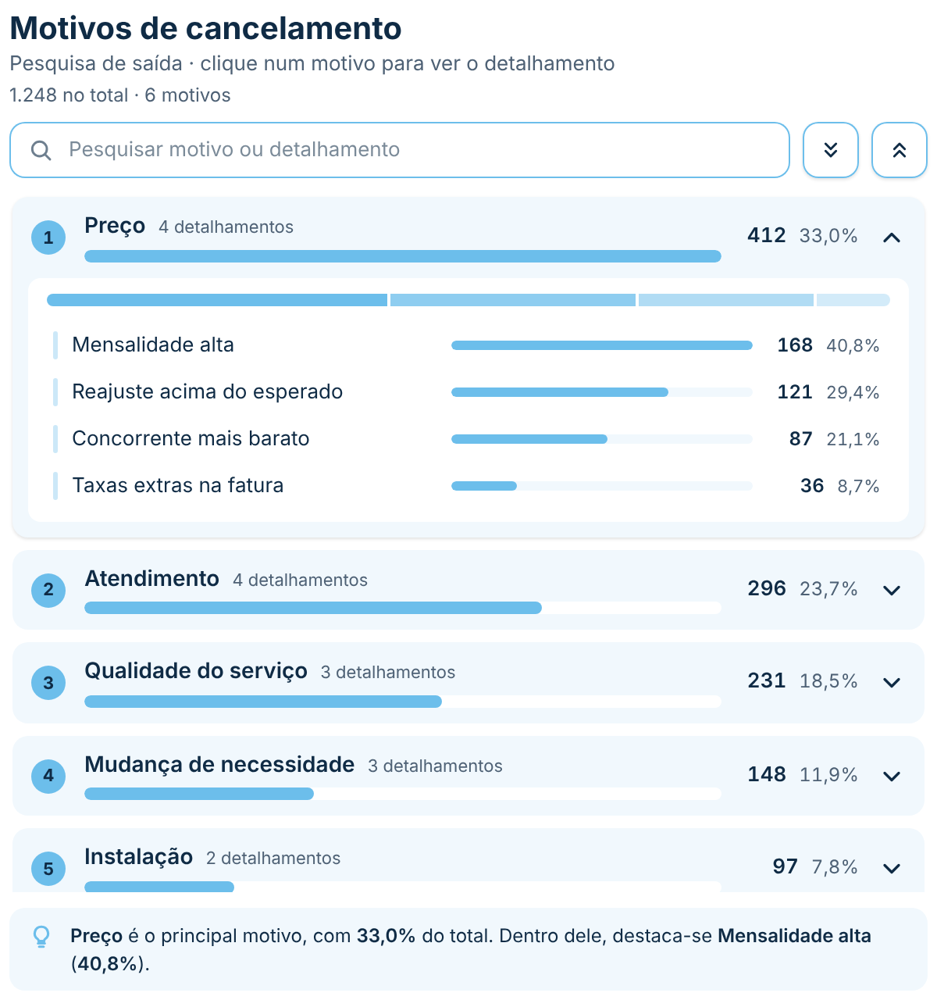
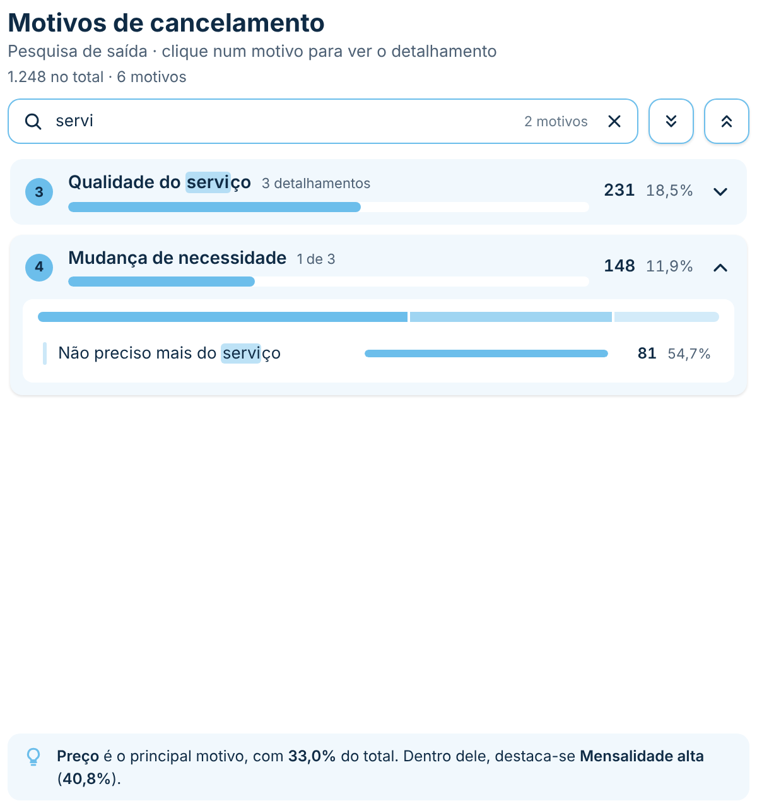
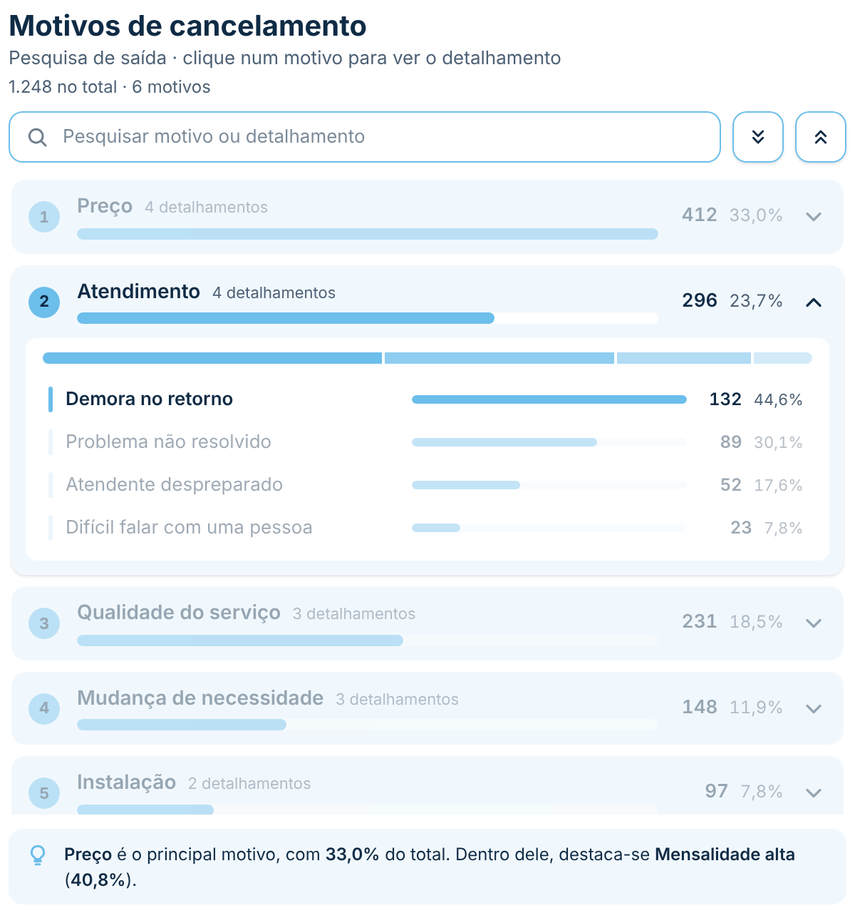
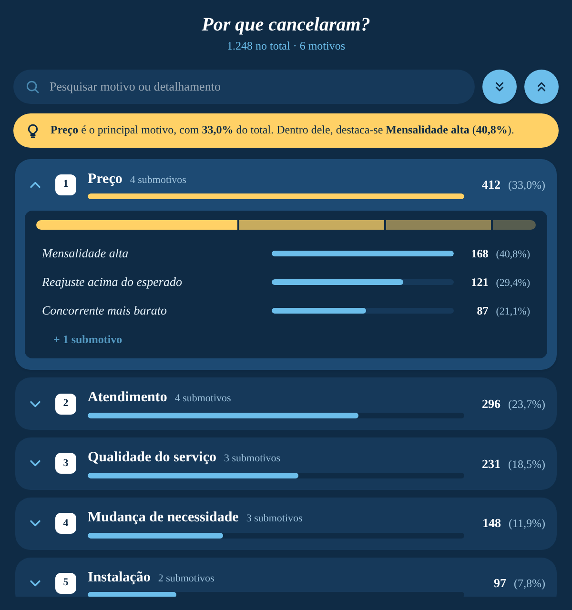

# Motivos Expansíveis

Ranking dos **motivos principais** de uma pesquisa (ou de qualquer par categoria › subcategoria) em que cada motivo **abre ao clicar** e mostra os **motivos de detalhamento** dele. Cada linha tem a posição, uma barra, o valor e o percentual do total; ao abrir, aparece uma **faixa de composição** (a fatia de cada detalhamento no motivo) e as barras dos detalhamentos crescem com animação. Tem **pesquisa** (sem diferenciar acentos), **filtro cruzado** e uma **frase de insight** automática. Segue o padrão visual do repositório ([DESIGN.md](../../DESIGN.md)).

| Padrão (primeiro motivo aberto) | Pesquisa | Filtro cruzado por detalhamento | Personalizado |
|---|---|---|---|
|  |  |  |  |

A última imagem é o mesmo visual só com opções do painel: fundo escuro, fonte Georgia, título centralizado em itálico, insight em cima, seta à esquerda, posição em quadrado, maior motivo em destaque, "submotivos" no lugar de "detalhamentos" e percentual entre parênteses.

## Como usar

1. Baixe [`dist/motivosExpansiveis5E8B4DD7DA854EB5ABE37E7ADD5E5227.1.1.0.0.pbiviz`](dist/) e importe no Power BI (**Visualizações → `…` → Importar um visual de um arquivo**).
2. Arraste os campos:
   - **Motivo principal**: a coluna do motivo (ex.: *Motivo do cancelamento*). Cada valor vira uma linha.
   - **Detalhamento**: a coluna do detalhamento do motivo (ex.: *Submotivo*). Aparece ao abrir o motivo. Opcional: sem ela, o visual vira um ranking simples.
   - **Valor**: a medida que dá o tamanho de cada item. Para contar respostas, arraste o ID da resposta e escolha **Contagem** (ou **Contagem (distinta)**), ou use uma medida como `Respostas = COUNTROWS(Pesquisa)`.
   - **Dicas de ferramenta** (opcional): medidas extras mostradas ao passar o mouse (ex.: nota média).

## Recursos

- **Abrir e fechar:** clique no motivo (ou na seta) para abrir o detalhamento, com animação. Botões **Abrir todos** e **Fechar todos** ao lado da pesquisa. Opção **Abrir um motivo por vez** (acordeão).
- **Ao carregar:** primeiro motivo aberto (padrão), todos fechados ou todos abertos.
- **Pesquisa:** procura nos motivos e nos detalhamentos, sem diferenciar maiúsculas e acentos (`servico` acha *Serviço*). O trecho encontrado fica marcado, os motivos achados pelo detalhamento abrem sozinhos e mostram só os detalhamentos que batem (`1 de 3`). `Esc` limpa a pesquisa.
- **Percentuais:** o motivo mostra o % do total; o detalhamento, o % **do motivo** (padrão) ou **do total**.
- **Faixa de composição:** barra 100% com a fatia de cada detalhamento. Passar o mouse numa fatia destaca a linha correspondente (e vice-versa).
- **Ver mais:** limite de detalhamentos por motivo (padrão 5) e de motivos na lista (padrão todos), com os botões **+ N detalhamentos** / **Ver mais N motivos**.
- **Insight** automático, embaixo da lista: *"Preço é o principal motivo, com 33,0% do total. Dentro dele, destaca-se Mensalidade alta (40,8%)."*. O texto é editável com os marcadores `{motivo}`, `{valor}`, `{percentual}`, `{detalhe}`, `{valorDetalhe}` e `{percentualDetalhe}` (este é sempre o % dentro do motivo). Se o motivo não tiver detalhamento, as frases que falam dele somem sozinhas. Clicar no insight abre o motivo citado.
- **Resumo** no cabeçalho: `1.248 no total · 6 motivos` (marcadores `{total}`, `{motivos}` e `{detalhamentos}`).
- **Filtro cruzado:**
  - abrir um motivo filtra os outros visuais por ele, e fechar tira o filtro (ou escolha **Só abrir e fechar** em *Interação → Clique no motivo*);
  - clicar num detalhamento filtra por motivo + detalhamento;
  - Ctrl + clique soma itens à seleção; o que não está selecionado fica esmaecido; clique no vazio limpa.
  - Menu do botão direito e Ctrl+C / Ctrl+V do Power BI.
- **Teclado:** `↑`/`↓` navegam, `→` abre (ou entra no detalhamento), `←` fecha (ou volta ao motivo), `Enter`/`Espaço` clicam, `Home`/`End`. Da pesquisa, `↓` vai para a lista.
- **Visual estreito** (menos de 380 px): o contador some e a barra do detalhamento vai para baixo do nome, para o texto não ser cortado.
- **Alto contraste** do Windows e lugares sem interação (como painéis/dashboards) são respeitados.
- **Números** no formato da medida e no idioma do relatório.

## Formatação

São mais de 160 opções, organizadas em grupos como nos visuais nativos. Todo texto tem o controle de fonte completo do Power BI (**fonte, tamanho, negrito, itálico e sublinhado**) e cor própria. Os textos que ficam com a fonte padrão usam a **fonte base** do cartão Geral, então dá para trocar a fonte de tudo num lugar só e ainda mudar um texto específico.

- **Geral:** fonte base, cor de fundo do visual e margem interna.
- **Cabeçalho:**
  - *Título*, *Subtítulo* e *Resumo*: texto, fonte e cor (o resumo liga e desliga e aceita `{total}`, `{motivos}` e `{detalhamentos}`);
  - *Layout*: alinhamento (esquerda, centro, direita) e espaço abaixo.
- **Pesquisa e botões:**
  - *Pesquisa* (liga e desliga): texto da caixa, fonte, cor do texto e da lupa, fundo, altura, arredondamento, borda, cor do destaque do texto achado e mensagem quando não acha nada (`{pesquisa}`);
  - *Botões abrir/fechar tudo* (liga e desliga): fundo, cor do ícone, arredondamento, borda e sombra.
- **Interação:** clique no motivo (abrir e filtrar ou só abrir), abrir um por vez, estado ao carregar, animação e duração (ms), opacidade do que não está selecionado.
- **Ordenação:** valor, nome (A–Z) ou ordem do Power BI, e direção.
- **Motivos:**
  - *Texto*: fonte, cor e quebrar texto longo (em vez de reticências);
  - *Cartão*: fundo, fundo quando aberto, arredondamento, espaço entre motivos, espaçamento lateral e vertical, borda, sombra quando aberto e motivos visíveis;
  - *Posição*: forma (círculo, quadrado arredondado ou só o número), cores e tamanho;
  - *Nº de detalhamentos*: tamanho, cor e as palavras no singular e no plural (ex.: *submotivo / submotivos*);
  - *Seta*: cor, tamanho e posição (direita ou esquerda).
- **Barras dos motivos:** mostrar, cor, destacar o maior motivo com outra cor, trilho, espessura, arredondamento e escala.
- **Detalhamentos:**
  - *Texto*: fonte, cor e quebrar texto longo;
  - *Área*: fundo, arredondamento, altura mínima da linha e cor ao passar o mouse;
  - *Barras* (liga e desliga): cor, trilho, espessura e arredondamento;
  - *Linha guia* (liga e desliga): cor;
  - *Faixa de composição* (liga e desliga): cor e altura;
  - *Conteúdo*: percentual do motivo ou do total, detalhamentos visíveis, detalhamentos em branco e cor do botão "Ver mais".
- **Valores:**
  - *Valor* (liga e desliga): fonte e cor dos motivos, tamanho e cor nos detalhamentos, unidades de exibição (nenhuma, automática, mil, milhões, bilhões) e casas decimais;
  - *Percentual* (liga e desliga): estilo (`33,0%`, `(33,0%)` ou `· 33,0%`), casas decimais, fonte e cor dos motivos, tamanho e cor nos detalhamentos.
- **Insight** (liga e desliga):
  - *Texto*: modelo com marcadores, fonte, cor, marcadores em negrito e cor dos marcadores;
  - *Caixa*: posição (embaixo ou em cima da lista), fundo, arredondamento, borda, ícone e cor do ícone.

## Observações

- O valor de cada motivo e o total vêm do próprio Power BI (subtotais da consulta), então medidas não somáveis, como **Contagem (distinta)** ou médias, ficam corretas.
- Detalhamentos em branco ficam escondidos por padrão; um motivo sem detalhamento não abre (o clique só filtra).
- Até 30 mil combinações de motivo e detalhamento.
