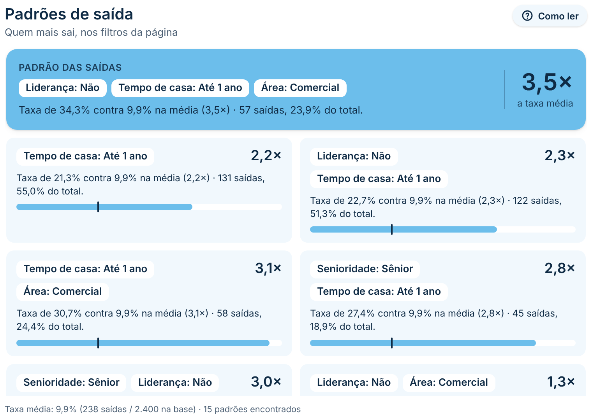
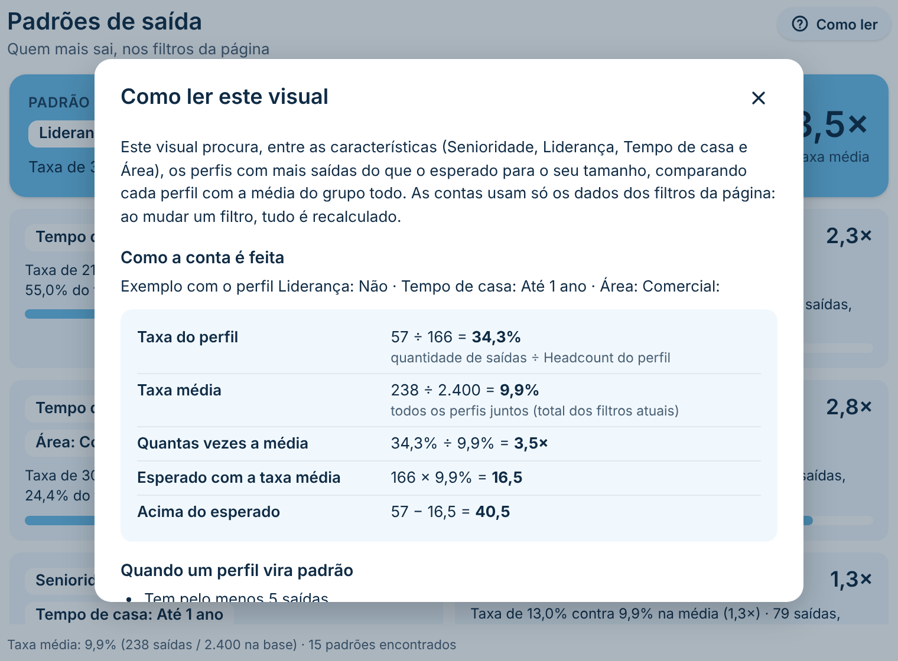
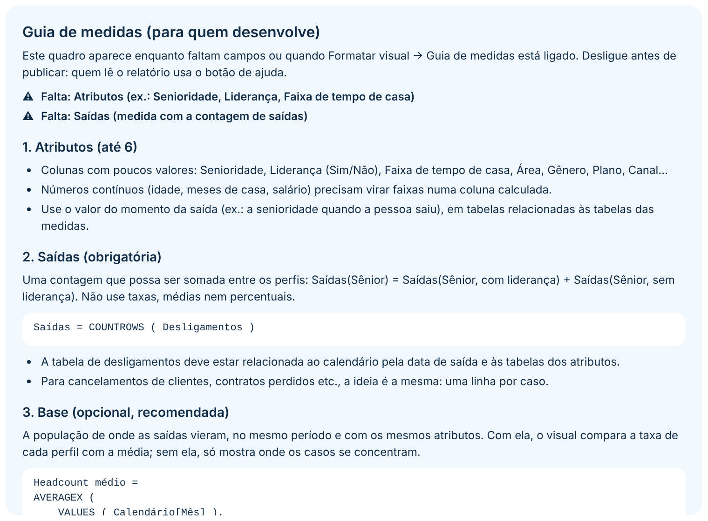
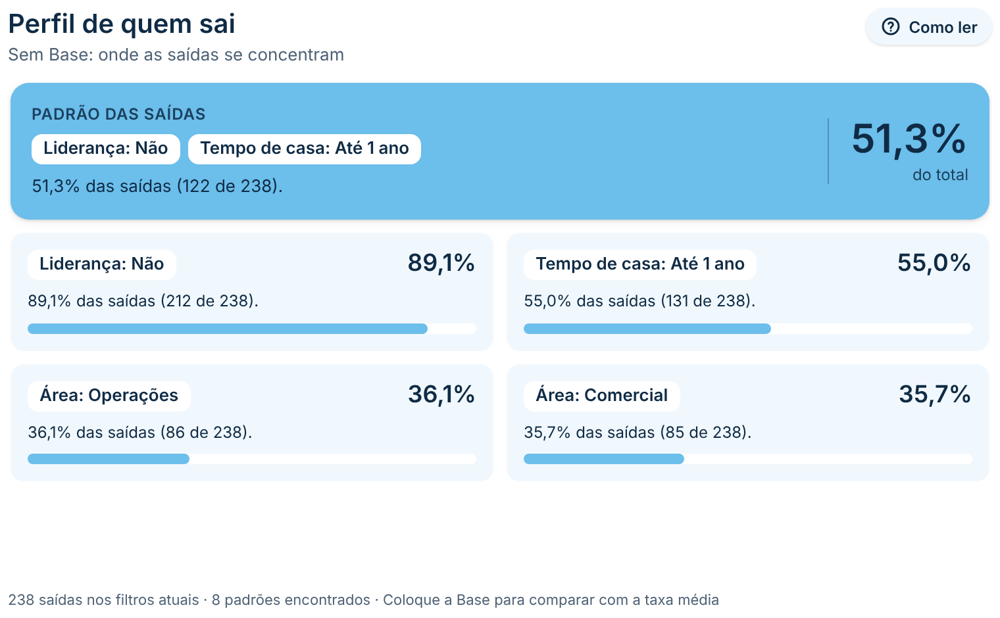
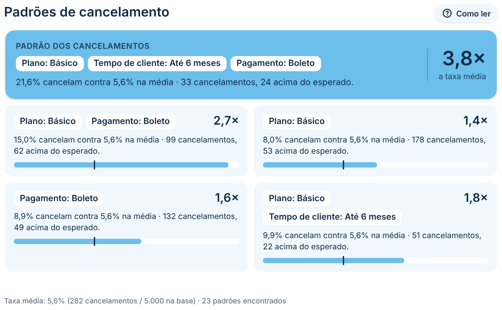
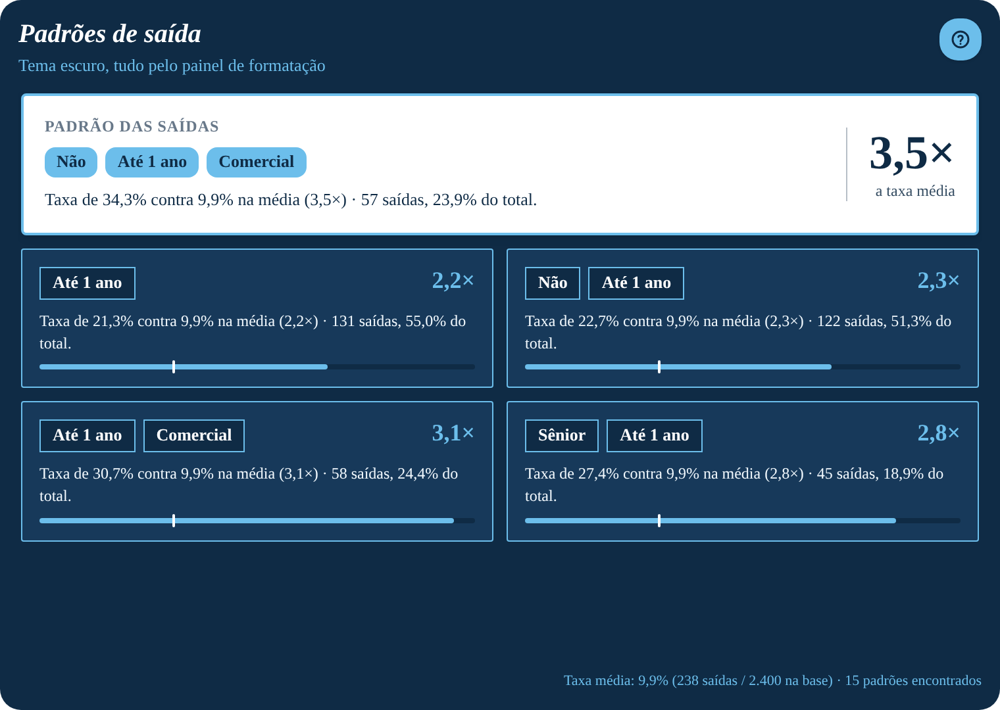

# Padrões de Saída

Visual de **destaques e insights de turnover** que responde à pergunta *"quem está saindo?"*. Você coloca as características (senioridade, liderança, faixa de tempo de casa, área…) e a medida de saídas. O visual procura sozinho as **combinações desses atributos** que explicam as saídas e mostra:

- um **destaque** com a regra principal, como *Liderança: Não · Tempo de casa: Até 1 ano · Área: Comercial, com taxa 3,5× a média*;
- uma **lista de padrões** com uma frase pronta, um número em destaque e uma barra comparada à média.

Tudo é recalculado com os **filtros da página** (ano, empresa, gestor etc.). Serve para qualquer tipo de saída: desligamentos, cancelamentos de clientes, perda de contratos, evasão de alunos… Segue o padrão visual do repositório ([DESIGN.md](../../DESIGN.md)).

| Com Base: taxa contra a média | Pop-up de ajuda (Como ler) | Guia de medidas (quem desenvolve) |
|---|---|---|
|  |  |  |

| Sem Base: concentração | Outro uso: cancelamento de clientes | Tudo personalizável (tema escuro) |
|---|---|---|
|  |  |  |

## Como usar

1. Baixe [`dist/padroesSaidaA60F1C0244064A00B5604B4C1557A0AE.1.1.0.0.pbiviz`](dist/) e importe no Power BI (**Visualizações → `…` → Importar um visual de um arquivo**).
2. Arraste os campos:
   - **Atributos** (até 6): as características a investigar (ex.: *Senioridade*, *Liderança (Sim/Não)*, *Faixa de tempo de casa*, *Área*). Para números contínuos, como tempo de casa em meses, use uma coluna de **faixas**.
   - **Saídas**: medida com a **contagem** de saídas (ex.: `Desligados = COUNTROWS(Desligamentos)`).
   - **Base** (opcional, recomendado): medida com a população de comparação (ex.: headcount médio, clientes ativos). Também precisa ser uma **contagem**.

> As duas medidas são **somadas** entre as combinações de atributos, então precisam ser contagens (ou somas), não taxas nem médias já calculadas. A medida de Base deve dar valor também nas combinações sem saídas (ex.: headcount, e não "headcount de quem saiu").

### Guia de medidas (para quem desenvolve)

Enquanto faltam campos, o próprio visual mostra um **guia de medidas** com o que colocar em cada campo e exemplos de DAX (contagem de desligamentos, headcount médio por mês, clientes ativos). Para vê-lo a qualquer momento, ligue **Formatar visual → Guia de medidas → Mostrar guia de medidas no visual** (e desligue antes de publicar).

O guia também **confere os dados atuais** e aponta problemas comuns:

- Saídas com casas decimais (provavelmente uma taxa ou média, não uma contagem);
- combinações com saídas e Base vazia ou zero (a Base não inclui quem saiu, ou falta relacionamento);
- taxa média acima de 100% (Base e Saídas de períodos diferentes);
- valores negativos, atributos com valores demais (use faixas) e o limite de 30 mil combinações.

Quando há algum problema, aparece no rodapé, **só no modo de edição**, o aviso *"⚠ N aviso(s) sobre as medidas"*. Clicar nele abre o guia (e o botão *Fechar guia* volta ao visual). Quem lê o relatório publicado não vê esse aviso.

## Como os padrões são encontrados

**Com Base (taxa comparada à média).** Para cada valor de atributo e cada combinação de até 3 atributos, o visual calcula a taxa de saída (*saídas ÷ base*) e compara com a taxa média de todo o filtro. Um perfil vira padrão quando:

- tem pelo menos **5 saídas** (configurável);
- a taxa é pelo menos **1,2× a média** (configurável);
- a diferença é **estatisticamente significativa** (teste z unilateral; 90% por padrão, ou 95%, 99% ou sem teste);
- no caso de combinações, a taxa precisa ser pelo menos 5% maior que a de cada parte isolada. Assim *Sênior + Até 1 ano* só aparece se juntar os dois atributos disser mais que cada um sozinho.

A lista é ordenada pelas **saídas acima do esperado** (quantas saídas a mais o perfil teve do que teria com a taxa média). Esse critério equilibra perfis grandes com taxa pouco acima da média e perfis pequenos com taxa muito alta. Também dá para ordenar por *quantas vezes a média* ou pelo *número de saídas*.

**Sem Base (concentração).** Sem a população, não dá para saber se um grupo sai *mais que o normal*, só que ele **concentra** as saídas. O visual mostra os perfis com pelo menos 20% das saídas e só combina atributos quando a maior parte das saídas do grupo (50%, configurável) também tem o novo atributo. Atenção: um grupo grande concentra muitas saídas mesmo saindo na média (ex.: *Liderança: Não* com 89% das saídas pode ser apenas porque 85% do quadro não tem liderança). Por isso a **Base é recomendada**.

**O destaque (a regra).** O perfil é montado atributo a atributo: começa pelo valor que mais explica as saídas (o maior excesso de saídas, ou a maior concentração sem Base) e, dentro dele, acrescenta o próximo atributo enquanto a regra continua relevante. O resultado é uma regra como *Sem liderança · Até 1 ano · Comercial*. Se preferir, o destaque pode mostrar só o padrão mais forte da lista.

## Botão de ajuda ("Como ler")

Um botão (por padrão ao lado do título, ou no rodapé) abre um **pop-up** que explica, para quem lê o relatório:

- **o que o visual mostra**, com os atributos e a Base usados;
- **como a conta é feita, passo a passo, com os números atuais** do perfil em destaque. Exemplo: taxa do perfil `57 ÷ 166 = 34,3%`, taxa média `238 ÷ 2.400 = 9,9%`, `34,3% ÷ 9,9% = 3,5×`, esperado `166 × 9,9% = 16,5`, acima do esperado `57 − 16,5 = 40,5`;
- **quando um perfil vira padrão**, com as regras configuradas (mínimo de saídas, quanto acima da média, confiança);
- **o que significa cada número** (taxa de saída, taxa média, × a média, acima do esperado, % do total, % da base, confiança estatística, barra);
- **cuidados na leitura** (associação não é causa etc.);
- uma **seção extra** com texto livre (ex.: fonte dos dados, contato do time).

O pop-up tem **largura e altura editáveis** (Formatar visual → Pop-up de ajuda → Tamanho). Ele abre dentro da área do visual: se ela for menor que o tamanho escolhido, o pop-up encolhe para caber, então para um pop-up maior aumente o visual. Fecha no X, clicando fora ou com Esc. Cada seção pode ser ligada ou desligada.

## Recursos

- **Textos editáveis** (**Formatar visual → Textos**), com marcadores:
  - `{padrao}` (as condições), `{saidas}`, `{total}`, `{pct}` (% das saídas);
  - com Base: `{base}`, `{pctBase}` (% da base), `{taxa}`, `{media}`, `{lift}` (ex.: 2,4×) e `{excesso}` (saídas acima do esperado);
  - exemplo para clientes: `{taxa} cancelam contra {media} na média · {saidas} cancelamentos, {excesso} acima do esperado.`
  - **Termo para as saídas** (ex.: *cancelamentos*), usado no rodapé.
- **Rodapé** com a taxa média de referência e quantos padrões foram encontrados.
- **Filtro cruzado:** clique num padrão para filtrar os outros visuais exatamente por aquele perfil (ex.: Liderança = Não **e** Tempo de casa = Até 1 ano). Ctrl + clique seleciona vários. O que não está selecionado fica esmaecido. Menu do botão direito e Ctrl+C / Ctrl+V.
- **Dicas de ferramenta** com saídas, % do total, base, % da base, taxa, taxa média, quantas vezes a média e saídas acima do esperado.
- **Números** no formato das medidas e no idioma do relatório.

## Formatação

Todo texto tem **fonte completa** (família, tamanho, negrito, itálico e sublinhado) e cor própria. Todo bloco tem **fundo, borda (espessura e cor), arredondamento, espaçamento interno e sombra**. A *Fonte base* do cartão Geral vale para todos os textos que estão na fonte padrão; trocar a fonte de uma parte só muda aquela parte.

- **Geral:** fonte base; fundo do visual (cor e transparência), borda e arredondamento; espaçamento interno e entre os blocos.
- **Cabeçalho:** título e subtítulo (texto, fonte e cor); alinhamento, fundo e espaçamento.
- **Análise:** comparar por (automático, taxa ou concentração), máximo de atributos por padrão (1 a 4), mínimo de saídas, quanto acima da média, confiança estatística, % mínima das saídas e predominância (sem Base), ordenação e ignorar valores em branco.
- **Destaque:** mostrar e conteúdo (perfil ou padrão mais forte); cartão (fundo, borda, arredondamento, espaçamento, sombra); rótulo (texto, fonte, cor, maiúsculas); frase (fonte e cor); número em destaque (fonte, cor, legendas com e sem Base, fonte e cor da legenda, linha divisória e sua cor).
- **Padrões:** mostrar, quantidade, largura mínima do cartão, espaço entre os cartões e opacidade do que não está selecionado; cartão (fundo, borda, arredondamento, espaçamento, sombra); frase (fonte e cor); número (mostrar, fonte e cor); barra (mostrar, cor, trilho, marca da média, espessura e arredondamento).
- **Etiquetas dos atributos:** mostrar o nome do atributo e o separador; estilos separados **no destaque** e **nos padrões** (fonte, cor, fundo, borda, arredondamento e espaçamentos).
- **Textos:** frases com e sem Base (com marcadores) e termo para as saídas.
- **Rodapé:** mostrar, fonte, cor e alinhamento.
- **Botão de ajuda:** mostrar, texto (em branco = só o ícone), ícone, posição (automática, em cima ou embaixo) e lado; fonte, cor, fundo, borda, arredondamento, altura e sombra.
- **Pop-up de ajuda:** largura e altura; título, seções exibidas e texto extra; janela (fundo, borda, arredondamento, espaçamento, sombra), fundo atrás (cor e opacidade), cor dos quadros e do botão fechar; fonte e cor do título, dos títulos das seções e do texto.
- **Guia de medidas:** mostrar no visual, avisos na edição; quadro (fundo, borda, arredondamento, espaçamento, sombra); fonte, cor do texto, fundo dos exemplos de DAX e cor dos avisos.

## Observações

- Até 6 atributos e 30 mil combinações de valores. Se passar disso, o rodapé avisa. Prefira atributos com poucos valores (faixas em vez de valores contínuos).
- A taxa média é a do filtro atual: os padrões dizem quem sai mais **em relação ao restante do mesmo recorte**.
- Com taxas acima de 100% (ex.: saídas do ano ÷ headcount de um mês), o teste estatístico usa a aproximação de Poisson.
- Padrões estatísticos mostram associação, não causa. Use os perfis como ponto de partida para investigar.
