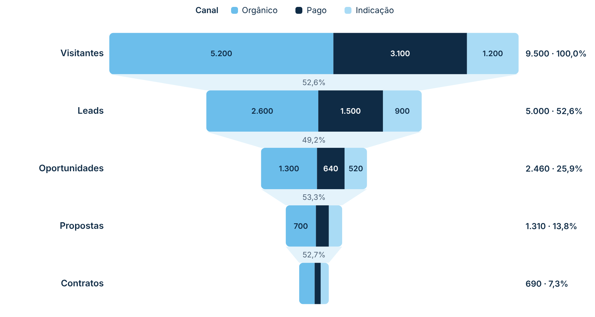
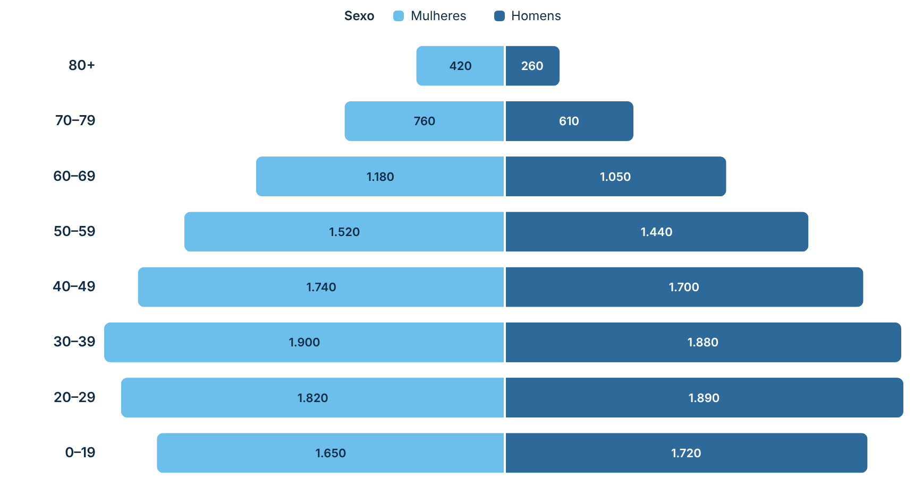
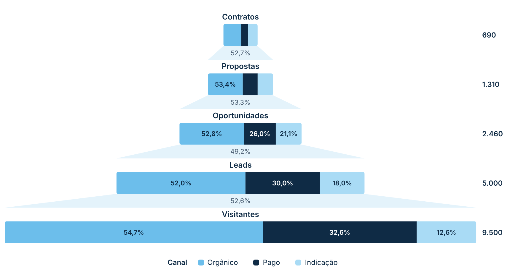

# Pirâmide Segmentada

Gráfico de funil/pirâmide como o nativo do Power BI, com um campo de **Legenda** que divide cada barra em **segmentos coloridos**. Também tem o modo **pirâmide espelhada** (pirâmide etária), com o 1º item da legenda à esquerda e os demais à direita. Segue o padrão visual do repositório ([DESIGN.md](../../DESIGN.md)).

| Funil segmentado | Pirâmide espelhada | Pirâmide (maior embaixo) |
|---|---|---|
|  |  |  |

## Como usar

1. Baixe [`dist/piramideSegmentadaBE8E71986FB04C009D1469C42B38D203.1.0.0.0.pbiviz`](dist/) e importe no Power BI (**Visualizações → `…` → Importar um visual de um arquivo**).
2. Arraste os campos:
   - **Categoria**: cada valor vira uma barra (ex.: Etapa do funil, Faixa etária).
   - **Legenda** (opcional): divide cada barra em segmentos (ex.: Canal, Sexo).
   - **Valores**: a medida que define o tamanho das barras.
   - **Dicas de ferramenta** (opcional): medidas extras mostradas ao passar o mouse.
3. Em **Formatar visual → Barras**, escolha a ordem:
   - **Maior em cima (funil)**, que é o padrão;
   - **Maior embaixo (pirâmide)**;
   - **Ordem do Power BI**, que respeita a classificação do campo.

### Pirâmide etária

Coloque *Faixa etária* em Categoria, *Sexo* em Legenda e a contagem em Valores. Depois:

- ligue **Barras → Pirâmide espelhada**;
- use **Ordem do Power BI**, classificando a faixa etária como quiser.

## Recursos

- **Segmentos por legenda:** cada barra é dividida na proporção de cada item da legenda, com cores configuráveis em **Cores da legenda**.
- **Conectores** entre as barras com a **taxa de conversão** (% de uma etapa para a seguinte). Na pirâmide, a taxa é calculada de baixo para cima.
- **Rótulos dentro dos segmentos:** valor, % da barra ou os dois. O texto troca sozinho para escuro ou branco conforme o fundo, e o rótulo some quando não cabe no segmento.
- **Rótulo do total** à direita da barra:
  - só o total;
  - total e % do primeiro;
  - total e % do anterior.
- **Dica de ferramenta** mostra:
  - categoria, legenda e valor;
  - % da barra, total da barra e % do total geral;
  - as medidas extras.
- **Filtro cruzado:**
  - clique num segmento para filtrar os outros visuais;
  - clique num item da legenda para filtrar por ele;
  - use Ctrl + clique para selecionar vários;
  - o que não está selecionado fica esmaecido.
- Menu do botão direito e Ctrl+C / Ctrl+V.
- **Números** no formato da medida e no idioma do relatório.

## Formatação

- **Geral:** fonte.
- **Barras:**
  - ordem e pirâmide espelhada;
  - espaço entre barras, arredondamento e largura mínima;
  - espessura e cor da borda;
  - opacidade do que não está selecionado.
- **Cores da legenda:** uma cor para cada item. Sem legenda, uma cor para a medida.
- **Conectores:** mostrar, cor, opacidade, taxa de conversão (tamanho e cor).
- **Rótulos das categorias:** mostrar, à esquerda ou acima da barra, tamanho, cor, largura e negrito.
- **Rótulos de dados:**
  - tipo de rótulo dos segmentos e do total;
  - tamanho e cor de cada um;
  - cor automática pelo fundo.
- **Legenda:** mostrar, em cima ou embaixo, título (nome do campo), tamanho e cor.

## Observações

- Até 60 categorias e 30 itens de legenda.
- Valores negativos são tratados como zero.
