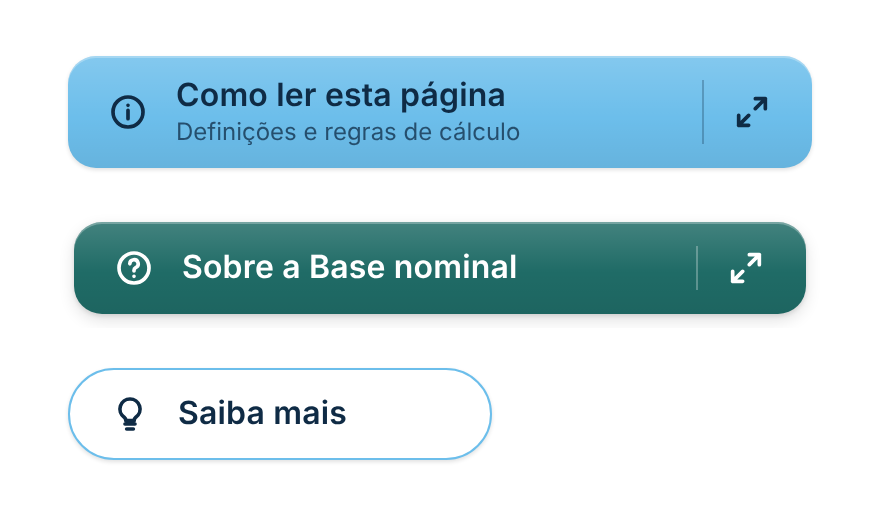
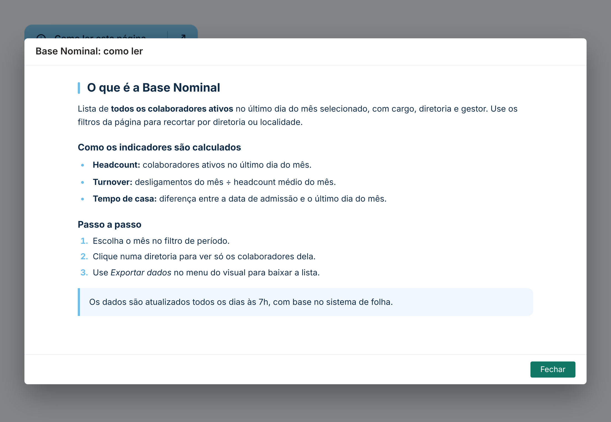
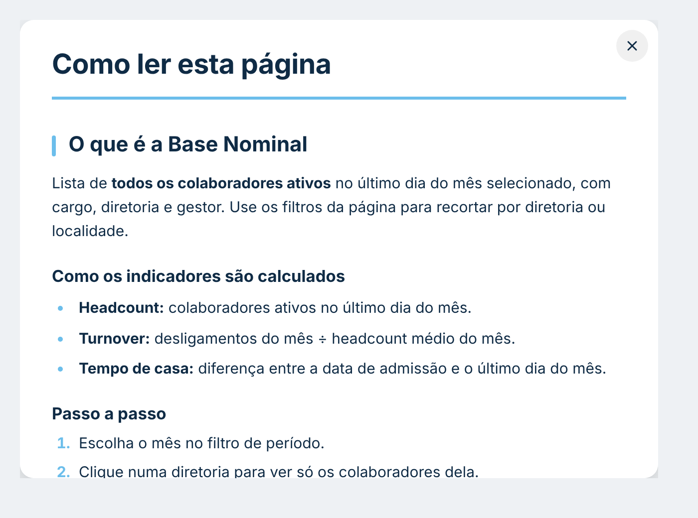

# Pop-up Explicativo

Botão (mesmo desenho caprichado do [Botão de Navegação](../botao-navegacao/)) que abre um **pop-up grande, até a tela inteira**, com um **texto explicativo**: como ler a página, regras de cálculo, glossário, avisos. O texto aceita títulos, listas, destaques, **negrito** e *itálico*. Segue o padrão visual do repositório ([DESIGN.md](../../DESIGN.md)).

| Botões | Pop-up aberto | Dentro do visual (sem diálogo) |
|---|---|---|
|  |  |  |

## Como usar

1. Baixe [`dist/popupExplicativoF66C2BC2624544D4B1648167E0490F4F.1.0.0.0.pbiviz`](dist/) e importe no Power BI (**Visualizações → `…` → Importar um visual de um arquivo**).
2. Em **Formatar visual → Texto do botão**, escreva o texto do botão.
3. Em **Formatar visual → Pop-up → Texto**, escreva a explicação (ou use a medida **Texto do pop-up**, abaixo).
4. Clique no botão. No Power BI Desktop e na edição do relatório, como nos botões nativos, use **Ctrl + clique**. Na leitura basta clicar.

O pop-up abre por cima do relatório inteiro (diálogo do próprio Power BI, com título e botão **Fechar**). Ele não depende do tamanho do visual: o visual pode ser só o botão.

## Como escrever o texto

| Escreva | Vira |
|---|---|
| `# Título` | título com barrinha colorida |
| `## Subtítulo` | subtítulo |
| `- item` (ou `*`, `•`) | lista com marcadores |
| `1. item` | lista numerada |
| `> texto` | caixa de destaque (aviso, observação) |
| `---` | linha divisória |
| `**texto**` / `*texto*` | **negrito** / *itálico* |
| linha em branco | novo parágrafo |

Se a caixa do painel não aceitar Enter, digite `\n` onde quiser quebrar a linha.

### Texto por medida (recomendado para textos longos)

Arraste uma medida para **Texto do pop-up**. Ela tem prioridade sobre o painel e pode mudar com os filtros:

```DAX
Texto Ajuda =
VAR QL = UNICHAR ( 10 )
RETURN
    "# O que é a Base Nominal" & QL
        & "Lista de **todos os colaboradores ativos** no último dia do mês." & QL & QL
        & "## Como é calculado" & QL
        & "- **Headcount:** ativos no último dia do mês." & QL
        & "- **Turnover:** desligamentos ÷ headcount médio." & QL
        & "> Atualizado em " & FORMAT ( MAX ( 'Atualização'[Data] ), "dd/mm/yyyy" )
```

Também há **Título do pop-up**, **Texto do botão** e **Subtítulo do botão** como medidas opcionais.

## Formatação

- **Botão, Texto do botão, Ícone à esquerda, Ícone à direita, Efeitos:** os mesmos do Botão de Navegação (cores, degradê, sombra, arredondamento, borda, ícones, hover, brilho, clique com onda). Ícones novos: informação, ajuda, livro e lâmpada. Ícone à direita padrão: expandir ⤢.
- **Pop-up:**
  - título (em branco = texto do botão) e texto;
  - tamanho: tela inteira, grande, médio ou personalizado (largura e altura);
  - cor de fundo, do texto, de destaque (títulos, marcadores, barras) e do fundo dos destaques;
  - tamanho da fonte, alinhamento (à esquerda ou justificado);
  - largura máxima do texto (padrão 820 px, centralizado: linhas longas demais cansam a leitura).

## Observações

- O tamanho pedido é limitado pelo Power BI ao espaço da janela. "Tela inteira" pede ~92% da tela.
- Onde o Power BI não oferece diálogos (ex.: **Publicar na Web** e alguns ambientes inseridos), o texto abre por cima do próprio visual, com um **X** para fechar (e `Esc`). Nesse caso, deixe o visual do tamanho que o texto deve ocupar.
- O texto nunca é interpretado como HTML: só a marcação da tabela acima.
