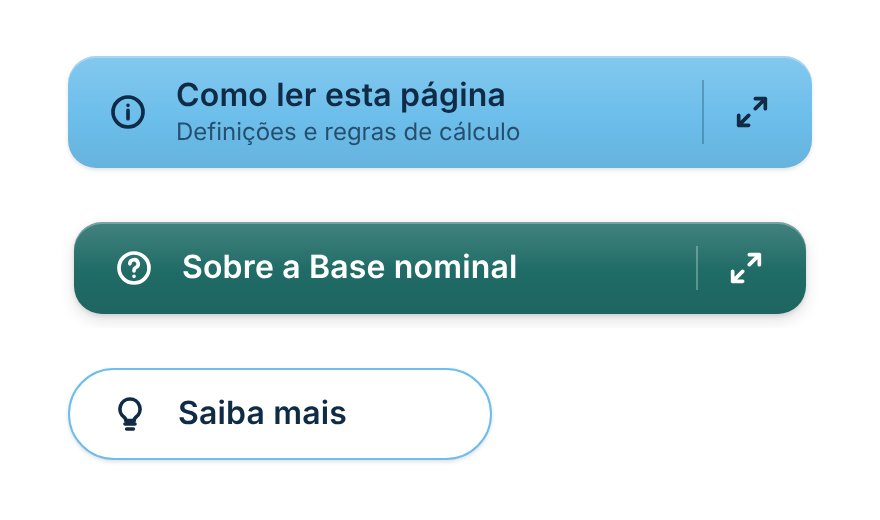
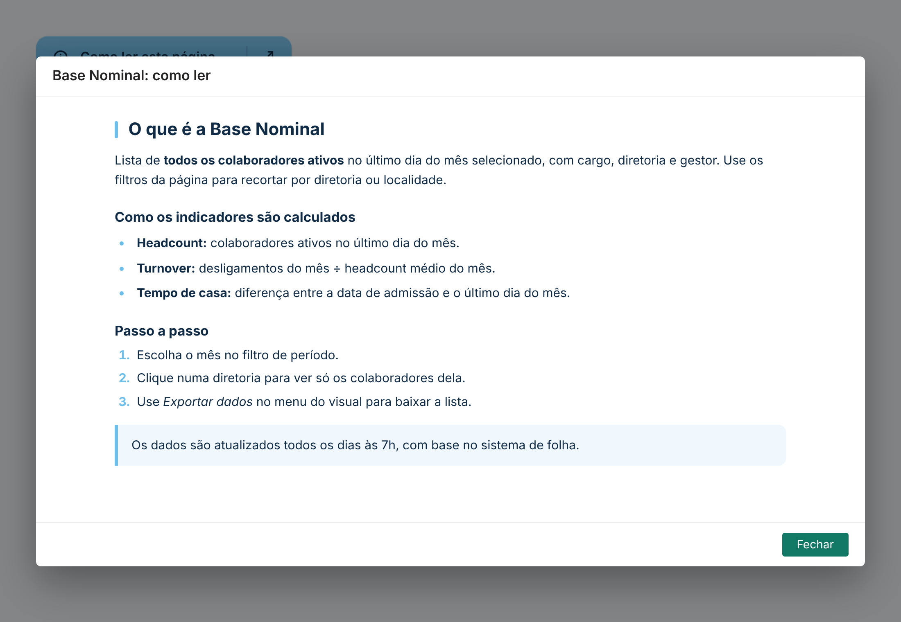
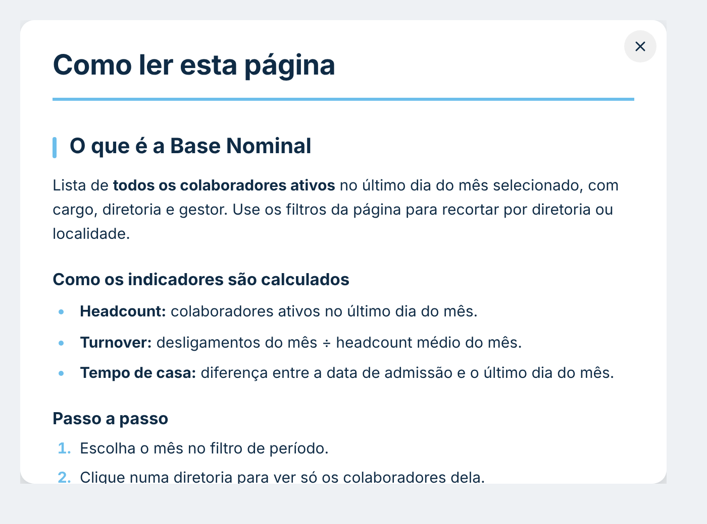
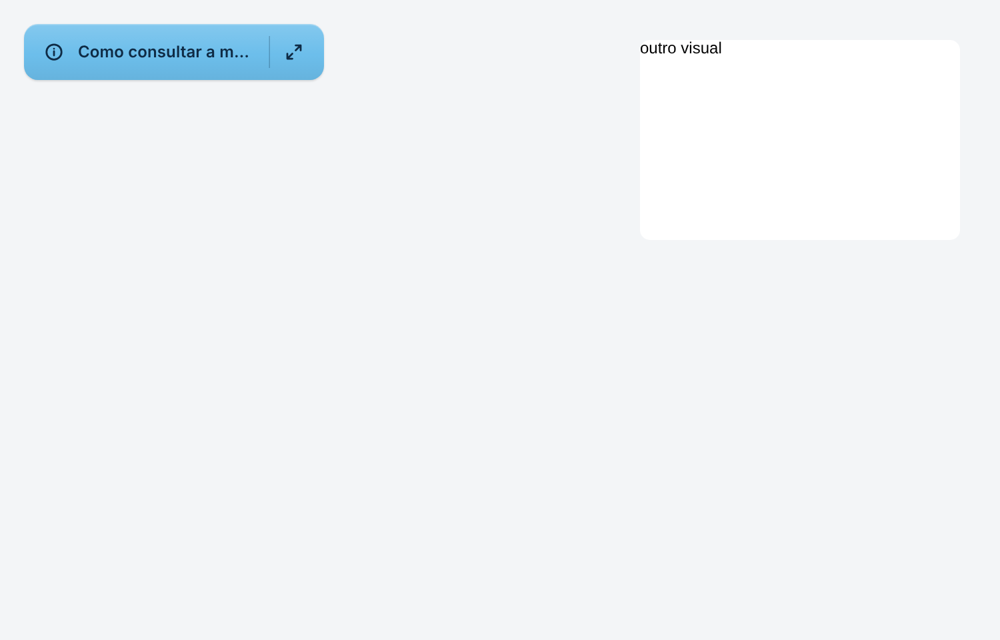
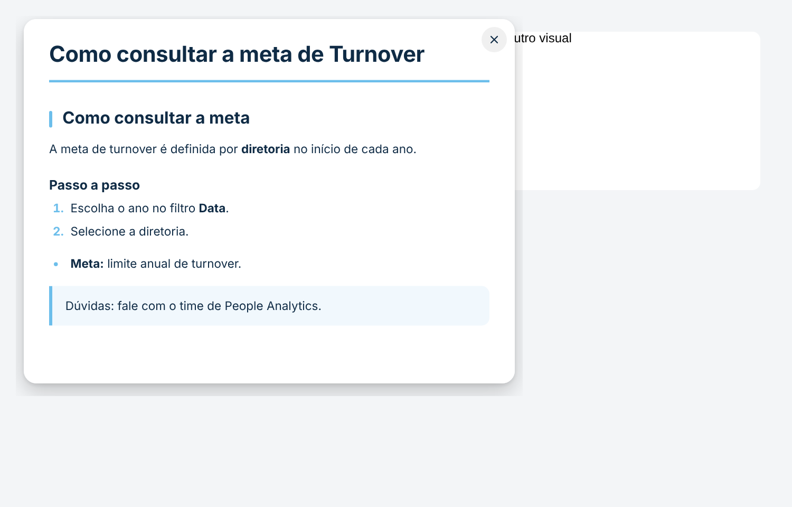
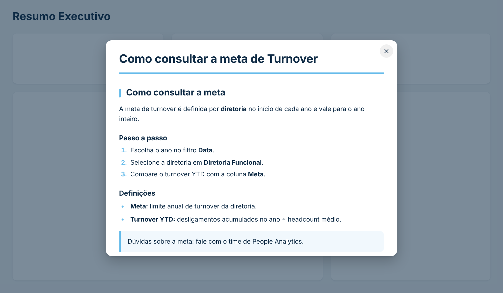

# Pop-up Explicativo

Botão (mesmo desenho caprichado do [Botão de Navegação](../botao-navegacao/)) que abre um **texto explicativo na área inteira do relatório**, com um **texto explicativo**: como ler a página, regras de cálculo, glossário, avisos. O texto aceita Markdown: títulos, listas aninhadas, tabelas, avisos, código, links, **negrito**, *itálico* e mais. Segue o padrão visual do repositório ([DESIGN.md](../../DESIGN.md)).

| Botões | Pop-up aberto | Dentro do visual (sem diálogo) |
|---|---|---|
|  |  |  |

## Como usar (recomendado): o botão se expande dentro do visual

Padrão desde a versão 2.1 (**Formatar visual → Pop-up → Abrir em → Dentro do visual**). Funciona como o Filtro em Pop-up: o visual é grande, o botão fica num canto e, ao clicar, a explicação ocupa o visual inteiro, **na hora**.

| Fechado | Aberto |
|---|---|
|  |  |

1. Baixe [`dist/popupExplicativoF66C2BC2624544D4B1648167E0490F4F.2.3.0.0.pbiviz`](dist/) e importe no Power BI (**Visualizações → `…` → Importar um visual de um arquivo**).
2. Deixe o visual **do tamanho que o pop-up deve ter** (ex.: a área central da página).
3. Em **Formatar visual → Geral → Efeitos**, desligue o **Plano de fundo** (e a borda e a sombra do contêiner), para a área fora do botão ficar transparente.
4. Em **Formatar visual → Botão**, ajuste **Largura do botão**, **Altura** e onde ele fica:
   - **Posição do botão:** em cima, no meio ou embaixo, cada um à esquerda, no centro ou à direita (9 posições);
   - **Deslocamento horizontal** e **vertical** (px): afastam o botão da borda escolhida, para o ajuste fino. Na posição central, valores positivos vão para a direita e para baixo, e negativos para a esquerda e para cima. O botão nunca sai do visual.
5. Escreva o texto em **Pop-up → Texto** (ou use a medida **Texto do pop-up**).

Para fechar: **X**, **Esc** ou **clicar em qualquer lugar fora do visual** (opção **Fechar ao clicar fora do visual**, ligada por padrão). Se preferir, ligue também **Fechar ao tirar o mouse**: o pop-up fecha assim que o mouse sai do visual. Assim o pop-up nunca fica aberto atrás dos outros visuais.

**Camadas:** a área transparente continua sendo do visual. Se ele ficar **na frente**, os visuais embaixo não recebem passar o mouse nem cliques naquela área. Se ficar **atrás**, eles funcionam normalmente; ao clicar no botão, o Power BI traz o visual para a frente e o pop-up aparece por cima, mas ele volta para a camada dele quando o mouse sai. O visual não consegue impedir isso (a ordem das camadas é do Power BI); por isso use **Fechar ao clicar fora do visual** e, se quiser, **Fechar ao tirar o mouse**.

## Alternativa: pop-up com indicadores

Um visual personalizado só desenha dentro do próprio retângulo. A caixa de diálogo do Power BI, que abre por cima da tela, no Service leva vários segundos para mostrar o texto. Por isso o jeito recomendado usa **indicadores** (bookmarks): o pop-up fica oculto na página e um botão nativo o mostra **na hora**.



O pop-up tem três peças:

| Peça | O que é | Para quê |
|---|---|---|
| **Fundo** | Retângulo nativo cobrindo a página, escuro e semitransparente | escurece o relatório; clicar nele fecha o pop-up |
| **Painel** | Este visual com **Função = Painel do pop-up** | o cartão com título, texto e X |
| **Fechar** | Botão nativo em branco, transparente, em cima do X | fecha o pop-up |

### Passo a passo (uma vez por página)

0. Baixe [`dist/popupExplicativoF66C2BC2624544D4B1648167E0490F4F.2.3.0.0.pbiviz`](dist/) e importe no Power BI (**Visualizações → `…` → Importar um visual de um arquivo**).
1. **Painel:** insira o Pop-up Explicativo e, em **Formatar visual → Visual → Função**, escolha **Painel do pop-up**. Escreva título e texto em **Pop-up**. Posicione no centro da página, no tamanho desejado.
2. **Fundo:** **Inserir → Formas → Retângulo** cobrindo a página inteira. Preenchimento preto (ou `#0F2B45`) com transparência ~45%, sem borda. Em **Ação**, ligue e escolha **Tipo: Indicador** (o indicador é criado no passo 5; volte aqui depois). Em **Exibir → Painel de seleção**, deixe o retângulo **abaixo** do painel.
3. **Fechar:** **Inserir → Botões → Em branco**, do tamanho do X (~40 × 40), em cima do X do painel. Preenchimento com transparência 100%, sem borda. **Ação → Indicador** (também configurada no passo 5).
4. **Agrupe** fundo, painel e botão Fechar (selecione os três → Ctrl+G) e renomeie o grupo para **Ajuda** no painel de seleção.
5. **Indicadores** (**Exibir → Indicadores**):
   - No painel de seleção, **oculte** o grupo Ajuda (ícone de olho). Selecione o grupo e crie o indicador **Fechar ajuda**.
   - **Mostre** o grupo Ajuda, selecione-o e crie o indicador **Abrir ajuda**.
   - Nos dois indicadores, clique em `…` e deixe **marcado** *Exibir* e *Visuais selecionados*, e **desmarcado** *Dados* e *Página atual*. Assim o indicador só mostra/esconde o pop-up e **não mexe nos filtros** que o usuário escolheu.
   - Volte aos passos 2 e 3 e aponte a ação do **Fundo** e do **Fechar** para o indicador **Fechar ajuda**.
   - Deixe a página salva com o grupo **oculto** (clique em *Fechar ajuda*).
6. **Botão que abre:** use um botão nativo com **Ação → Indicador → Abrir ajuda**. Se quiser o desenho caprichado, coloque um Pop-up Explicativo com **Função = Botão** e um botão nativo em branco transparente por cima dele, com essa ação.

No Desktop, os botões nativos respondem com **Ctrl + clique**. No Service, basta clicar.

> Dica: para levar o pop-up a outra página, copie o grupo e o botão e crie os dois indicadores daquela página.

## Como usar como botão com caixa de diálogo

1. Baixe [`dist/popupExplicativoF66C2BC2624544D4B1648167E0490F4F.2.3.0.0.pbiviz`](dist/) e importe no Power BI (**Visualizações → `…` → Importar um visual de um arquivo**).
2. Em **Formatar visual → Texto do botão**, escreva o texto do botão.
3. Em **Formatar visual → Pop-up → Texto**, escreva a explicação (ou use a medida **Texto do pop-up**, abaixo).
4. Clique no botão (clique normal, também no Power BI Desktop).

O texto abre numa **caixa de diálogo do Power BI**, por cima do relatório (título e botão **Fechar**). Ela não depende do tamanho do visual: o visual pode ser só o botão.

> **No Power BI Service a caixa fica em branco por alguns segundos** antes de mostrar o texto. O Power BI carrega o visual do zero dentro da janela, e essa espera é dele: o tamanho do texto não influencia. Se a espera incomodar, use o pop-up com indicadores, acima.

Em **Formatar visual → Pop-up → Abrir em** dá para trocar para **Área inteira do relatório (modo foco)**: o visual se expande para a área do relatório, como o botão *Modo de foco* do cabeçalho dos visuais, e o texto aparece na hora. Fecha no **X** ou em **Voltar ao relatório**.

Campos opcionais (medidas): **Texto do botão**, **Subtítulo do botão**, **Título do pop-up** e **Texto do pop-up**.

## Como escrever o texto

O texto aceita **Markdown** (o mesmo do GitHub, Teams, Notion etc.). Desde a versão 2.3 o interpretador cobre quase tudo:

| Escreva | Vira |
|---|---|
| `# Título` … `#### Título` (ou `Título` + `===` na linha de baixo) | títulos em 4 níveis (o `#` tem barrinha colorida) |
| `**texto**` / `__texto__` | **negrito** |
| `*texto*` / `_texto_` | *itálico* |
| `***texto***` | ***negrito e itálico*** |
| `~~texto~~` | ~~riscado~~ |
| `==texto==` | texto marcado (fundo na cor de destaque) |
| `` `código` `` | código em fonte monoespaçada |
| `[texto](https://site.com)` | link (abre pelo Power BI, que pede confirmação) |
| `https://site.com`, `www.site.com`, `<https://site.com>` | link automático |
| `` | imagem (veja observações) |
| `- item` (ou `*`, `+`, `•`) | lista com marcadores |
| `1. item` (ou `1)`; pode começar em outro número) | lista numerada |
| item recuado com 2+ espaços | sublista (listas aninhadas, de qualquer tipo) |
| `- [ ] tarefa` / `- [x] feita` | lista de tarefas com caixinhas |
| `> texto` (`>>` para aninhar) | caixa de destaque, que aceita listas, títulos etc. dentro |
| `> [!NOTE]`, `[!TIP]`, `[!IMPORTANT]`, `[!WARNING]`, `[!CAUTION]` na 1ª linha | aviso com ícone e título (Observação, Dica, Importante, Atenção, Cuidado) |
| <code>```</code> (ou `~~~`) antes e depois | bloco de código (ex.: uma fórmula DAX), sem interpretar a marcação dentro |
| `\| A \| B \|` + `\|---\|:---:\|` + linhas | tabela; `:---` esquerda, `:---:` centro, `---:` direita |
| `---`, `***` ou `___` | linha divisória |
| `<u>`, `<sub>`, `<sup>`, `<kbd>`, `<mark>`, `<small>`, `<br>` | sublinhado, subscrito, sobrescrito, tecla, marcado, menor, quebra de linha |
| `\*` (barra antes) | o caractere literal, sem virar marcação |
| Enter | nova linha no mesmo parágrafo |
| linha em branco | novo parágrafo |

Se a caixa do painel não aceitar Enter, digite `\n` onde quiser quebrar a linha (`\\n` mostra o `\n` literal).

### Texto por medida (recomendado para textos longos)

Arraste uma medida para **Texto do pop-up**. Ela tem prioridade sobre o painel e pode mudar com os filtros:

```DAX
Texto Ajuda =
VAR QL = UNICHAR ( 10 )
RETURN
    "# O que é a Base Nominal" & QL
        & "Lista de **todos os colaboradores ativos** no último dia do mês." & QL & QL
        & "## Como é calculado" & QL
        & "- **Headcount:** ativos no último dia do mês." & QL
        & "- **Turnover:** desligamentos ÷ headcount médio." & QL
        & "> Atualizado em " & FORMAT ( MAX ( 'Atualização'[Data] ), "dd/mm/yyyy" )
```

Também há **Título do pop-up**, **Texto do botão** e **Subtítulo do botão** como medidas opcionais.

## Formatação

- **Botão, Texto do botão, Ícone à esquerda, Ícone à direita, Efeitos:** os mesmos do Botão de Navegação (cores, degradê, sombra, arredondamento, borda, ícones, hover, brilho, clique com onda). Ícones novos: informação, ajuda, livro e lâmpada. Ícone à direita padrão: expandir ⤢.
- **Visual:** função (Botão ou Painel do pop-up).
- **Pop-up:**
  - título (em branco = texto do botão) e texto;
  - abrir em: dentro do visual (padrão), caixa de diálogo ou modo foco;
  - dentro do visual: arredondamento, sombra, fechar ao clicar fora e fechar ao tirar o mouse (largura, posição e deslocamento do botão ficam em **Botão**);
  - tamanho do diálogo: tela inteira, grande, médio ou personalizado (largura e altura);
  - cor de fundo, do texto, de destaque (títulos, marcadores, barras) e do fundo dos destaques;
  - tamanho da fonte, alinhamento (à esquerda ou justificado);
  - no Painel: arredondamento, sombra e X de fechar;
  - largura máxima do texto (padrão 820 px, centralizado: linhas longas demais cansam a leitura).

## Observações

- Caixa de diálogo: o tamanho pedido é limitado pelo Power BI ao espaço da janela ("Tela inteira" pede ~92% da tela); se ele recusar o tamanho, o diálogo abre no tamanho padrão dele.
- Onde o Power BI não oferece o modo foco nem diálogos (ex.: **Publicar na Web** e alguns ambientes inseridos), o texto abre por cima do próprio visual, com um **X** para fechar (e `Esc`). Nesse caso aparece um ícone de aviso (⚠) no cabeçalho do visual com o motivo; deixe o visual do tamanho que o texto deve ocupar.
- O texto nunca é interpretado como HTML: só a marcação da tabela acima (as marcas `<u>`, `<sub>` etc. viram elementos montados pelo visual; `<script>` e outras aparecem como texto).
- Imagens: as embutidas (`data:image/...;base64,`) sempre aparecem; as de endereço externo (`https://`) dependem de o Power BI permitir o carregamento no seu ambiente.
- Links só abrem com `http(s)://` e `mailto:`; outros tipos aparecem como texto.
