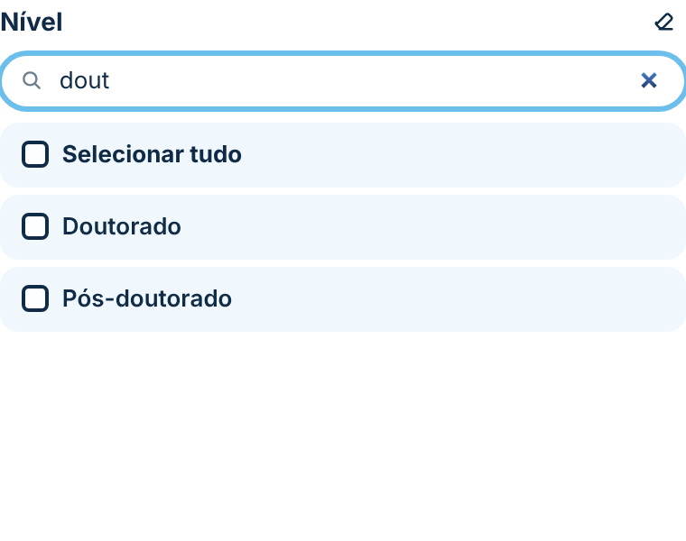
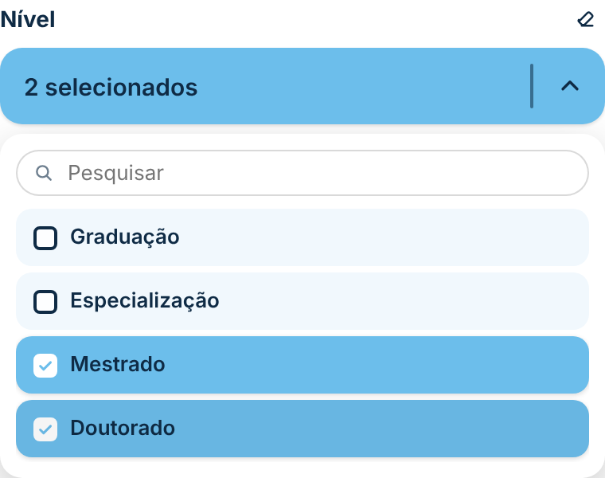
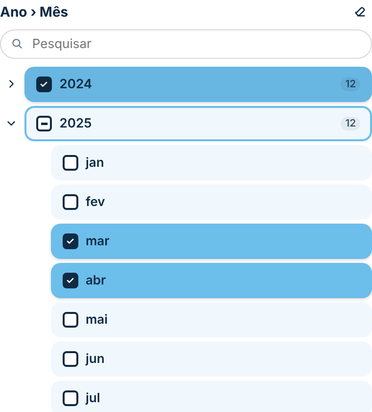
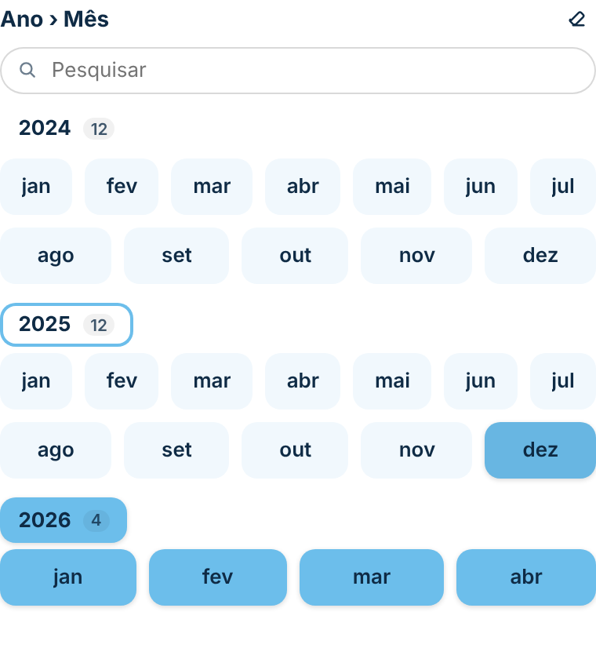

# Segmentação Estilizada

Substituto mais bonito da **segmentação de dados (slicer) nativa** do Power BI, no mesmo padrão visual do [Filtro em Pop-up](../filtro-popup/). Funciona como a segmentação nativa: filtra os outros visuais da página, fica salva no relatório, respeita indicadores (bookmarks) e pode ser sincronizada entre páginas.

| Blocos (botões) | Lista vertical | Suspenso |
|---|---|---|
|  |  |  |

## Como usar

1. Baixe [`dist/segmentacaoEstilizada9140412062C0470F98172EC5D1A911C8.1.4.0.0.pbiviz`](dist/).
2. No Power BI Desktop: **Visualizações → `…` → Importar um visual de um arquivo**.
3. Arraste uma coluna para **Campo**. Para uma **hierarquia** (filtro aninhado), arraste mais de uma, na ordem dos níveis: por exemplo, *Ano* e depois *Mês*.
4. Em **Formatar visual → Layout → Estilo**, escolha **Blocos (botões)**, **Lista vertical** ou **Suspenso**.

## Recursos

- **Hierarquia:** mais de uma coluna em Campo vira uma árvore (lista e suspenso) ou blocos agrupados.
- **Três estilos:** blocos lado a lado (com número de colunas automático ou fixo), lista vertical com rolagem, ou caixa suspensa no estilo do botão "Abrir Filtros".
- **Seleção múltipla** (clique marca/desmarca) ou **seleção única**.
- **Selecionar tudo** (opcional), **pesquisa** na lista e no suspenso (aparece com mais de 6 valores).
- **Cabeçalho** com o nome do campo (ou texto próprio) e botão de **limpar seleção**.
- **Copiar e colar** (`Ctrl+C` / `Ctrl+V` e menu do botão direito) e **sincronizar segmentações** entre páginas.
- A ordem dos valores segue o Power BI (inclusive "Classificar por coluna").

## Hierarquia (campos aninhados)

Com mais de uma coluna em **Campo**, a segmentação vira uma hierarquia, como a segmentação nativa com vários campos:

| Lista vertical | Blocos agrupados |
|---|---|
|  |  |

- **Lista vertical e suspenso:** árvore com setas para abrir e fechar cada nível, recuo por nível e contador de itens. O nível de cima fica "parcial" quando só parte do que está abaixo dele está marcado.
- **Blocos:** os valores do último nível aparecem em blocos, agrupados pelo nível acima (ex.: os meses embaixo de cada ano). O título de cada grupo marca o grupo inteiro.
- Clicar num nível de cima marca ou desmarca tudo o que está abaixo dele.
- O filtro é exato: marcar *mar/2025* não filtra *mar/2024*. Só com níveis de cima inteiros marcados, filtra só a coluna de cima (ex.: Ano = 2025).
- A pesquisa encontra valores de qualquer nível e abre sozinha os níveis com resultado.
- No suspenso, o texto mostra a seleção pelo caminho (ex.: "2026 › fev") ou "N selecionados".
- Parâmetros de campo (modo seleção) funcionam com uma coluna só; com hierarquia, o visual usa sempre o modo filtro.

## Parâmetros de campo

Funciona com **parâmetros de campo** (inclusive com uma coluna de grupo, para escolher vários campos de uma vez):

- Coloque em **Campo** a coluna do parâmetro (ou a coluna de grupo dele).
- O visual detecta sozinho que a coluna tem uma **chave oculta** (o campo real por trás de cada nome) e passa a filtrar por **seleção**, que o Power BI converte na chave certa — do mesmo jeito que a segmentação nativa. Seleção múltipla funciona normalmente.
- A seleção fica salva no relatório e é reaplicada quando ele é aberto.
- Se precisar forçar, use **Formatar visual → Layout → Como filtrar**: *Automático* (padrão), *Filtro (colunas comuns)* ou *Seleção (parâmetros de campo)*.
- No modo seleção, o efeito nos outros visuais segue **Formatar → Editar interações** (o padrão "filtrar" é o certo).

## Formatação (painel "Formatar visual")

- **Layout:** estilo, seleção única, "Selecionar tudo", pesquisa, colunas dos blocos (0 = automático), espaçamento entre itens, como filtrar (automático, filtro ou seleção).
- **Cabeçalho:** mostrar, texto, tamanho da fonte, fonte, cor, botão de limpar.
- **Itens:** tamanho da fonte, fonte, cor de fundo e do texto, cor de fundo e do texto quando **selecionado**, arredondamento, altura, espessura e cor da borda, mostrar caixa de seleção.
- **Caixa de seleção:** símbolo quando selecionado (visto ✓, xis ✕, bolinha ●, quadrado ■ ou nenhum), formato (quadrada arredondada, quadrada ou redonda), tamanho, espessura da borda, cor de fundo e da borda quando não selecionada, e cor de fundo, da borda e do símbolo quando selecionada.
- **Suspenso:** texto quando nada está selecionado, cor de fundo e do texto da caixa, tamanho da fonte, arredondamento, altura, espessura e cor da borda, cor da lista aberta.

## Observações

- **Suspenso:** como em todo visual personalizado, a lista aberta só aparece **dentro da área do visual** (o Power BI não deixa desenhar fora dela). Deixe o visual alto o suficiente para a lista; com ela fechada, a área abaixo da caixa fica transparente.
- Um campo por visual, como na segmentação nativa. Para vários campos num lugar só, use o [Filtro em Pop-up](../filtro-popup/).
