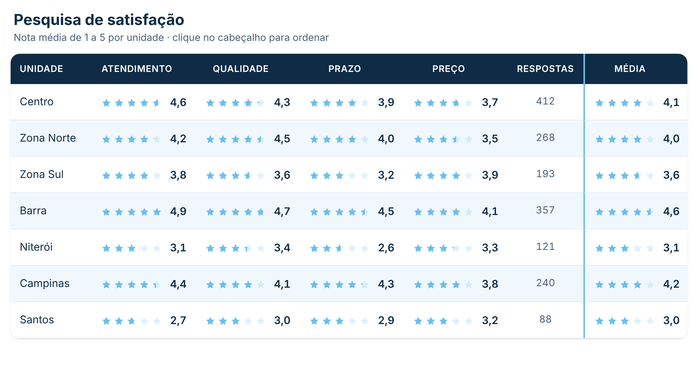
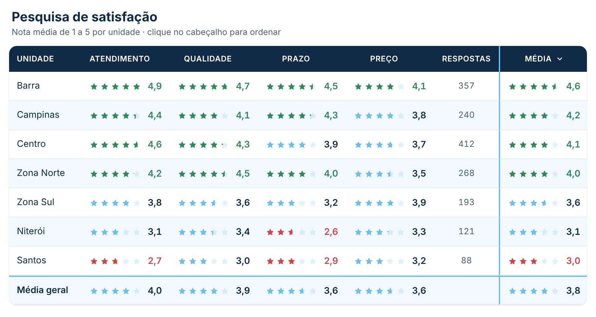
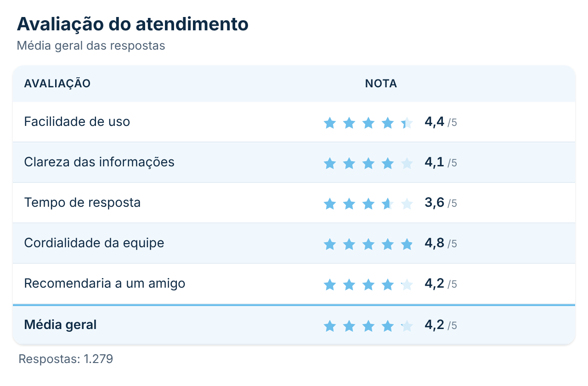
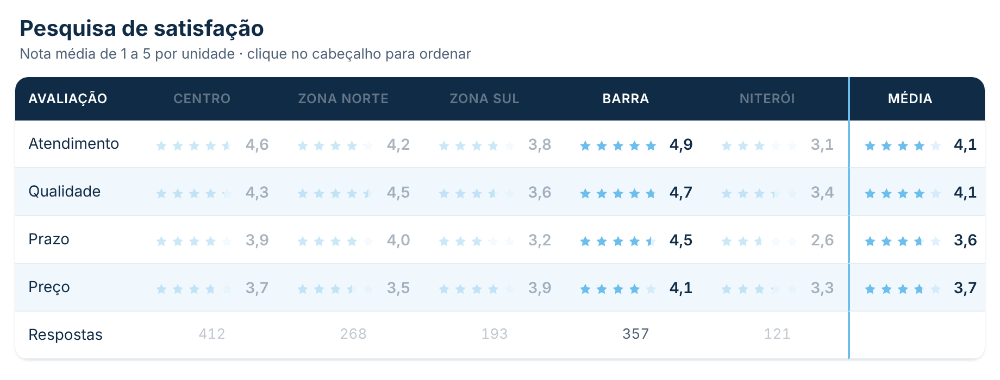

# Tabela de Avaliação

Tabela para notas de pesquisa (ex.: satisfação de 1 a 5) mostradas em **estrelas**: cada célula tem as estrelas preenchidas na proporção exata da nota (4,3 = 4 estrelas e 30% da quinta) e o número ao lado. Aceita **várias medidas** ao mesmo tempo (uma coluna por pergunta), **nº de respostas**, **coluna e linha de média**, **ordenação ao clicar no cabeçalho** e **cores por faixa** de nota. Segue o padrão visual do repositório ([DESIGN.md](../../DESIGN.md)).

| Padrão (unidades × perguntas) | Cores por faixa e linha de média |
|---|---|
|  |  |

| Só medidas (sem campo em Linhas) | Medidas nas linhas, com seleção |
|---|---|
|  |  |

## Como usar

1. Baixe [`dist/tabelaAvaliacaoC8386E97BF4D43C39C6E4C6B96873485.1.0.0.0.pbiviz`](dist/) e importe no Power BI (**Visualizações → `…` → Importar um visual de um arquivo**).
2. Arraste os campos:
   - **Avaliações**: uma ou mais medidas com a nota (ex.: *Média Atendimento*, *Média Qualidade*). Cada medida vira uma coluna. Se for a própria coluna da pesquisa (valores de 1 a 5), troque a agregação para **Média**.
   - **Linhas** (opcional): cada valor do campo vira uma linha (ex.: Unidade, Gestor, Área). Sem campo, cada medida vira uma linha da tabela.
   - **Nº de respostas** (opcional): medida com a quantidade de respostas (ex.: `COUNTROWS(Pesquisa)`), mostrada numa coluna — ou como "Respostas: 1.279" abaixo da tabela, quando não há campo em Linhas.
   - **Dicas de ferramenta** (opcional): medidas extras mostradas ao passar o mouse.

### Exemplo

Uma tabela `Pesquisa` com uma linha por resposta e as colunas `Unidade`, `Atendimento`, `Qualidade`, `Prazo` e `Preço` (notas de 1 a 5):

```DAX
Nota Atendimento = AVERAGE ( Pesquisa[Atendimento] )
Nota Qualidade   = AVERAGE ( Pesquisa[Qualidade] )
Respostas        = COUNTROWS ( Pesquisa )
```

| Espaço | Campos |
|---|---|
| Linhas | Unidade |
| Avaliações | Nota Atendimento, Nota Qualidade, … |
| Nº de respostas | Respostas |

Para mudar o nome que aparece no cabeçalho de uma medida, use **Renomear para este visual** no campo.

## Recursos

- **Estrelas com preenchimento exato**, meia estrela ou estrela inteira; quantidade de estrelas e nota máxima configuráveis (ex.: escala de 0 a 10 com 5 estrelas, ou porcentagem com nota máxima 1). Forma de estrela ou círculo.
- **Disposição** (**Formatar visual → Tabela**): automática (campo nas linhas e medidas nas colunas; sem campo, uma medida por linha) ou invertida (medidas nas linhas e os valores do campo nas colunas).
- **Ordenação ao clicar no cabeçalho**: 1º clique = maior nota primeiro, 2º = menor primeiro, 3º = volta à ordem inicial. Na primeira coluna, ordena por nome. A ordenação inicial pode ser *Ordem do Power BI*, *Maior média*, *Menor média* ou *Nome (A–Z)*.
- **Média**: coluna com a média de cada linha e linha com a média de cada coluna (*Média geral*), separadas por uma divisória na cor primária.
- **Cores por faixa** (desligado por padrão): notas abaixo de um limite (padrão 3) em vermelho e a partir de outro limite (padrão 4) em verde; opcionalmente também no número.
- **Ajuste automático**: as linhas encolhem para caber na altura do visual e as estrelas encolhem (até 60%) para caber na largura; além disso, aparece a rolagem, com o cabeçalho e a primeira coluna fixos.
- **Filtro cruzado**: clique numa célula ou no nome da linha para filtrar os outros visuais (Ctrl + clique para vários); o que não está selecionado fica esmaecido. Menu do botão direito e Ctrl+C / Ctrl+V.
- **Dicas de ferramenta** com a nota, o nº de respostas e as medidas extras.
- **Números** no idioma do relatório (4,3) com casas decimais configuráveis, ou no formato da própria medida.

## Formatação

- **Geral:** fonte.
- **Cabeçalho:** título e subtítulo (texto, tamanho e cor; em branco = escondido).
- **Tabela:** disposição, ordenação inicial, ordenar ao clicar no cabeçalho e título da primeira coluna.
- **Escala:** nota máxima, quantidade de estrelas e preenchimento (exato, meia ou inteira).
- **Estrelas:** forma, tamanho, espaço, cor da cheia, cor e opacidade da vazia, espessura e cor do contorno e alinhamento.
- **Cores por faixa:** ligar, limites e cores da nota baixa e alta, aplicar ao número.
- **Nota:** mostrar, posição (ao lado ou abaixo das estrelas), casas decimais, formato da medida, mostrar a nota máxima (`4,3 /5`), tamanho, cor e negrito.
- **Cabeçalho das colunas:** cor de fundo e do texto, tamanho, negrito, maiúsculas e altura.
- **Linhas:** altura, ajustar à altura do visual, tamanho, cor e negrito do texto, fundo, linhas alternadas, espessura e cor da divisória, opacidade do que não está selecionado.
- **Nº de respostas:** mostrar, título, tamanho e cor.
- **Média:** coluna e linha de média (com títulos), espessura e cor da divisória.
- **Borda:** arredondamento, espessura e cor da borda.

## Observações

- A média da coluna e da linha é **simples**: cada medida (ou cada linha) tem o mesmo peso, sem ponderar pelo nº de respostas. Para a média ponderada, crie uma medida e coloque-a em **Avaliações**.
- Células sem nota aparecem como "—" e ficam fora das médias.
- Até 1000 valores no campo Linhas.
